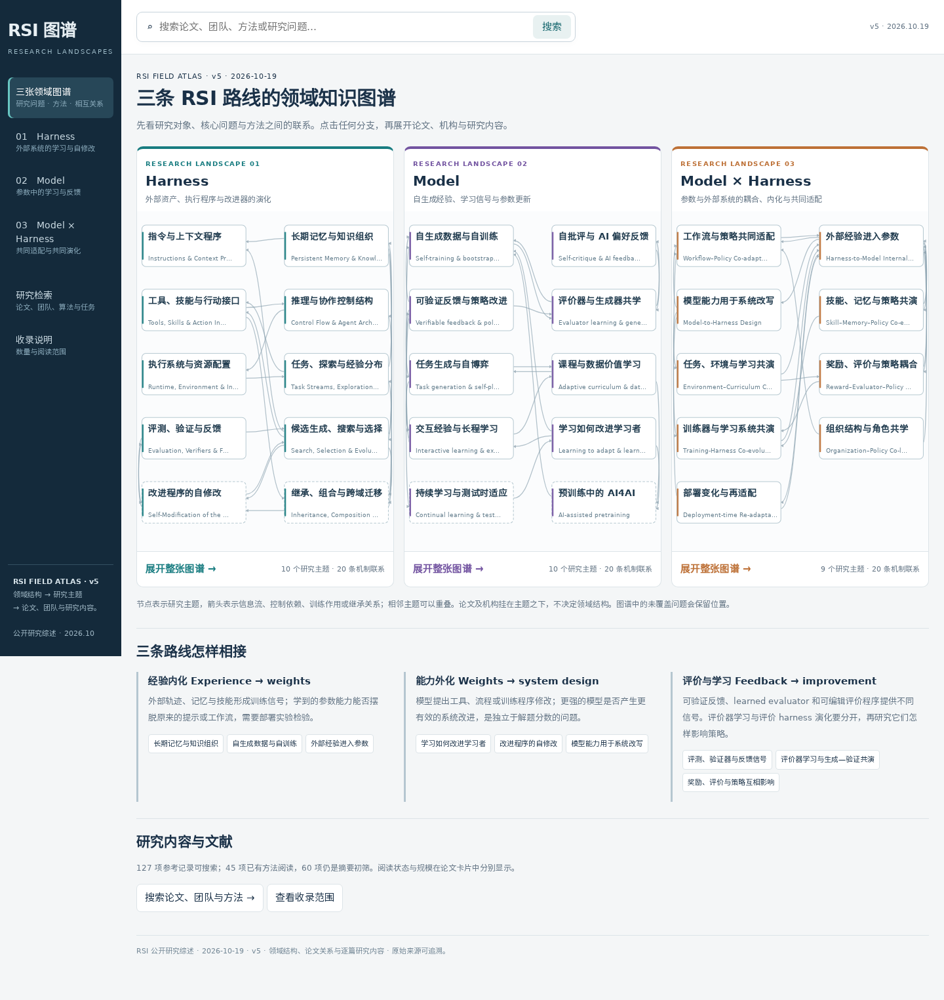

# 三条 RSI 路线的领域知识图谱

[打开 v5 HTML](research/atlas/RSI_Field_Atlas_v5.html) · [领域结构文字版](research/atlas/field-guide.md) · [逐篇阅读](research/atlas/literature-cards.md)

三张图先描述研究问题及机制关系，再把论文、机构与团队接入相关主题。公开研究综述与项目自身的理论、预测及实验分开。

| 主线 | 什么在学习或演化 | 图谱中的研究结构 |
|---|---|---|
| Harness | 基础模型参数之外的持久状态和可执行程序 | 指令、记忆、技能、控制结构、运行系统、经验、评价、搜索、改进器和继承 |
| Model | 策略、评价器、出题者、世界模型或改进模型的参数 | 自训练、偏好反馈、可验证反馈、评价学习、自博弈、课程、经验学习、学习更新、持续适应与预训练 |
| Model × Harness | 参数与外部系统共同变化及其相互作用 | 工作流适配、内化、外化、技能记忆共演、环境、反馈、训练系统、组织与部署适应 |

这些主题允许交叉，构成 29 个主题、146 个子问题和 60 条机制联系。它们是可修订的领域问题结构，不是已经证明穷尽所有机制的分类定理。图中没有当前论文的主题仍保留。

## 怎样读图

首页直接显示三图；进入一条路线可展开全部子问题。点击主题，依次阅读研究问题、结构原理、具体技术和相邻联系，再查看对应论文与署名团队。点击连线，阅读机制联系的含义及原文例证。论文卡片提供 A–F 解释，并可返回主题；全局搜索覆盖论文、团队、算法及问题。

Model 的训练阶段、SFT/DPO/RL 目标、在线采样方式、更新节奏、功能角色及参数规模是交叉维度，不能与学习机制混成同一级互斥分类。Hybrid 中的一次内化、交替适配、双向反馈与持续共演分别说明。

## 多关系图的数据

`data/field-knowledge.json` 保存领域结构；`data/knowledge-graph.json` v5 整合主题、子问题、论文、原有方法分组、机构五种节点。

- 领域机制联系与主题包含关系：综述对问题空间的组织，有相关原文例证，不声称是论文间引用。
- 论文—主题关系：一项工作可以连接多个主题；跨路线实例注明主路线。
- 原文明示论文关系：明确扩展、采用、比较或讨论；有原文与位置。
- 综述方法对照：比较两项研究的对象、反馈或继承方式，不推断学术影响。
- 署名机构关系：来自论文首页或官方团队信息，不把模型提供方当作研究机构。

当前 45 条论文关系中有 15 条原文明示和 30 条方法对照。尚无连线表示关系尚未整理，不代表工作彼此无关。

## 收录范围

主路线记录为 Harness 40、Model 35、Model × Harness 22；另有 8 项跨路线资料和 22 项历史/背景。45 项有选定方法段落阅读，60 项为摘要初筛。9 项已确认小于 27B 的 Model/混合机制参考默认隐藏；训练规模未知不视为已通过门槛，也不视为低质量。

[Harness 静态领域图](assets/atlas/harness-field-graph.svg) · [Model 静态领域图](assets/atlas/model-field-graph.svg) · [Model × Harness 静态领域图](assets/atlas/hybrid-field-graph.svg)
