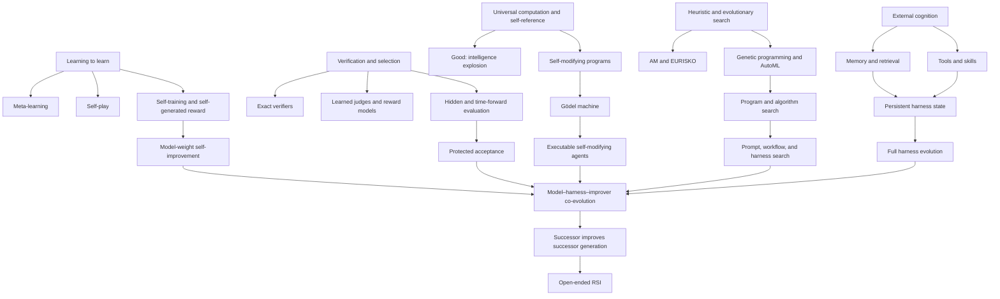
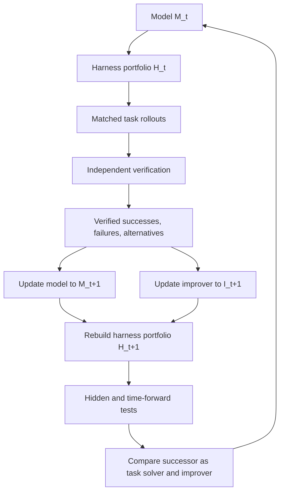

# The RSI map

[English](MAP.md) · [简体中文](docs/zh/MAP.md)

RSI has been obscured by mixing several different questions:

- Can software rewrite itself?
- Can a learner improve its learning rule?
- Can an AI generate better training data or rewards?
- Can an agent improve prompts, memory, tools, or code around a fixed model?
- Can a successor become better at producing the next successor?
- Can these gains persist when tasks, models, and bottlenecks change?

The field becomes clear when the questions are arranged by causal dependency rather than by project name.

## 1. The object

A deployed AI system is represented as

$$

S_t=(M_t,H_t,I_t,D_t,E_t).

$$

- $M_t$: model weights, architecture, optimizer state, and learned policies;
- $H_t$: prompts, context construction, memory, tools, skills, routing, agent topology, control flow, verification calls, and stopping rules;
- $I_t$: the procedure that proposes, implements, tests, and selects changes;
- $D_t$: persistent experience, training data, lineage, and externalized knowledge;
- $E_t$: tasks, software, simulators, instruments, users, and other sources of feedback.

The acceptance process is written separately:

$$

V^\*(S_t,S_{t+1};Q,B),

$$

where $Q$ is an untouched task distribution and $B$ is a fixed resource budget. $V^\*$ may be improved through a separate process, but a candidate cannot freely modify the test that accepts it.

A work contributes to RSI only after the changed object, improvement operator, feedback source, persistence, transfer, and recursion depth are explicit.

## 2. Historical and causal tree

The arrows do not imply that later work dominates earlier work. They identify missing dependencies. A model can self-train without a self-modifying harness; a harness can evolve without changing model weights; a search procedure can improve artifacts while remaining fixed. The target requires these capabilities to interact without losing attribution or trustworthy evaluation.

## 3. The five branches

### 3.1 Self-reference and formal self-modification

[I. J. Good’s 1965 argument](https://doi.org/10.1016/S0065-2458(08)60418-0) stated the qualitative possibility that an ultraintelligent machine could improve machine design and thereby initiate an “intelligence explosion.” It supplied no algorithm or empirical criterion.

[Gödel machines](https://arxiv.org/abs/cs/0309048) made self-reference formal. A system may rewrite any part of itself after proving that the rewrite increases a stated utility. The result is conceptually exact and computationally restrictive: useful improvements must be expressible and provable inside the initial axiomatic system, and proof search can be intractable.

Modern self-modifying agents replace proof with empirical selection. STOP, Gödel Agent, SICA, Darwin Gödel Machine, HGM, HyperAgents, and AIDE² make executable code or the improvement procedure part of the editable state. Their central scientific question is whether empirical selection produces transferable successors and whether later successors improve the improvement process itself.

### 3.2 Heuristic, evolutionary, and program search

[AM and EURISKO](https://www.cs.northwestern.edu/~mek802/papers/not-mine/Lenat_EURISKO.pdf) used heuristics to guide discovery, and EURISKO could generate or modify heuristics. The work established that a system can search over parts of its own problem-solving procedure. It also exposed dependence on human-supplied representations, heuristics, and domain structure.

Genetic programming, neural architecture search, AutoML, and program synthesis expanded automated search. [AutoML-Zero](https://proceedings.mlr.press/v119/real20a.html) searched for learning algorithms from primitive operations. [FunSearch](https://www.nature.com/articles/s41586-023-06924-6) and later algorithm-search systems paired a pretrained model with an external evaluator to discover useful programs.

This branch is indispensable but frequently mislabeled. A fixed optimizer that discovers a better external algorithm has automated research capability. It has not shown that the optimizer became better at improving itself.

Promptbreeder, ADAS, AFlow, GEPA, and AgentBreeder move the search target closer to the deployed agent. The decisive boundary remains whether the update is persistent, transferable, and improves later update capability.

### 3.3 Meta-learning, self-play, and model updates

Meta-learning trains systems to adapt rapidly across tasks. [MAML](https://proceedings.mlr.press/v70/finn17a.html) learns parameters that support fast adaptation. [AlphaGo Zero](https://www.nature.com/articles/nature24270) demonstrates powerful self-play under exact game rules and rewards. These works show that learned update behavior and self-generated experience can scale, but the training algorithm and objective remain externally specified.

SPIN, Self-Rewarding Language Models, and SEAL bring the source of data, preferences, or updates inside the model loop. They are direct precursors to model-level RSI. Their unresolved issue is informational closure: repeated self-training cannot create reliable new information indefinitely without external grounding, strong verification, or retained real data. Errors, preference drift, and distribution narrowing can compound across generations.

Model-level RSI requires more than updated weights. The successor must generalize, retain unrelated capabilities, and improve the process that constructs later updates.

### 3.4 External cognition and harness evolution

Modern agents realize capability through software around the model. A harness decides what context is visible, which tools can be called, how state persists, how tasks are decomposed, how attempts are checked, and when execution stops.

This branch progresses through four increasingly broad targets:

1. a prompt or textual policy;
2. memory, skills, and tool descriptions;
3. workflow and agent topology;
4. full source code and runtime behavior.

ACE, EvoHarness-RL, RHI, Meta-Harness, RRSI, HSI, HarnessDev, and related systems occupy different points on this branch. Harness evolution is attractive because changes are inspectable and cheap relative to weight training. It is also vulnerable to benchmark memorization, token-budget inflation, hidden retries, parser changes, evaluator access, and model-specific compensation.

The critical empirical result of 2026 is that harness production and harness use are different capabilities. A model that proposes a useful update need not be the model that benefits most from it. This makes the model–harness pair, rather than either component alone, the correct experimental unit.

### 3.5 Verification and selection

No improvement process can exceed the information carried by its feedback.

Exact verifiers make algorithm search, games, theorem proving, and code tests unusually tractable. Learned judges broaden the task range but introduce noise, bias, self-preference, and exploitation. Hidden tests reduce direct fitting but can still be overused adaptively. Time-forward tasks are stronger because they did not exist during system construction.

A credible RSI system therefore needs three feedback layers:

$$

V_t^{\text{search}},\qquad
V_t^{\text{validation}},\qquad
V^\*_{\text{accept}}.

$$

- $V^{\text{search}}$ supplies dense feedback and may be imperfect.
- $V^{\text{validation}}$ supports model and procedure choices but must have controlled exposure.
- $V^\*_{\text{accept}}$ is protected, sparse, and preferably time-forward or externally generated.

Rethinking the Evaluation of Harness Evolution, Harness Updating Is Not Harness Benefit, On the Statistical Limits of Self-Improving Agents, and Auditing Harness Tampering are part of the mainline because they change which apparent gains can be believed.

## 4. Timeline

| Period | What changed | Representative work | What remained missing |
|---|---|---|---|
| 1965 | Intelligence explosion proposed | Good | Algorithm, evidence, operational definition |
| 1970s–1980s | Heuristics and meta-heuristics became editable | AM, EURISKO | Scalable representations, independent replication |
| 1987–2001 | Learning procedures became learning targets | early meta-learning, learning-to-learn | Broad tasks and strong models |
| 2003 | Fully self-referential self-rewrite formalized | Gödel machine | Tractable proof and realistic environments |
| 2010s | Meta-learning and self-play scaled learned adaptation | MAML, AlphaGo Zero | Persistent general self-modification |
| 2020–2024 | Automated algorithm search and self-generated training matured | AutoML-Zero, FunSearch, SPIN, Self-Rewarding LMs | Improved improver, broad transfer |
| 2023–2025 | LLMs began editing prompts, programs, and agent code | STOP, Promptbreeder, Gödel Agent, SICA, DGM | Multi-generation attribution and scale transfer |
| 2026 | Harness evolution, self-modifying meta-agents, and model–harness co-evolution became explicit | RRSI, Meta-Harness, HSI, HyperAgents, AIDE², HELIX, Co-Harness | Repeated full-loop evidence, frontier-scale public replication |
| Future | Model, harness, improver, and data update repeatedly under protected evaluation | target of BeforeRSI | Unknown |

## 5. Present frontier

The public frontier is distributed across four incomplete achievements.

### Persistent code and harness modification

This is established in bounded settings. Systems can inspect traces, propose source-level edits, evaluate variants, retain successful changes, and continue from the successor.

### Limited transfer

Several systems report held-out or out-of-distribution gains. The strongest evidence remains narrow compared with the desired claim: transfer is often within coding or agent benchmarks, across related task families, or across a small number of model endpoints.

### Short multi-generation improvement

DGM-style lineages, HyperAgents, HSI, and AIDE² make more than one generation explicit. The remaining question is whether the successor became a better improver, rather than merely inheriting a fixed strong outer search procedure.

### First model–harness co-evolution loops

Co-Harness, OpenRSI, MASS and SIA study model–system adaptation with different scopes and schedules. HELIX supplies harness composition and model-update records without training a successor model. The landscape records these implemented and proposed edges separately. Stable repeated co-evolution and increasing improvement efficiency remain experimental questions.

## 6. The convergent mainline

The research program proposes the following route to test general RSI:

The loop has six necessary properties:

1. **Portfolio search:** maintain several harnesses and lineages; a single incumbent loses diversity and hides co-adaptation.
2. **Verified experience:** model training uses solutions, failures, near misses, and counterfactual alternatives linked to reliable outcomes.
3. **Cross-component attribution:** evaluate $M_i\times H_j\times I_k$, not only matched versions.
4. **Protected acceptance:** the candidate cannot rewrite the final test or its provenance.
5. **Time-forward transfer:** evaluation includes tasks created after the candidate is frozen.
6. **Successor-as-improver measurement:** compare parents by the quality and cost of descendants they generate.

## 7. What would change the field

The following results would materially advance the mainline:

- a harness improvement that transfers across unrelated task families and stronger model scales under equal total compute;
- a model update trained from harness-generated trajectories that improves both the parent harness and independently developed harnesses;
- a successor that generates better later successors than its parent under the same improvement procedure and budget;
- a multi-generation run whose held-out gain does not saturate after one or two defect removals;
- an improver that learns when to modify weights, harness, memory, tools, or itself;
- a protected evaluation process that remains informative while tasks and system capabilities change;
- a scaling law connecting base-model capability, evaluator quality, search budget, and achievable self-improvement.

Until these exist, open-ended RSI remains a research target rather than an established capability.
