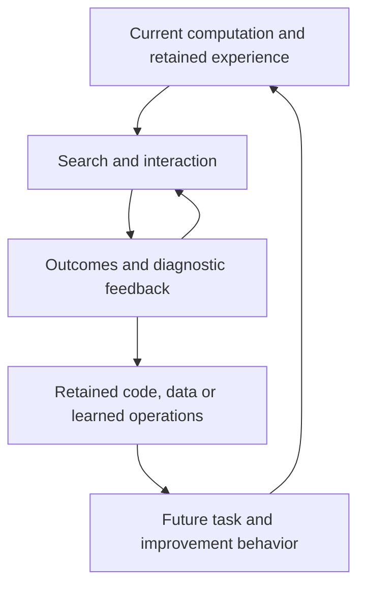

# What makes self-improvement work?

The state-kernel model in THEORY.md represents a process, but does not explain
its performance by itself. An explanatory model must identify operations whose
intervention changes a result, derive conditions for that change, and survive
comparison with existing methods. This document supplies a conditional
mechanism model and changes the research route accordingly.

**Scope correction:** these are conditional mechanisms, not a complete
explanation of frontier AI development. [FRONTIER_COVERAGE.md](FRONTIER_COVERAGE.md)
identifies substantive omissions in large-scale RL, learned feedback, generated
environments and industrial research production. Mapping those processes into
the following variables does not establish their learning dynamics or transfer.

The common object is a **reusable computation interacting with feedback**.
Its implementation can reside in weights, executable code, context, memory,
an archive, or their combination. The quantities that matter are the reachable
behaviors, the information returned about them, the behaviors retained by an
update, their transfer to future problems, and their resource cost. A universal
partition into model and harness is neither necessary nor sufficient.

There are two coupled distributions. A deployed system induces task behavior
`p(trajectory | task, budget)`. Used as an improver, it induces changes
`K(new system | target, feedback, budget)`. Training a task policy can improve
the second distribution when useful skills overlap; training or rewriting the
improver can change it directly. Neither overlap nor improvement is automatic.

## 1. Search changes accessible behavior

Let a generated candidate have true utility U in [0,1] and CDF F. For n
independent, identically distributed candidates and exact best selection,

$$
\mathbb E[\max_{i\le n}U_i]=\int_0^1[1-F(u)^n]du.
$$

**Derivation.** The maximum is at most u iff all n candidates are, with
probability F(u)^n; integrate the survival probability. For binary success
with probability p, this reduces to `1-(1-p)^n`. This familiar order-statistic
identity is not an RSI growth law.

This explains how unchanged weights can support improved execution: a harness
changes F through conditioning, decomposition, tools or feedback, changes the
number of affordable trials, or changes selection. Identical model copies need
not produce independent errors. With equal marginal success p and arbitrary
dependence, union success lies between p and min(np,1); the i.i.d. formula
cannot be assumed for a multi-agent team.

For constant per-trial cost c, a budget B permits floor(B/c) trials. With
history-dependent costs, use the measured cumulative cost. An improvement to
memory can therefore increase performance even if its per-trial solution
distribution is unchanged. Conversely, higher mean candidate quality does not
order the upper tails or guarantee better best-of-n results.

**Discriminating prediction.** Compare candidate distributions and trial counts
separately. If an intervention works only by making calls cheaper, fixing the
number of calls should remove that mechanism's gain. If it changes proposal
quality, the gain can persist. AIDE²'s memory and search changes motivate this
comparison; its aggregate outcome does not identify their separate effects.

For example, if call k costs a+b(k-1) because full history is resent, n calls
cost `an+bn(n-1)/2`. A context policy with bounded per-call cost a' instead
costs `a'n`. In the respective dominant regimes, a budget B buys approximately
`sqrt(2B/b)` versus `B/a'` calls. This is a resource-allocation explanation of a
possible scaling difference with unchanged weights. It assumes the specified
linear cost model; caching, inference pricing and information lost in compression
must be measured before applying it to a real system.

## 2. Feedback supplies both selection and localization

### 2.1 Correct selection is not the same as informative feedback

Let q be a candidate distribution, u its true utility, and w>=0 a selection
weight with 0<E_q[w]<infinity. The retained distribution is
`q_w(z)=q(z)w(z)/E_q[w]`. Then

$$
\mathbb E_{q_w}u-\mathbb E_q u
=\frac{\operatorname{Cov}_q(w,u)}{\mathbb E_q w}.
$$

This is the selection part of the standard [Price identity](https://www.nature.com/articles/227520a0),
obtained by expanding the covariance. With stochastic judgments, use the
conditional expected retention probability given z. If candidates interact
during selection, w denotes their resulting marginal retention weight, not an
assumed independent score.

For binary truth, let p be candidate success, beta the probability of accepting
a correct candidate, and alpha the probability of accepting an incorrect one.
For 0<p<1 and positive acceptance probability,

$$
p_{\rm retained}=\frac{\beta p}{\beta p+\alpha(1-p)},
\qquad p_{\rm retained}>p\iff\beta>\alpha.
$$

This is a condition on selection, not on the complete learning loop. It says
nothing about how an unsuccessful proposal should be repaired. A perfect
pass/fail verifier can still leave a combinatorial search problem.

### 2.2 A structural query-complexity separation

Consider d independent unknown choices, each with m alternatives, uniformly
distributed. A full candidate succeeds exactly when all d choices are correct.
Every query checks all d components and has equal cost in both settings.

**Scalar oracle.** Return only whether the full candidate is correct. After a
failed query, exactly one assignment is eliminated. For B distinct queries,
the probability of finding a passing queried candidate is

$$
\min(B/m^d,1).
$$

Adaptivity cannot improve this under the uniform prior: every remaining
assignment has the same posterior probability. This is an exact statement for
this equality-oracle problem, not a lower bound on all program synthesis.

**Localized oracle.** Also return the first incorrect component, without
revealing its correct value. Preserve the certified prefix and try alternatives
at the failing component. This requires at most `1+d(m-1)` queries. With fixed
symbol order and a uniform target, its exact query count is

$$
1+\sum_{i=1}^d V_i,\qquad
V_i\overset{\rm iid}{\sim}\operatorname{Uniform}\{0,\ldots,m-1\}.
$$

**Proof.** The localization certifies the preceding choices. Each unsuccessful
query eliminates an alternative for the current component while preserving
that certificate. At most m-1 alternatives fail per component; one final query
certifies the complete candidate. Under the uniform prior the correct symbol's
rank is uniform, independently across components.

The difference is exponential versus linear in d despite identical final
correctness and identical per-query checking cost. The condition is strong:
local correctness must compose and the localization must be trustworthy.
Integration failures, changing interfaces and incorrect diagnoses invalidate
the certified-prefix algorithm. Rich prose is not automatically such feedback.

**Executed construction.** [Experiment 007](experiments/007-feedback-structure/RESULTS.md)
tests the same parameter-free law at four dimensions, with 2,000 problems each.
This establishes the mechanism in a defined computational problem. It does
not estimate GEPA's or Co-Harness's real-world speedup.

**Research consequence.** Preserve compiler errors, failing examples,
intermediate artifacts, and the specific dependency they constrain. Reducing
all of them to one reward can destroy useful repair information. Test this by
removing localization while keeping final correctness and budgets unchanged.

## 3. Selection can silently change the task distribution

Suppose tasks are drawn from Q(x), trajectories from q(z|x), and retained with
weight w(x,z). Let `Z(x)=E[w(x,z)|x]`. Pooling all retained trajectories gives

$$
\nu(x)=\frac{Q(x)Z(x)}{\mathbb E_Q Z},\qquad
\nu(z\mid x)=\frac{q(z\mid x)w(x,z)}{Z(x)}.
$$

Even an exact verifier changes both the within-task behavior and the training
task mixture. With equally frequent easy/hard tasks and success probabilities
0.9/0.1, pooling successful samples yields a 90%/10% task mixture. All retained
answers may be correct while the hard task family loses training mass.

Per-task quotas or inverse-Z weighting can restore the intended marginal
where Z>0. They cost more generation or increase estimator variance when
success is rare. If Z=0, filtering cannot supply examples: change exploration,
decomposition, curriculum, external information or representation first.
This does not imply that a language model assigns literally zero probability
to every missing solution; finite budgets can make tiny mass inaccessible.

Unfiltered exact population self-distillation is a useful null case:
`argmin_p KL(q||p)=q` when the model class contains q. Improvement then requires
something that changes the effective target or computation: selection,
search, new information, a prior/regularizer, altered representation, or a
better optimization solution. Finite training can also change behavior, with
no general positive sign.

## 4. Execution advantage must survive inheritance

Let p be the original behavior, q a stronger teacher/search behavior, and p'
the updated student's behavior. All are distributions on the same task and
trajectory space with the same external task criterion. Under Q, define
`gamma=J_Q(q)-J_Q(p)`. If

$$
\operatorname{KL}(Qq\Vert Qp')\le\epsilon,
$$

then for utility in [0,1],

$$
J_Q(p')-J_Q(p)\ge\gamma-\sqrt{\epsilon/2}.
$$

**Proof.** Add and subtract J_Q(q), bound the expectation difference by total
variation, and use Pinsker's inequality. The result is sufficient and often
loose; it is not necessary because another behavior can achieve equal utility.
Single-token loss on a short logged slice is not the trajectory KL above.
For common environment dynamics, the KL chain rule expresses trajectory KL
as the sum of conditional action KLs under teacher histories, including
stopping. For differing interfaces, first define a common behavior space;
do not compute KL between incompatible action vocabularies.

If the task distribution changes to Q' with TV(Q,Q')<=delta, the same bounded
utility assumptions give

$$
J_{Q'}(p')-J_{Q'}(p)
\ge\gamma-\sqrt{\epsilon/2}-2\delta.
$$

The two task-expectation differences each cost at most delta. This bound may
be vacuous for genuinely new domains; shared causal structure is then needed
to obtain a sharper transfer claim. No number of successful source traces
alone supplies it.

### 4.1 Missing decision inputs impose an inheritance obstruction

Let H be a teacher's decision history, A its next action, and Z=phi(H) the
information exposed to the student. For unrestricted student conditionals,

$$
\min_{p(A\mid Z)}\mathbb E_H
\operatorname{KL}(q(A\mid H)\Vert p(A\mid Z))
=I_q(A;H\mid Z).
$$

**Proof.** Add and subtract `log q(A|Z)`. The expected divergence decomposes
into conditional mutual information plus
`E_Z KL(q(A|Z)||p(A|Z))`; the second term is minimized at zero. A restricted
parameterization can incur more error.

Thus even unlimited training cannot reproduce distinctions omitted from the
student's observation. A perfect teacher choosing a fresh hidden bit has
100% accuracy; a student denied that bit has at most 50%. Supplying the bit
removes the obstruction. The information term is an imitation obstruction,
not a universal lower bound on task error: different actions may be equally
valid. Nor does it prohibit acquiring durable facts in weights.

This identifies a specific harness-to-model interface: preserve the task,
available artifact inputs, tool results, assignments and feedback that made
the target action justified **at decision time**. Do not insert later outcomes
as if the student had observed them. Context truncation can remove precisely
the variables needed to learn the behavior.

Sequential learning also changes future observations. Teacher-forced fit
alone does not measure recovery from student-induced errors; this is the
covariate-shift problem addressed by
[DAgger](https://proceedings.mlr.press/v15/ross11a.html).

### 4.2 Selecting a teacher is different from selecting training data

An execution-optimal harness maximizes its task score at an execution budget.
A teaching-optimal harness maximizes the **post-update** student's future
utility after data-generation and training costs. These objectives coincide
only under additional assumptions, such as exact affordable inheritance on
the relevant task distribution. HELIX motivates data production; SEAL directly
optimizes a form of downstream update value. Their mechanisms are distinct.

For learner state theta, update U and data D generated by harness h, the latter
objective can be written explicitly as

$$
T(h;\theta)=\mathbb E_{D\sim P_{\theta,h}}
\left[J_Q(U(\theta,D),h_{\rm deploy})-J_Q(\theta,h_{\rm deploy})\right].
$$

Hold the deployment interface fixed for this comparison and include data
generation, trial-update and selection costs in the feasible budget. If the
learner will be used as an improver, replace or supplement J by the common-target
G from THEORY.md. This makes the intended inherited role explicit.

An exact finite-class example shows the distinction even with the same task
distribution, complete observations and globally optimal likelihood training.
Take four equally likely task types. The learner can represent only A and B,
whose probabilities of the correct answer are respectively

$$
A=(0.99,0.99,0.99,0.001),\qquad B=(0.6,0.6,0.4,0.4).
$$

A perfect teacher has correctness vector (1,1,1,1). Its average KL to A is
approximately 1.7345 nats, versus 0.7136 to B, so likelihood projection chooses
B. A weaker teacher identical to A projects exactly to A. The perfect teacher
therefore produces a student with 50% expected and greedy accuracy; the weaker
teacher produces 74.275% expected and 75% greedy accuracy. The mechanism is
learner-class misspecification and loss/utility mismatch, not noisy labels,
missing inputs or failure to optimize the training loss. The finite class is
deliberately restrictive; the example refutes necessity, not the usefulness of
accurate teachers. `scripts/check_teacher_projection.py` computes all cells.

The general concern is established in knowledge distillation; see
[Cho and Hariharan (2019)](https://openaccess.thecvf.com/content_ICCV_2019/html/Cho_On_the_Efficacy_of_Knowledge_Distillation_ICCV_2019_paper.html).
The finite construction here isolates a reason for the reversal without
claiming that this particular two-policy class models a language model.

For a differentiable utility J_j and update direction g_i supplied by a source
i, let `theta'=theta+eta*g_i`. If J_j has L_j-Lipschitz gradient on the update
segment, Taylor's integral remainder gives

$$
J_j(\theta')-J_j(\theta)
=\eta\nabla J_j(\theta)^\top g_i+R_{ji},\quad
|R_{ji}|\le\tfrac12 L_j\eta^2\|g_i\|^2.
$$

The matrix `A[j,i]=grad J_j dot g_i` describes local transfer of update sources.
It can contain positive and negative entries even when every source example
is correct. Source score and trace count do not determine this matrix.
For code edits or non-differentiable scores, measure finite update contrasts
instead; do not pretend the gradient exists. This is a standard local
approximation, and finite-update predictions must include its remainder.

**Discriminating prediction.** Hold teacher output quality and training budget
approximately fixed; change which decision inputs survive in the training
record. Compare post-update behavior and recovery. Separately change the task
mixture while holding total training tokens fixed. These interventions target
inheritance and transfer, rather than merely comparing one versus many agents.

## 5. Archives and curricula change future reachability

Let V_B(x) be attainable expected terminal utility from state x with remaining
budget B under a specified continuation. Parent score J(x) and V_B(x) can order
states differently. THEORY.md Section 9 proves this without noise or regression.
HGM already pursues descendant-based value; that idea must not be claimed as a
new discovery here.

An archive enlarges the set of available starting points. If storage is free,
it retains the incumbent, and the policy may ignore extra entries, optimal
value cannot decrease: every old action sequence remains feasible. With
maintenance, retrieval or evaluation costs, dominance no longer follows.
The practical question is which retained branches add attainable outcomes
worth their cost, not whether diversity is invariably beneficial.

POET additionally changes the distribution of problems and allows transfer
between problem-agent pairs. In a transfer graph, intermediate environments
may provide a path to a target that direct training fails to reach within B.
This is compatible with the same finite-budget value model; it need not be
relabelled as model/harness alternation. A curriculum's intermediate score
is not the terminal criterion.

**Discriminating prediction.** Remove transfer or revisitable branches while
preserving the total budget. A reachability mechanism predicts losing some
outcomes, not just slowing the same greedy trajectory. A descendant estimator
must be evaluated on later branches not used to construct that estimate.

## 6. Recursion closes the loop through reusable operations

The previous mechanisms become recursive when their changes alter future
proposal, diagnosis, selection, training, routing or resource-allocation
operations, and those altered operations are actually reused. An unchanged
outer trainer is compatible with a changing learned improver. Conversely,
editing one's own code does not guarantee a positive change in these operations.

This loop can exploit prior knowledge more effectively, infer consequences by
computation, or acquire constraints through environment interaction. It need
not import a stronger teacher every round. Conversely, merely sampling and
copying an unchanged distribution supplies no population-level improvement
under the exact-copy null case in Section 3. Information-theoretic statements
must not confuse unchanged world facts with unchanged computational capability.

The useful causal loop is therefore:

The graph does not prescribe a neural architecture, one agent, multiple agents,
or a fixed update order. The preceding equations attach measurable quantities
to its transitions. Only the finite-state/history encoding is broadly general;
each sharper prediction has the explicit distributional, feedback or learning
assumptions stated above.

## 7. What the existing works require this model to explain

The following source facts are author-reported, not independent reproductions.
The mechanism interpretation and proposed separating intervention are ours.

| Work | Source observation | Mechanism and separating intervention |
|---|---|---|
| [AlphaGo Zero](https://deepmind.google/blog/alphago-zero-starting-from-scratch/) | Search and self-play train policy/value networks under game rules. | Search-improved behavior is inherited through learning. Fix search expenditure and change distillation fidelity or replay distribution. |
| [STaR](https://arxiv.org/abs/2203.14465), [ReST-EM](https://arxiv.org/html/2312.06585v4) | Correctness-filtered generated reasoning trains later models; STaR also uses answer-conditioned rationalization. | Selection changes the target distribution; conditioning can expose otherwise rare solutions. Preserve task marginals to separate filtering from curriculum shifts. |
| [FunSearch](https://github.com/google-deepmind/funsearch), [GEPA](https://proceedings.iclr.cc/paper_files/paper/2026/file/0e9e708b6f48e14fd0ac29e167413f76-Paper-Conference.pdf) | Program evaluation or reflective trace feedback supports persistent search products; GEPA retains instance-specialist candidates. | Proposal conditioning, diagnostic information and branch retention. Remove diagnostic detail while retaining the final score, then separately remove specialist branches. |
| [DGM](https://arxiv.org/html/2505.22954v1), [HGM](https://arxiv.org/html/2510.21614v1) | DGM reports gains over fixed-improver and archive-removal controls. HGM selects using descendant-informed estimates. | Reusable proposal operations and future branch value. Compare reuse on common targets; assess continuation predictions on future branches. |
| [HyperAgents](https://arxiv.org/html/2603.19461v1) | Task and meta programs are editable; the paper reports transfer of improvement mechanisms across domains. | Changes target the improvement kernel, not only solver output. Transfer the meta program while matching task-agent initialization. |
| [AIDE²](https://arxiv.org/html/2609.26457v1) | Main outer proposer is fixed; successive inner agents improve. Search/memory change; a separate ignition test is inconclusive against the strong proposer. | Improved research behavior is real evidence without an established stronger outer proposer. Separate cheaper context, better proposals and recursive reuse. |
| [SEAL](https://arxiv.org/html/2506.10943v1) | Self-edit data receive reward from the model after adaptation. | Optimize teaching value directly. Compare against selecting data by immediate answer quality on the same contexts and update budget. |
| [Co-Harness](https://arxiv.org/html/2607.22688v1), [HELIX](https://arxiv.org/html/2608.13951v1) | Co-Harness targets diagnosed runtime failures; HELIX reports harness results and training-record production. | Feedback access and inheritance interface. Test real post-update gains separately from data yield; HELIX's records alone do not measure that gain. |
| [MASS](https://arxiv.org/html/2610.12176v1) | Workflow-derived training improves several research outcomes; some coding benchmarks regress. Multi-agent supervision beats a larger single-agent training-token control. | Teacher quality, learnability and transfer can differ. Preserve decision inputs, equalize task mixtures, and separate generation cost from processed training tokens. |
| [OpenRSI](https://arxiv.org/html/2607.28568v1) | It trains Draft/Improve/Debug/Crossover and composes them in research search, reporting model and framework transfer separately. | Share the operator interface across training and use. Replace trained operators while fixing the search policy, and vice versa. |
| [RRSI](https://arxiv.org/html/2609.24972v1) | Its ablations show higher evolve score can accompany worse OOD score and greater token cost. | Retention aligned to source score can select a worse transferable computation. Hold candidate pool fixed to isolate selection from proposal regularization. |
| [POET](https://arxiv.org/abs/1901.01753) | Environment-agent transfer supports solutions missed by direct optimization controls. | A change to reachable learning paths. Remove cross-environment transfer at matched total optimization cost. |

The complete [67-work map](research/mechanism-map.md) records a concrete
mechanism and counterfactual for every current corpus entry. Rows whose sources
were only previously checked at abstract/repository level are marked as such.
Formal and evaluation papers constrain the mechanism rather than implementing
every operation. Mapping is not a calibrated quantitative explanation of all
published outcomes.

## 8. The route this supports

[SEARCH.md](SEARCH.md) now makes one branch of this route executable: search
effort is related to the probability of successful paths, and a complete
ancestor computation can be retained with a known scheduling overhead. It
adds Expert Iteration, DreamCoder, metareasoning and policy-guided search to
the source explanation. Experiment 008 trains and repeatedly reuses real
context-policy parameters and tests the final actors on common learner targets.

The next system should learn **reusable research operations with preserved
decision inputs**, while retaining executable alternatives. Its unit of learning
is a task state, available evidence, proposed operation, resulting artifact and
observed consequence. Whole successful transcripts alone are an insufficient
specification of that unit.

1. Start with shared operators: propose, repair, compare, combine, and choose
   the next experiment. Keep their interfaces identical in data collection,
   training and deployment. OpenRSI provides a concrete precedent.
2. Use harness search to improve reachable behavior and expose diagnostic
   feedback. Preserve alternative solutions and failures that identify a
   repair, with their prerequisites. Do not replace information-rich feedback
   by a score-only archive.
3. Select training sources by the effect of a bounded trial update on a
   separate development task panel, including the same operators used as
   improvers. Maintain source-task weights explicitly. Final assessment stays
   outside this selection; trial-update and selection costs are included.
4. Internalize a behavior when its measured future benefit exceeds its training,
   regression and maintenance cost. If training cost is C and expected per-use
   net advantage is Delta>0 under a declared utility/cost conversion, a simple
   stationary break-even condition is `N*Delta>C`. Without that conversion,
   compare the performance/resource frontier rather than inventing an exchange rate.
5. Rebuild only the interfaces whose behavior or cost changed after training.
   Compare a current operator with its pinned ancestor on common targets;
   compare branches with remaining-budget continuation when the decision is
   consequential. There is no fixed requirement to alternate every component.

This is an engineering route, not a demonstrated frontier-model result.
Experiment 006 remains evidence against its particular numerical-optimizer
implementation; it is not evidence against the learned-operator route above.
Experiment 007 establishes the feedback/localization mechanism in a controlled
construction. The published-source calculations in
[research/source-comparisons.json](research/source-comparisons.json) expose
actual heterogeneous outcomes, without manufacturing independent-run errors
from aggregate tables.

Physical resources enter as measured runtime, power integration, storage and
communication costs. This work has no measured energy law. No thermodynamic
analogy determines which proposal, learning update or continuation is useful.

## Provenance of the mathematical tools

The contribution here is a mechanism synthesis, conditional derivations,
explicit counterfactuals and a changed system design. Order statistics,
selection covariance, Bayes conditioning, KL projection, conditional mutual
information, Taylor bounds and finite-horizon value are established tools.
ReST-EM already gives a filtering/projection interpretation, SEAL already
optimizes downstream update value, and HGM already estimates descendant value.
None is claimed as an original discovery of BeforeRSI.
