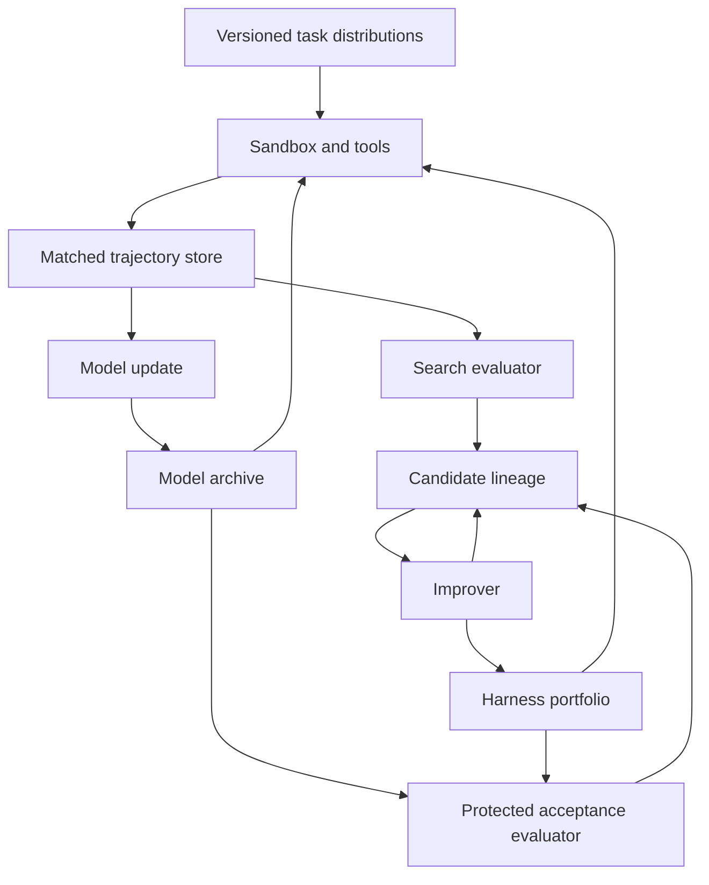

# Research program: learning reusable research operations

The objective is a system that repeatedly improves both task capability and the ability to construct later improvements.

**Priority correction, 2026-10-18:** [RSI_SCOPE.md](RSI_SCOPE.md) separates
LLM/agent self-evolution from enabling AI4AI and background science/training.
The research object is improvement of learning/development processes with
reuse in later improvement. Runtime harnesses and training harnesses both matter.

Three immediate comparisons now drive the route: SEAL/DERL/EvoTrainer for
learning how to improve training; Skill-SP/RLAnything/RQGM/WebEvolver and
on-policy model–harness co-evolution for coupled learning; and
STOP/HyperAgents/ModularRSI/DGM/HGM/AIDE²/OpenRSI for successor reuse.
Their source scopes differ and their outcomes remain author-reported.
SoL-Pi's cheaper successor-research loop is explicitly future work; strong
engineering results must not be promoted to demonstrated recursive compounding.

General Co-Scientist results and overall R1/Qwen/o1 reports are background,
not primary evidence of this closed loop. Model–harness alternation and learned
puzzle search remain bounded branches. No new toy experiment is introduced.

Record a versioned system and an explicit improvement role:

$

S_t=(M_t,H_t,D_t),

$

with protected acceptance $V^\*$.

$M_t$ records learned models, $H_t$ executable orchestration, and $D_t$ persistent information. The improver role $A_t$ names the complete snapshot that proposes and tests changes, including its model, code, and data dependencies. It may be $S_t$ itself. Environments and budgets are declared separately.

One implementation branch is **search for useful research operations, preserve their
decision inputs, and learn the operations that improve later work**. The
mechanism derivation is in [MECHANISMS.md](MECHANISMS.md). A harness is both an
execution policy and a producer of learning experience; these objectives can
rank harnesses differently. An excellent executor is not automatically the
best teacher for the current learner.

The alternating portfolio schedule below remains a candidate implementation.
Its individual operations are selected according to the current bottleneck
and their measured downstream value. A portfolio is optional; its future
branch value must justify retrieval, maintenance and evaluation costs.

## Candidate implementation choice

Use one shared interface for research operations during training and execution:
available task state and evidence in; proposed operation and resulting artifact
out. Start with propose, repair, compare, combine and next-experiment choice.
Store the decision-time inputs, tool feedback, artifact dependencies and the
observed consequence. Training records must not omit an input that justified
the action or insert a future outcome into the input.

Collect candidate data sources through alternative harnesses. Make a small,
reversible learner update from each source under equal generation/training
budgets. Choose sources using resulting task and common-target operator gains
on a development panel, with regressions and task weights explicit. The panel
is selection data; external final tests remain separate. Charge these trial
updates to the research budget. SEAL supplies a precedent for downstream edit
value; OpenRSI supplies a precedent for shared trainable research operators.

When execution quality is weak, improve proposal support or local feedback.
When good executions fail to train a better learner, inspect missing decision
inputs, projection error and task mixture before generating more of the same
traces. When learned changes fail to transfer, change source allocation or
representation rather than assuming another identical cycle will repair it.

This replaces the previous presumption that every cycle should execute A–G
in a fixed order. The component interventions below remain useful controls.

## Executed search-and-learn branch

[Experiment 008](experiments/008-learned-search/RESULTS.md) implements a bounded
version with 2,592 learned context parameters. Its reused policy collects new
verified paths and supplies later updates. Under shared search-pop caps it
outperforms frozen collection on unseen puzzle starts, including a declared
uniform-state follow-up. On common fresh learners, data from the reused actor
also produce stronger descendants. This is a real parameter-update and search
loop in one small deterministic environment; it does not establish broad RSI.

Use a loss tied to the operation being improved when such a connection exists.
Here an existing search-bound objective helps particularly at low budgets on
the harder follow-up. Keep CE as a baseline: a bound is not the actual search
cost, and stronger conclusions do not follow from convexity alone.

When preserving an ancestor, retain its whole resumable search with an explicit
compute share. Mixing a little old-policy probability into every new action can
destroy coherent long paths exponentially; the whole-process schedule has a
constant completion-overhead guarantee in its stated work unit. The experiment
finds that this protection still costs performance relative to learned search
alone. [SEARCH.md](SEARCH.md) states the proofs and execution assumptions.

Report build plus subsequent use. At a small search cap the more capable route
can still consume more total CPU after including training; at a larger cap,
faster solution finding can repay the build. A metacontroller that trial-trains
several candidates must pay for all trials. Do not assume an elaborate selector
is worthwhile before measuring that reuse horizon.

An initial bounded implementation has now been executed:
[Experiment 006](experiments/006-recursive-optimizer/RESULTS.md). The tested
recursive optimizer did not establish an advantage over a pinned ancestor.
Direct G-training did not establish a better improver either. M-then-H beat
H-then-M on new instances in that benchmark, without established superiority
over joint search. These observations do not justify treating the proposed
alternating schedule as the default winner.

For a finite research budget, compare continuation value: the expected final
utility after a candidate change and a specified subsequent improvement policy.
THEORY.md Section 9 derives its relation to recursive reuse. A positive
one-step common-target G remains useful evidence, but is not an acceptance
certificate for a whole multi-generation route.

## 1. The optimization target

A single benchmark score is inadequate. For candidate system $S$, define a vector:

$

J(S)=
\left(
U_Q(S),
-U_{\text{regress}}(S),
-C_{\text{task}}(S),
-C_{\text{improve}}(S),
T(S),
R(S),
D_{\text{quality}}(S)
\right),

$

where:

- $U_Q$: capability on untouched tasks;
- $U_{\text{regress}}$: losses on protected capabilities;
- $C_{\text{task}}$: execution cost;
- $C_{\text{improve}}$: cost of producing the successor;
- $T$: transfer across tasks, models, and environments;
- $R$: quality of later successors generated by this system;
- $D_{\text{quality}}$: usefulness and diversity of trajectories produced for model learning.

Selection should maintain a Pareto set. A system that gains two points by doubling task-time compute or destroying a critical capability is not automatically preferred.

## 2. The repeated loop

### Step A: freeze the model and evolve a harness portfolio

For fixed $M_t$, generate harness candidates that differ in context policy, memory, tools, planning, verification, search, and stopping. Each candidate must declare a small intervention set and a hypothesis.

Candidates are evaluated on an improvement set. Selection uses validation tasks, cost, and hard regression limits. Hidden and time-forward tasks remain inaccessible.

The output is a portfolio $\mathcal H_t=\{H_t^1,\ldots,H_t^k\}$, not only the highest scorer.

### Step B: produce matched trajectories

Run the same tasks, seeds, tools, and budgets across the harness portfolio. Preserve:

- successful solutions;
- failures;
- near misses;
- divergent valid strategies;
- attempts rejected by verifiers;
- component-level changes;
- evaluator disagreement;
- task and model resource use.

Matched rollouts allow causal comparison. Unmatched logs from different tasks cannot identify which harness change caused a result.

### Step C: verify and attribute

Use independent tests where possible. For each accepted result, attach the exact evidence that made it acceptable.

Estimate the effect of each change through:

- paired task outcomes;
- component ablation;
- harness swaps;
- counterfactual replay;
- repeated evaluation;
- negative controls;
- tampering audits.

Attribution does not need to be perfect. It must be good enough to avoid training the model on explanations contradicted by the intervention record.

### Step D: update the model

Construct several data views from verified trajectories:

- supervised solutions;
- preferences between matched alternatives;
- critic examples linking failures to evidence;
- tool-use and state-transition records;
- counterexamples and hard negatives;
- tasks where the harness changed the reachable solution set.

Update $M_t\rightarrow M_{t+1}$ with a declared training method. Retain a frozen copy of $M_t$. Measure general capability and protected regressions before any new harness search.

### Step E: rebuild the harness

The optimal harness may change when the model changes. Freeze $M_{t+1}$ and repeat harness search to test whether adaptation is useful. Compare the kinds of edits discovered at different model scales and generations.

A useful pattern is one whose benefit survives model changes or whose failure can be predicted from model capability. A patch that only compensates one checkpoint is local engineering, not a general improvement principle.

### Step F: cross models and harnesses

Evaluate the full matrix

$

M_i \times H_j,

$

at minimum:

$

(M_t,H_t),\quad
(M_{t+1},H_t),\quad
(M_t,H_{t+1}),\quad
(M_{t+1},H_{t+1}).

$

With a portfolio, estimate:

$

A_{ij}=U_Q(M_i,H_j).

$

This matrix measures component effects conditional on the counterpart, data snapshot, interface, and task budget. Negative interaction can reflect redundant solutions; positive interaction can coexist with poor portability. It does not by itself identify improved learning or recursion.

### Step G: update the improver

The lineage contains hypotheses, edits, evaluations, accepted candidates, rejected candidates, and later transfer. Use it to improve:

- which component to edit;
- how large an edit should be;
- which experiment best distinguishes competing explanations;
- which parent or branch to expand;
- when to update model weights instead of the harness;
- how to allocate evaluation budget.

Then compare the complete old and new improver snapshots on identical copies of common new targets. A separate improver-code update is optional; changes to its model or available information can change the effective improvement policy.

## 3. System architecture



The protected evaluator and raw evidence store are outside the candidate’s editable surface. The candidate may propose new tests, but those tests cannot alone authorize deployment.

## 4. The critical design decisions

### Separate evolver and executor

The model that proposes changes need not be the model that executes tasks. Public evidence suggests update quality and update benefit can scale differently.

Distinguish the following roles; separate model instances are a design choice:

- proposer/evolver;
- task executor;
- verifier or evidence interpreter.

Cross them experimentally instead of assuming one strongest model should perform every role.

### Maintain specialized and general harnesses

A universal harness is likely to underfit heterogeneous tasks; a task-specific harness may not transfer. Maintain:

- a small general core;
- domain or task-family harnesses;
- temporary task-local state.

Promotion from local to general requires transfer evidence.

### Preserve diversity

Greedy replacement can lose useful branches. Test a Pareto archive over capability, cost, novelty, error type, and data contribution against simpler search under a matched budget.

Lineage should record ancestry and rejected branches. A rejected candidate may become useful after the model changes.

### Treat the harness as a data policy

A harness determines which attempts the model makes and therefore which data exists for later training. Optimize both immediate utility and the expected value of generated experience.

A high-scoring harness that produces homogeneous traces can be inferior to a portfolio that exposes complementary valid strategies and informative failures.

### Keep evaluator evolution separate

Search evaluators and learned judges can improve, but the acceptance test must not drift with the candidate. Changes to $V^\*$ require their own external evidence and retrospective replay against prior versions.

### Use time-forward tasks

A static hidden set becomes less hidden after repeated system development. Create task cohorts after candidate freeze and rotate external task generators or environments.

## 5. Experimental dependency order

### Experiment 1: harness transfer under equal compute

Purpose: determine whether a persistent harness change beats giving the parent the same total compute.

Required comparisons:

$

H_0^{\text{standard}},\quad
H_0^{\text{equal-compute}},\quad
H_1^{\text{standard}}.

$

Evaluate on untouched and time-forward tasks, then transfer $H_1$ to a second model family.

### Experiment 2: model–harness attribution

Train or obtain $M_1$ from verified trajectories and evaluate:

$

(M_0,H_0),\ (M_1,H_0),\ (M_0,H_1),\ (M_1,H_1).

$

Repeat across more than one model scale. This experiment decides whether joint gains are additive, synergistic, compensatory, or locally co-adapted.

### Experiment 3: successor as improver

Give $S_0$ and $S_1$ the same new improvement problem and budget. Compare the descendants they generate on hidden tasks.

Primary quantity:

$

\Delta_{\rm rec}
=
G(S_1;\mu,B,b)-G(S_0;\mu,B,b).

$

Both improvers modify identical copies of targets sampled from the same distribution; their own versions are not the two target starting points. D3 requires a reproducible increase in improvement performance under the declared comparison. See Experiment 003.

### Experiment 4: [repeated co-evolution](experiments/004-repeated-coevolution.md)

Run at least three complete cycles:

$

S_t=(M_t,H_t,D_t)\rightarrow S_{t+1},
\qquad A_t\text{ is recorded separately as the acting role}.

$

Track held-out capability, transfer, diversity, regressions, update cost, and saturation. Compare with:

- harness-only evolution;
- model-only updating;
- frozen ancestor improver, including all of its model, code, and data dependencies;
- equal total compute spent on the parent;
- human-designed update schedules.

### Experiment 5: [evaluator robustness](experiments/005-evaluator-phase-boundary.md)

Vary evaluator quality, noise, access, and exploitability. Measure how frequently accepted updates fail external tests or violate provenance and completeness.

The objective is to estimate the minimum evaluator quality required for positive long-run gain.

## 6. Scale experiments

A result on one model endpoint does not determine the sign of the effect at another scale.

For each intervention, measure:

$

\Delta(s)=
U_Q(M_s,H_1)-U_Q(M_s,H_0),

$

where $s$ indexes model scale or capability.

Possible regimes:

- **weak-model failure:** the model cannot follow or invoke the harness;
- **mid-scale gain:** the harness supplies structure the model can exploit;
- **strong-model redundancy:** the model already implements the strategy internally;
- **strong-model obstruction:** a rigid harness constrains better internal behavior;
- **threshold discovery:** only sufficiently capable models can improve the improver.

The goal is a scale curve and failure explanation, not one positive endpoint.

## 7. Data requirements

Every improvement event should record:

```text
system_id
parent_id
model_checkpoint
harness_commit
improver_version
candidate_id
changed_objects
hypothesis
visible_tasks
validation_tasks
hidden_cohort
time_forward_cohort
raw_trajectory_refs
verifier_version
resource_use
selection_decision
transfer_results
regressions
tampering_audit
descendant_results
```

Training data must retain provenance to the exact system and evaluator versions that produced it.

## 8. Success criteria

A credible model–harness RSI result should satisfy all of the following:

- persistent versioned changes;
- positive held-out and time-forward transfer;
- declared execution, improvement, and amortized lifecycle cost comparisons;
- model–harness crossing when claiming separate component effects;
- no undisclosed critical regressions;
- independent final acceptance;
- repeated generations;
- successor improvement ability greater than parent improvement ability on common targets;
- replication from public artifacts or an independent implementation.

Open-ended RSI would additionally require changing task distributions and bottlenecks, many generations, and evidence against rapid saturation.

## 9. Stop conditions

Pause or change the research representation when any of these persist:

- gains disappear under equal compute;
- transfer is confined to one benchmark;
- the successor cannot reproduce its own advantage;
- improvements shrink monotonically with stronger models;
- self-generated data reduces diversity or unrelated capability;
- evaluator disagreement dominates measured gain;
- tampering or provenance failures enter accepted lineages;
- component attribution remains unidentified despite a valid pair-level gain; redesign the attribution experiment;
- additional search produces only noisy winner selection.

The correct response is to change the task distribution, evaluator, editable surface, or update operator. Repeating local prompt edits does not resolve a structural failure.

## 10. Retained harness-branch sequence

The following is a candidate sequence for the harness branch. It is subordinate
to the frontier mechanism comparisons at the start of this document, and is
not the default route for explaining all important RSI-related research:

1. choose one public, inspectable harness-evolution implementation;
2. reproduce its author-reported result;
3. add matched-compute and time-forward evaluation;
4. transfer the evolved harness across model families;
5. run the $M\times H$ attribution matrix;
6. train one local model update from verified portfolio trajectories;
7. rebuild harnesses for the updated model;
8. compare parent and successor as improvers.

Completion would provide evidence about model–harness co-evolution under its
tested conditions. It would not establish coverage of large-scale RL,
evaluator/environment co-training or industrial research-production feedback.
