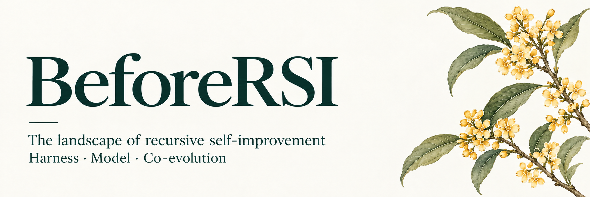

# BeforeRSI



**A bilingual research atlas of recursive self-improvement.**

[English](README.md) · [简体中文](README.zh-CN.md)

**[Download the bilingual interactive atlas · RSI_Field_landscape.html](https://raw.githubusercontent.com/Cherish0925/BeforeRSI/main/RSI_Field_landscape.html)**

Save the file and open it in a browser. Switch 中文 / English at the top right. The home view presents all three mechanism maps.

BeforeRSI connects the mechanisms, literature and research organizations behind AI self-improvement. It follows three routes: **Harness**, **Model**, and **Model × Harness**. The central question is how a system's retained changes affect its ability to produce the next improvement.

## Start here

| Goal | English | 中文 |
|---|---|---|
| Explore the landscape | [Download the offline atlas](https://raw.githubusercontent.com/Cherish0925/BeforeRSI/main/RSI_Field_landscape.html), open it in a browser, and select English | 下载同一文件，打开后选择中文 |
| Learn model and LLM foundations | [Learning manual](docs/model-llm.en.md) · [49-page PDF](docs/Model_LLM_Learning_Manual.en.pdf) | [学习手册](docs/model-llm.md) · [52 页 PDF](docs/Model_LLM_Learning_Manual.pdf) |
| Follow the research program | [Map](MAP.md) → [Theory](THEORY.md) → [Hypotheses](HYPOTHESES.md) | [图景](docs/zh/MAP.md) → [理论](docs/zh/THEORY.md) → [假设](docs/zh/HYPOTHESES.md) |
| Contribute or build | [Contributing](CONTRIBUTING.md) · [Documentation](docs/README.md) | [参与贡献](CONTRIBUTING.zh-CN.md) · [构建说明](docs/README.zh-CN.md) |

The interactive HTML atlas is the main entry to the project. Three mechanism maps appear side by side, and each route has a research relationship graph. Select a topic or arrow to inspect subquestions, mechanisms, papers and sources. The same file includes the participant matrix, reading guide, discovery pool, search, learning manual and both PDFs, available offline.

## What is included

| Collection | Coverage |
|---|---|
| Research catalog | 141 records: 118 method records, 1 screened record, 22 historical/context records |
| Mechanism maps | 3 routes, 29 nodes, 60 conceptual links |
| Work relationships | 69 extensions, uses, discussions and comparisons |
| Discovery pool | 567 entries with abstracts, authors, scope decisions and links to matched studies |
| Reading guide | 6 reading dimensions, 6 worked examples and 4 method comparisons |
| Research participants | 157 normalized entries from 170 source affiliation names |
| Company profiles | 27 companies and industry research teams |
| Learning manual | 29 chapters, 148 glossary entries, 61 foundational topics, 95 atlas subtopics, 43 references |
| Research program | 38 selected work records, 12 working hypotheses, 5 proposed experiments |

Source snapshot: **19 October 2026**. Bilingual edition: **20 October 2026**. The 38-work research claim index serves the theoretical program; it is separate from the 141-record landscape and the counts are not additive.

## Three routes

**Harness** — persistent prompts, memory, skills, tools, control flow, runtime code and improvement procedures. Follow which external assets change and which changes survive across tasks.

**Model** — parameter learning from self-generated data, preferences, verification, interaction, curricula and learned update policies. Record the model actually trained separately from fixed teachers, judges and baselines.

**Model × Harness** — feedback between weights and external systems. Study internalization of experience, workflow adaptation, evolving skills, environments, evaluators and training programs.

Each work has six sections: purpose, core idea, mechanism, experiments, learning and inheritance, and results and scope. Chinese and English share IDs and sources. Full original Chinese review notes can be expanded within each study and remain in the source data.

## From the landscape to experiments

The research program compares task capability with improvement capability. A successor may solve more tasks without becoming better at producing later successors.

| Document | Question |
|---|---|
| [Map](MAP.md) | How do the historical and causal branches connect? |
| [Theory](THEORY.md) | How can states, update operators and recursive gain be modeled? |
| [Evidence](EVIDENCE.md) | What does the public record establish? |
| [Hypotheses](HYPOTHESES.md) | Which predictions remain open? |
| [Program](PROGRAM.md) · [Experiments](experiments/) | Which interventions distinguish competing explanations? |
| [Evaluation](EVALUATION.md) | How are transfer, resources, regressions and successor quality measured? |
| [Simulation](SIMULATION.md) | Which dynamics follow from explicit toy assumptions? |
| [Research history](RESEARCH_LOG.md) | How did the current representation develop? |

The equations and experiment proposals are working research. Simulations illustrate assumptions; literature entries summarize the cited public material. These statuses are recorded where the claims appear.

## Repository layout

| Path | Role |
|---|---|
| [`RSI_Field_landscape.html`](RSI_Field_landscape.html) | Main bilingual interactive atlas; `docs/index.html` contains the same page for hosting |
| `data/atlas.json` | Landscape records, mappings, sources, organizations and review notes |
| `data/locales/en.json` | English work, mechanism, relationship and company text |
| `data/works.json` | Research claim index; see [data documentation](data/README.md) |
| `docs/model-llm*.md` | Chinese and English manual sources |
| `docs/zh/` | Chinese research documents |
| `web/` | Maintainable atlas template, styles and behavior |
| `scripts/` | Build and validation commands |
| `experiments/` · `simulations/` | Experiment specifications and illustrative models |

## Build

```bash
python -m pip install -r requirements-docs.txt
python scripts/build_learning.py
python scripts/validate.py
```

The first build downloads a pinned Noto Sans SC font; later builds use the local cache. See [documentation](docs/README.md) for generated files and browser checks.

Contributions should add a source, correct a mechanism, improve an explanation or resolve an experimental question. See [CONTRIBUTING.md](CONTRIBUTING.md) and [AGENTS.md](AGENTS.md).

[MIT license](LICENSE). Bundled font licensing: [SIL OFL](assets/fonts/OFL.txt).
