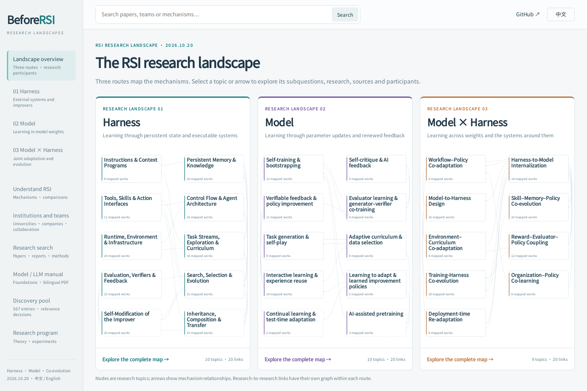

# BeforeRSI


**A bilingual research landscape of recursive self-improvement.**

[English](README.md) · [简体中文](README.zh-CN.md)

**[Download the bilingual RSI research landscape · BeforeRSI.zip](https://raw.githubusercontent.com/Cherish0925/BeforeRSI/main/BeforeRSI.zip)**

Download → extract → open `RSI_Field_landscape.html` in Chrome or Edge. Switch 中文 / English at the top right. Maps, search, the learning manual and its PDFs work offline. Source links open online.

BeforeRSI connects the mechanisms, literature and research organizations behind AI self-improvement. Explore three routes—**Harness**, **Model**, and **Model × Harness**—from a mechanism to its subquestions, research papers and original sources.



Select a node or arrow to inspect its explanation and related work. Each route also has a research relationship graph. The same file includes the participant matrix, reading guide, discovery pool and learning manual.

## Start here

| Goal | English | 中文 |
|---|---|---|
| Learn model and LLM foundations | [Learning manual](docs/model-llm.en.md) · [49-page PDF](docs/Model_LLM_Learning_Manual.en.pdf) | [学习手册](docs/model-llm.md) · [52 页 PDF](docs/Model_LLM_Learning_Manual.pdf) |
| Follow the research program | [Map](MAP.md) → [Theory](THEORY.md) → [Hypotheses](HYPOTHESES.md) | [图景](docs/zh/MAP.md) → [理论](docs/zh/THEORY.md) → [假设](docs/zh/HYPOTHESES.md) |
| Contribute or build | [Contributing](CONTRIBUTING.md) · [Documentation](docs/README.md) | [参与贡献](CONTRIBUTING.zh-CN.md) · [构建说明](docs/README.zh-CN.md) |

## What is included

| Collection | Coverage |
|---|---|
| Research catalog | 141 records: 118 method records, 1 screened record, 22 historical/context records |
| Mechanism maps | 3 routes, 29 topics, 146 subquestions, 60 conceptual links |
| Work relationships | 69 extensions, uses, discussions and comparisons |
| Discovery pool | 567 entries with abstracts, authors, scope decisions and links to matched studies |
| Reading guide | 6 reading dimensions, 6 worked examples and 4 method comparisons |
| Research participants | 157 normalized entries from 170 source affiliation names |
| Company profiles | 27 companies and industry research teams |
| Learning manual | 29 chapters, 148 glossary entries, 61 foundational topics, 95 landscape subtopics, 43 references |
| Research program | 38 selected work records, 12 working hypotheses, 5 proposed experiments |

Source snapshot: **19 October 2026**. Bilingual edition: **20 October 2026**. Record definitions, relationships between collections and filters are documented in [data/README.md](data/README.md).

## Three routes

| Route | What changes | Mechanisms |
|---|---|---|
| **Harness** | Persistent state and programs around a model | Prompts, memory, skills, tools, workflows, runtime code and improvement procedures |
| **Model** | Model parameters and learned update policies | Self-generated data, preferences, verification, interaction and curricula |
| **Model × Harness** | Weights and external systems together | Experience internalization; coevolution of skills, environments, evaluators and training programs |

Each work has six sections: purpose, core idea, mechanism, experiments, learning and inheritance, and results and scope. Chinese and English share IDs and sources. Full original Chinese review notes can be expanded within each study and remain in the source data.

## From the landscape to experiments

The research program compares task capability with improvement capability. A successor may solve more tasks without becoming better at producing later successors.

| Document | Question |
|---|---|
| [Map](MAP.md) | How do the historical and causal branches connect? |
| [Theory](THEORY.md) | How can states, update operators and recursive gain be modeled? |
| [Evidence](EVIDENCE.md) | What does the public record establish? |
| [Hypotheses](HYPOTHESES.md) | Which predictions remain open? |
| [Program](PROGRAM.md) · [Experiments](experiments/) | Which interventions distinguish competing explanations? |
| [Evaluation](EVALUATION.md) | How are transfer, resources, regressions and successor quality measured? |
| [Simulation](SIMULATION.md) | Which dynamics follow from explicit toy assumptions? |
| [Research history](RESEARCH_LOG.md) | How did the current representation develop? |

## Repository layout

| Path | Role |
|---|---|
| [`BeforeRSI.zip`](BeforeRSI.zip) | Offline download containing the single HTML file below |
| [`RSI_Field_landscape.html`](RSI_Field_landscape.html) | Main bilingual interactive landscape; `docs/index.html` contains the same page for hosting |
| `data/landscape.json` | Landscape records, mappings, sources, organizations and review notes |
| `data/locales/en.json` | English work, mechanism, relationship and company text |
| `data/works.json` | Research claim index; see [data documentation](data/README.md) |
| `docs/model-llm*.md` | Chinese and English manual sources |
| `docs/zh/` | Chinese research documents |
| `web/` | Maintainable landscape template, styles and behavior |
| `scripts/` | Build and validation commands |
| `experiments/` · `simulations/` | Experiment specifications and illustrative models |

## Build

```bash
python -m pip install -r requirements-docs.txt
python scripts/build_learning.py
python scripts/validate.py
```

The first build downloads a pinned Noto Sans SC font; later builds use the local cache. See [documentation](docs/README.md) for generated files and browser checks.

To suggest a source or report a correction, [open an issue](https://github.com/Cherish0925/BeforeRSI/issues/new) with a link and the affected topic. For edits, follow [CONTRIBUTING.md](CONTRIBUTING.md). Citation metadata is in [CITATION.cff](CITATION.cff).

[MIT license](LICENSE). Bundled font licensing: [SIL OFL](assets/fonts/OFL.txt).
