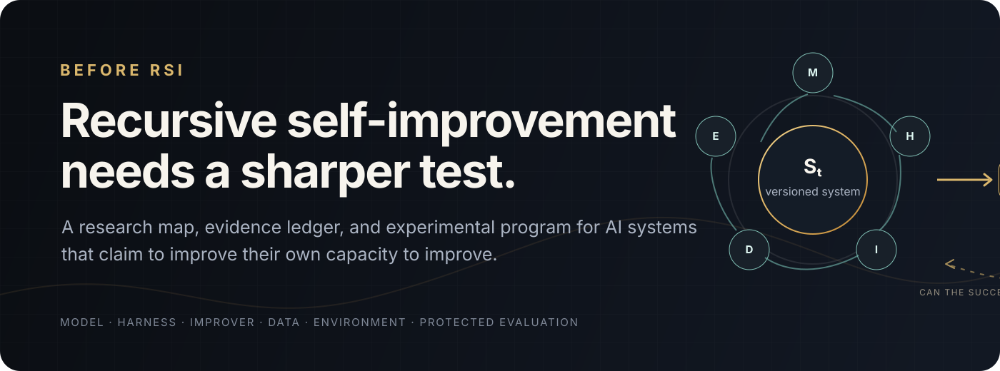
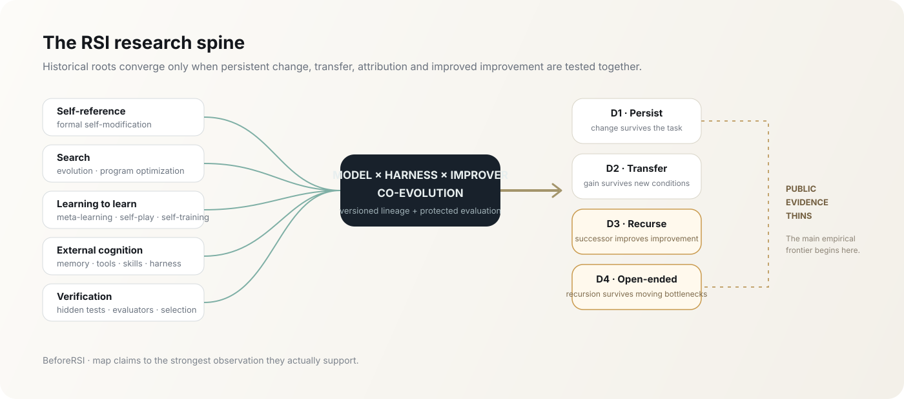

# BeforeRSI

 

**[Frontier coverage](FRONTIER_COVERAGE.md)** · **[Theory](THEORY.md)** · **[Mechanisms](MECHANISMS.md)** · **[Compatibility](COMPATIBILITY.md)** · **[Map](MAP.md)** · **[Evidence](EVIDENCE.md)** · **[Program](PROGRAM.md)** · **[Evaluation](EVALUATION.md)** · **[Learned search](SEARCH.md)** · **[Hypotheses](HYPOTHESES.md)**

---

## What must be true before RSI is real?

**Current coverage judgment:** the framework does not yet explain nearly all
important RSI-related research. The previous corpus overemphasized harness and
search systems. [The frontier review](FRONTIER_COVERAGE.md) adds major reasoning
RL, adversarial co-training, evaluator learning, generated-environment and
industrial AI-development work. The general research object is **how AI changes
the process producing later capabilities, and how those changes are reused**.
Model–harness co-evolution is one route within that scope. The 67-entry catalog
is not a coverage percentage or a validated universal theory.

**BeforeRSI** studies one question:

> When can we say that an AI system has improved its own capacity to improve?

A better answer after more sampling is not enough. A benchmark score obtained after repeated access to the benchmark is not enough. A fixed optimizer producing a better prompt or workflow is not enough. A joint model–harness gain establishes a result for the pair; separate component claims require additional interventions.

The object of study is a versioned AI system:

$$
S_t=(M_t,H_t,D_t),
$$

where **M** records learned models, **H** executable orchestration, and **D** persistent information. **Improver** is a role performed by a configured system; it can use the same model and harness as task solving. Environment, resource budgets, and assessment protocol are declared separately. Each artifact has one recorded owner.

The central empirical target is stronger than task performance:

$$
S_t \xrightarrow{\text{self-modification}} S_{t+1}
\qquad\text{and then}\qquad
S_{t+1}\ \text{must be a better improver than}\ S_t.
$$

Test that second statement by letting parent and successor improve identical copies of common targets under matched budgets. **[THEORY.md](THEORY.md)** defines this comparison and gives counterexamples to the previous growth interpretation. It does not claim an identified law of RSI.

One-step improvement ability does not guarantee a better multi-generation
endpoint. THEORY.md Section 9 gives the exact finite-budget continuation
comparison, including a counterexample with monotone gains under both routes.
[Experiment 006](experiments/006-recursive-optimizer/RESULTS.md) now contains
executed numerical-optimizer self-reuse, training-objective and update-order
comparisons. It reports negative and inconclusive results alongside the measured
order effect; these are bounded numerical experiments, not LLM training runs.

## From representation to explanation

[MECHANISMS.md](MECHANISMS.md) derives how proposal distributions, diagnostic feedback, selection, inheritance, task transfer and continuation interact. It connects representative primary-source methods and ablations to distinct predictions, with a [67-work mechanism map](research/mechanism-map.md).

The resulting route learns reusable research operations while preserving their decision inputs. It selects training sources by downstream update value, instead of assuming the best executing harness is the best teacher. [Experiment 007](experiments/007-feedback-structure/RESULTS.md) executes a controlled information-localization construction; it is not an LLM reproduction.

## An executable bridge from learning to improvement cost

[SEARCH.md](SEARCH.md) connects existing policy-guided search bounds to an
actual learned search-and-reuse loop. It also distinguishes retaining a whole
ancestor computation from mixing ancestor actions locally; the former admits
a pointwise completion guarantee under explicit scheduling assumptions.

[Experiment 008](experiments/008-learned-search/RESULTS.md) trains 2,592-parameter
context policies from solutions found by search. Four paired lineages compare
frozen and reused collection, imitation and search-bound losses, and local
versus whole-search preservation. A common-target intervention trains identical
fresh learners from each final actor's search results. Reuse improves both
solver and data-producing actor performance in this bounded puzzle domain;
resource measurements and a declared distribution-shift follow-up are included.

## The research spine

The history of self-improving AI is easiest to understand as five streams that now meet:

| Stream | What it contributed | What remains unresolved |
|---|---|---|
| **Self-reference** | programs and agents that can modify their own executable description | whether self-reference produces transferable improvement rather than bounded self-editing |
| **Search** | evolutionary search, program synthesis, prompt/workflow optimization | whether the optimizer itself improves, rather than only its target |
| **Learning to learn** | meta-learning, self-play, self-training, self-generated rewards | whether repeated weight updates remain reliable and useful as models become stronger |
| **External cognition** | memory, tools, skills, context, agent control, harnesses | where durable capability should live and whether harness gains transfer across models |
| **Verification** | exact checks, learned judges, hidden tasks, selection under uncertainty | how to prevent benchmark fitting, evaluator exploitation, and metric drift |

The mainline is **the production and reuse of improvements across the AI research process**. Model–harness co-evolution, learned feedback, generated curricula, learning-algorithm design and computational infrastructure are candidate feedback paths. Each needs its own supported mechanism and conditions; none is a universal default architecture.

Read the full historical and causal map in **[MAP.md](MAP.md)**.

## Claim depth

BeforeRSI does not classify whole projects as “RSI” or “not RSI.” It asks what a specific experiment actually establishes.

| Level | Claim | Minimum observation |
|---|---|---|
| **D0** | task-time adaptation | better current-task output; no persistent successor required |
| **D1** | persistent self-modification | a versioned change survives into later tasks |
| **D2** | transferable self-improvement | the change improves untouched tasks, models, environments, or cost |
| **D3** | improved self-improvement ability | the successor improves common reference targets more effectively under matched budgets |
| **D4** | open-ended RSI | D3 persists as tasks and bottlenecks change, without rapid saturation |

These levels are this repository's evidence convention. They do not require improvement to accelerate at every generation. Useful D0/D1 results retain their value; D3/D4 require the corresponding observations.

## What the public record says now

The strongest public work has already established several pieces of the puzzle:

- **persistent capability can live outside weights** — prompts, context, memory, tools, workflows and executable agent code can materially change a fixed model's realized capability;
- **self-modification can be executable** — agents can inspect, edit, test and retain changes to their own software;
- **model updates can be self-generated** — self-training, self-generated rewards and AI-generated update data can improve model behavior in bounded settings;
- **model and harness can be improved together** — recent systems expose both as editable objects and begin to test component transfer;
- **selection quality is a first-class constraint** — hidden tasks, cost accounting, lineage and independent acceptance materially change what counts as an improvement.

The checked sources now include large-scale weight-level co-training and AI-assisted production-model development. Their existence must not be denied because they fail a narrower preferred definition. What this repository **has not established** is a common predictive law across these systems, sustained broad improved improvement under comparable resources, or exhaustive coverage of public and private frontier research.

The source-backed record is in **[EVIDENCE.md](EVIDENCE.md)** and the machine-readable corpus is in **[data/works.json](data/works.json)**.

## The system we actually want to test

One route under test alternates harness changes, learning from trajectories, and renewed system design:

$$
(M_t,H_t)
\rightarrow D_{t+1}^{\mathrm{development}}
\rightarrow M_{t+1}
\rightarrow H_{t+1}.
$$

1. improve a **portfolio of harnesses** around a fixed model;
2. collect matched trajectories and verify them independently;
3. update the model from evidence-bearing trajectories rather than undifferentiated logs;
4. cross old/new models with old/new harnesses to locate the gain;
5. rebuild the harness around the new model instead of assuming the old optimum remains optimal;
6. improve the improver using candidate lineage, failed hypotheses and transfer results;
7. compare parent and successor **as improvers** on a new improvement problem;
8. repeat only while held-out gain survives cost, regression and contamination controls.

The detailed design is in **[PROGRAM.md](PROGRAM.md)**. This schedule and its portfolio are hypotheses; model-only, harness-only, joint, and other schedules remain valid alternatives. No independent improver module is required.

## Experimental sequence

<table>
<tr>
<td width="33%" valign="top">

### 01 · Harness transfer

Does an evolved harness still win after the parent receives the same total compute?

[Protocol →](experiments/001-harness-transfer.md)

</td>
<td width="33%" valign="top">

### 02 · Model × Harness

Evaluate the full cross:

(M0,H0) · (M1,H0) · (M0,H1) · (M1,H1)

[Protocol →](experiments/002-model-harness-cross.md)

</td>
<td width="33%" valign="top">

### 03 · Successor as improver

Under the same improvement budget, does $S_1$ produce a better descendant than $S_0$?

[Protocol →](experiments/003-successor-as-improver.md)

</td>
</tr>
</table>

These experiments form an ordered candidate harness branch. They are not the
general research priority specified in FRONTIER_COVERAGE.md. Experiment 03
directly tests **improved improvement ability** on common targets; recursive
reuse is a separate structural claim.

4. **[Repeated co-evolution](experiments/004-repeated-coevolution.md)** — run model, harness, and improver updates for several generations against model-only, harness-only, fixed-improver, and equal-compute baselines.
5. **[Evaluator fidelity and search efficiency](experiments/005-evaluator-phase-boundary.md)** — distinguish absolute selected gain, gain per unit cost, and adaptive exploitation as search grows.

## What this repository rejects

BeforeRSI does not upgrade a result because its title contains *recursive*, *self-evolving*, *autonomous* or *self-reflective*. The following are insufficient on their own for the stronger claim that the successor is a better improver:

- extra samples, retries, agents or evaluator calls;
- a fixed outer optimizer repeatedly improving a target;
- benchmark-specific prompt or workflow patches;
- self-generated data without evidence that later improvement behavior became better;
- joint model/harness task gains without measuring subsequent improvement ability;
- one successful parent → child update without comparing improvement ability;
- gains demonstrated only on small models and extrapolated to frontier models;
- self-evaluation used as the sole acceptance test.

These methods may be valuable results, useful components, or strong baselines. Component crossing is needed for component attribution, not for establishing every joint-system gain. **[EVALUATION.md](EVALUATION.md)** specifies what stronger claims require.

Generality requires mechanism coverage and testable predictions across methods. It does not follow from mapping papers into shared notation. [COMPATIBILITY.md](COMPATIBILITY.md) records both the current coverage and the claim-based criteria for choosing substantive work; rigorous negative results and counterexamples remain part of the research.

## Repository

| File | Purpose |
|---|---|
| **[FRONTIER_COVERAGE.md](FRONTIER_COVERAGE.md)** | major-lab mechanisms, substantive omissions, source limits and the revised research scope |
| **[SEARCH.md](SEARCH.md)** | search-effort objectives, complete-computation preservation, and the executable learning loop |
| **[THEORY.md](THEORY.md)** | implementation boundaries, common-target improvement tests, coupling, and mathematical counterexamples |
| **[COMPATIBILITY.md](COMPATIBILITY.md)** | per-work representation of all 67 catalog entries and limits of universality claims |
| **[MECHANISMS.md](MECHANISMS.md)** | conditional explanations, derivations, interventions and learner-aware research route |
| **[research/mechanism-map.md](research/mechanism-map.md)** | causal operation, failure condition and separating intervention for every corpus entry |
| **[MAP.md](MAP.md)** | history, causal structure, knowledge tree and present frontier |
| **[EVIDENCE.md](EVIDENCE.md)** | strongest public work, claim depth, limitations and primary sources |
| **[PROGRAM.md](PROGRAM.md)** | research-production mechanisms and candidate implementation branches |
| **[EVALUATION.md](EVALUATION.md)** | hidden/time-forward tests, cost controls, attribution, regression and recursion tests |
| **[data/works.json](data/works.json)** | machine-readable public research corpus |
| **[data/knowledge-graph.json](data/knowledge-graph.json)** | machine-readable causal knowledge graph |
| **[experiments/](experiments/)** | protocols and the executed bounded optimizer experiment |
| **[Experiment 006](experiments/006-recursive-optimizer/RESULTS.md)** | executed numerical optimizer experiments, task-level records, resource counts and reproducible figures |
| **[Experiment 008](experiments/008-learned-search/RESULTS.md)** | actual context-policy learning, recursive reuse, common-target data generation and measured costs |
| **[SIMULATION.md](SIMULATION.md)** | illustrative trajectories, identification limits, and reproducible plots |
| **[HYPOTHESES.md](HYPOTHESES.md)** | working propositions, alternatives and decisive tests |
| **[RESEARCH_LOG.md](RESEARCH_LOG.md)** | distilled lineage of the project's changing representations and decisions |
| **[AGENTS.md](AGENTS.md)** | multi-agent research protocol and epistemic rules |

The repository stays small on purpose. New files are added when they contain a new source audit, a testable claim, an experiment, or a result.

## Status

**October 2026.** The historical map and experimental program are established; the corpus is still being audited claim by claim. Author-reported results remain labeled reported until they are independently rerun or replicated.

Experiment 006 did not establish a positive common-target improver advantage
or a generally superior schedule. Experiment 008 establishes a positive bounded
search-and-learning result under its declared conditions, including a common
fresh-learner comparison. These different outcomes constrain different routes;
neither is a universal claim about open-ended RSI.

---

BeforeRSI asks for stronger evidence before stronger words.

