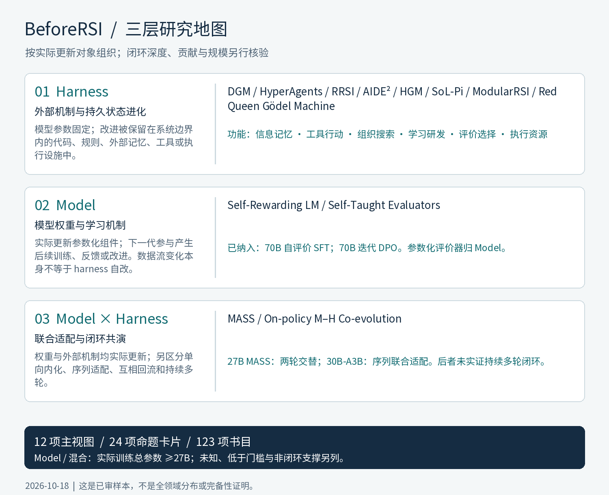
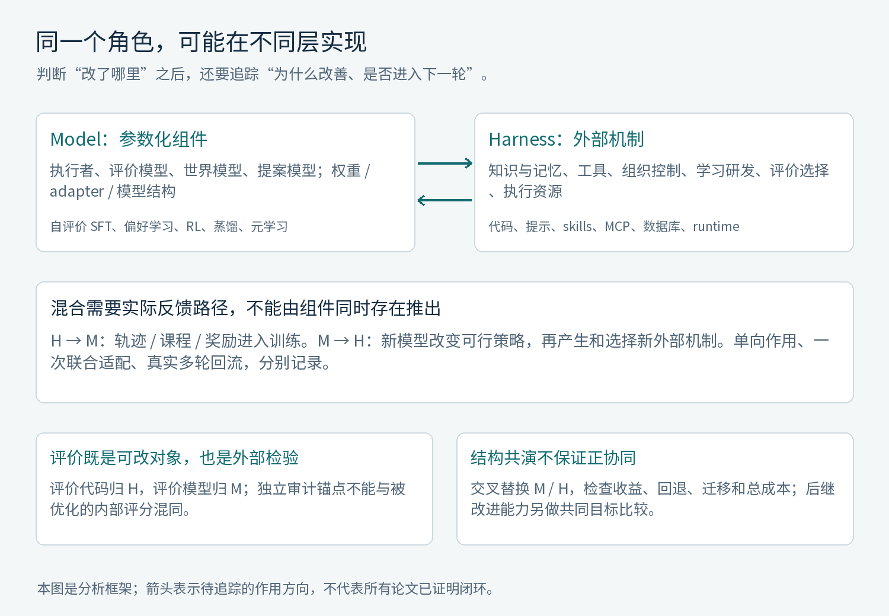

# BeforeRSI 三层研究地图

更新：2026-10-18。入口为 Harness、Model、Model × Harness；角色、算法、时间尺度、闭环与证据在各层内部说明。

**[打开可搜索离线 HTML](research/atlas/index.html)** · [图文导读 PDF](output/pdf/beforersi-research-atlas.pdf) · [分类原理与边界](research/atlas/classification.md)

## 先区分三个统计

- 主视图 **12 项**：Harness 8、Model 2、混合 2。混合中的一次联合适配不冒充多轮递归。
- 已有 **24 项限定命题卡片**；有价值的参考不一定满足主图的规模与 RSI 边界。
- 完整书目 **123 项**，另有 567 个去重发现线索；线索与书目重叠，不相加、不作为覆盖率分母。

## 主线及其功能结构

| 主线 | 核心问题 | 主视图实例 |
|---|---|---|
| Harness | 怎样让同一模型更会行动、学习、评价和继续改进？ | DGM、HyperAgents、RRSI、AIDE²、HGM、SoL-Pi、ModularRSI、Red Queen Gödel Machine |
| Model | 怎样让学习改变下一轮学习信号或改进行为？ | Self-Rewarding LM、Self-Taught Evaluators |
| Model × Harness | 两条更新路径怎样相互适应，而不是互相破坏？ | MASS、On-policy M–H Co-evolution |

Model / 混合的实际训练目标按总参数 ≥27B 筛选；MoE 激活量另报，教师/评审规模不能替代。Harness 主线不训练基座，不能套用被训练模型的门槛。该门槛是研究范围，不是质量定理。

## 三层之下不能再混淆的维度

- **Harness 的六类功能**：信息与记忆；工具与行动；组织与搜索；学习与研发；评价与选择；执行与资源。文件、MCP、skills 等是具体载体。
- **Model 的六个描述轴**：被训练角色；训练阶段；学习目标；参数更新算法；数据/时间方式；继承回流。on-policy 采样不等于在线 RL。
- **混合的关系强度**：并存 → 单向作用 → 序列联合适配 → 双向多轮回流；协同收益须另测。
- **A–F 贡献标签**：每项只提炼 1–3 个主要贡献，不填写六大类全部子项，不推测作者个人品味。

## 研究空间与未确认的位置

下表的候选与背景关联仅作检索线索，不能读成已审实例或全球研究空白。

| 主线 / 功能位置 | 当前证据状态 | 下一步应回答的问题 |
|---|---|---|
| Harness / 信息与持久记忆 | 主图有对应实例 | 更新事实、更新检索策略与真正增加后续改进能力，怎样分开测量？ |
| Harness / 工具与行动接口 | 主图有对应实例 | 学到可复用的动作原语，还是只为已见任务添加特例？ |
| Harness / 组织、控制与搜索 | 主图有对应实例 | 后继改变的是任务策略、搜索策略，还是产生搜索策略的方法？ |
| Harness / 学习与研发流程 | 主图有对应实例 | 训练代码被优化后，能否跨目标模型复用并由后继继续研发？ |
| Harness / 评价、选择与继承 | 主图有对应实例 | 评分规则变化时，怎样保留跨代可比较的外部锚点？ |
| Harness / 执行、环境与资源 | 主图有对应实例 | 是固定预算下机制更有效，还是只获得更多算力或有利环境？ |
| Model / 自生成监督与蒸馏 | 主图有对应实例 | 每代生成的数据为何更有用；学生重置与继续训练有什么区别？ |
| Model / 自奖励与偏好学习 | 主图有对应实例 | 奖励质量增长能否在独立任务上验证，是否随训练共同偏移？ |
| Model / 在线交互与自博弈 RL | 只有候选 / 范围外参考 | ≥27B、反馈回流、实际代际收益三者能否同时公开核验？ |
| Model / 学习如何更新与持续适应 | 只有候选 / 范围外参考 | 学习者当前状态改变后，更新策略是否仍产生正增益？ |
| Model / 预训练与继续预训练 | 只有候选 / 范围外参考 | 现有参考未构成 ≥27B LLM 自主预训练闭环；如何接到可核验的后继能力？ |
| Model / 模型结构与可训练表征 | 只有候选 / 范围外参考 | 发现其他模型的结构，不等于重构自身并继承其改进能力。 |
| Model × Harness / 外部能力内化再外化 | 主图有对应实例 | 去掉旧工作流后能力保留多少，更新模型是否又能设计更好工作流？ |
| Model × Harness / 行为分布与接口适配 | 主图有对应实例 | 联合更新何时正协同，何时破坏规划、接口或执行习惯？ |
| Model × Harness / 训练器与学习者共演 | 只有候选 / 范围外参考 | 训练代理和目标模型的边界是什么；后继能否承担下一轮训练决策？ |
| Model × Harness / 外部知识与参数记忆共演 | 只有候选 / 范围外参考 | 新知识应写入外部状态还是权重；淘汰与内化怎样避免遗忘和重复？ |
| Model × Harness / 环境、评价与策略共演 | 只有候选 / 范围外参考 | 系统是能力增长，还是创造了更容易被自己满足的世界与评价？ |
| Model × Harness / 模型结构与执行资源共设计 | 本次调查未确认实例 | 在本次已审集合中尚无确认实例；如何测量端到端收益而不把资源增加当能力增益？ |

## 逐项退出主图的理由

| 工作 | 当前去向 | 理由 |
|---|---|---|
| SEAL | <27B 机制参考 | 已核对的 1B / 7B 训练实验均低于 27B。 |
| Harness Updating ≠ Benefit | 评测与形式工具 | 作为评价/形式分析工具单列，不新增一种自改进系统路线。 |
| Rethinking Harness Evaluation | 评测与形式工具 | 作为评价/形式分析工具单列，不新增一种自改进系统路线。 |
| Frontis-MA1 / OpenMLE | AI4AI 支撑 / 非已证闭环 | 35B/30B 达规模门槛，但 §8 明示外部演化系统基本固定；主图不算闭环 RSI。 |
| GPT-Red | 规模未核准 | 工业级规模描述不能替代实际被训练模型的公开参数量。 |
| Automated Alignment Researchers | AI4AI 支撑 / 非已证闭环 | 自动研究者训练其他目标模型有实际价值；未核实后继接管研究者的闭环，参数也未核准。 |
| Dr. Zero | <27B 机制参考 | 3B / 7B 训练实验均低于规模门槛。 |
| Skill Self-Play | <27B 机制参考 | 实际训练基座范围 3B–14B。 |
| RLAnything | <27B 机制参考 | 策略/奖励训练均未达到 27B；32B/72B 为评审，不能越过门槛。 |
| EvoTrainer | 规模未核准 | 已核对 SWE 为 4B/9B；其余域规模未核准，未发现可入主图的 ≥27B 训练分支。 |
| DERL | <27B 机制参考 | 设计者 0.5B、学习者 1.5B，不得相加或用外部模型替代。 |
| Generalized Agent Iteration | 评测与形式工具 | 作为评价/形式分析工具单列，不新增一种自改进系统路线。 |

## 文件与证据

- [完整研究卡片](research/atlas/core-cards.md)：先列主图，后列规模参考、AI4AI 支撑与横向工具。
- [完整参考索引](research/atlas/references.md)：保留全部条目、阅读范围、纳入和规模决定。
- [筛选与待审](research/atlas/review-queue.md)：未知不伪装成低质量。
- [分类与原理](research/atlas/classification.md)：对象划分的相对完备性，以及它不能证明的事情。
- [层级和规模人工记录](data/layer-review.json)、[贡献记录](data/quality-review.json)、[生成图谱](data/research-atlas.json)。

三分法只解决对象表示；统一解释还需要机制和失效条件，统一预测还需要实测参数与跨分布检验。当前不宣称全领域已穷尽，亦不宣称建立了普适增长定律。
