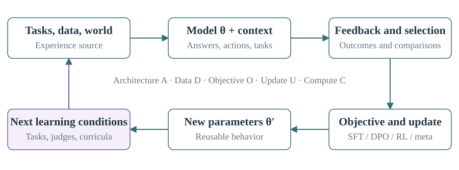
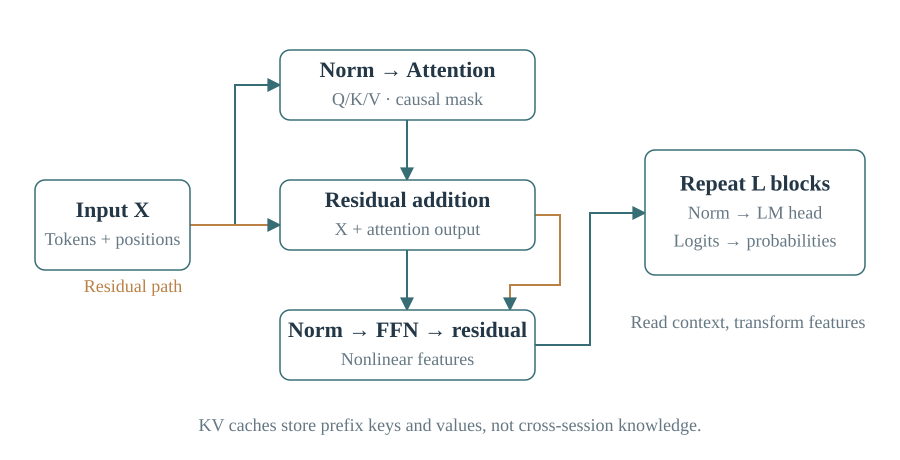
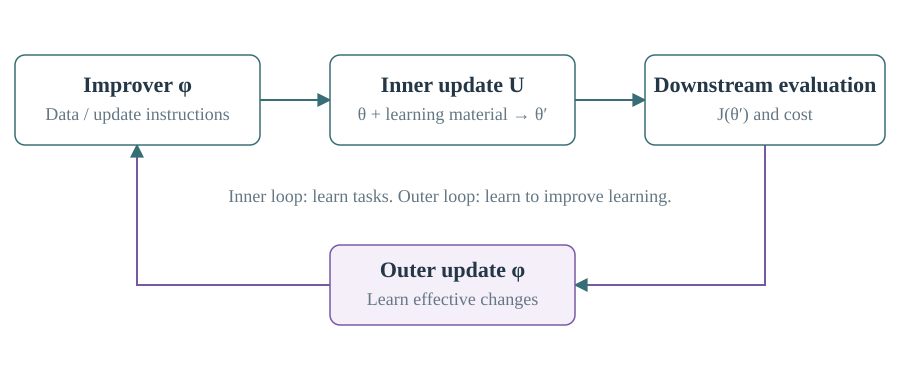
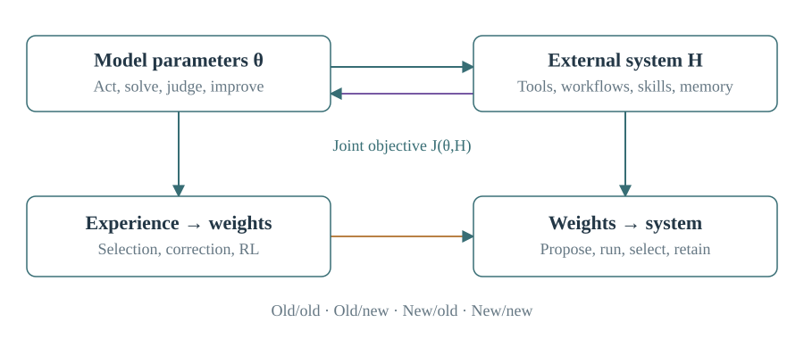
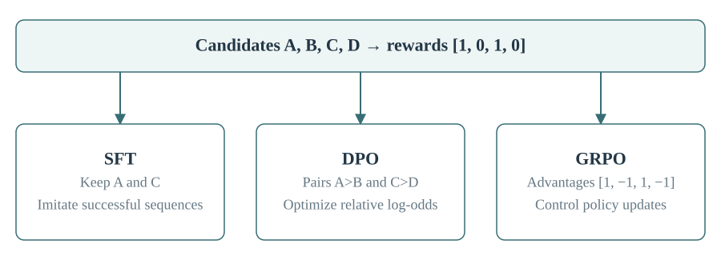

# Model / LLM: From Computation to Self-Improvement

[中文](model-llm.md) · [PDF](Model_LLM_Learning_Manual.en.pdf) · [Interactive atlas](index.html?lang=en#learn=00) · [Project](../README.md)

## 00｜A map of the learning process

This guide connects model computation, parameter learning and the mechanisms that generate subsequent learning experiences. Its 29 chapters cover architecture, training, inference, evaluation, self-training, self-play, curricula, continual adaptation and model–harness co-evolution. Four appendices provide terminology, a 61-topic index, links to 95 atlas subtopics and primary references.

The organizing question is: **which experience, transformed by which feedback and update, becomes which reusable capability?** A model may produce answers, critiques, tasks, training data or update instructions. Selection and learning determine which of those outputs change future behavior.

Distinguish parameters θ, current context c, external programs and state H, training data D and feedback r. Parameters persist when saved and loaded; context matters while available; external memory matters when retrieved and used. An update program U converts experience into a successor.

$$
p_\theta(y\mid c,H),\quad D_k\leftarrow\mathrm{Experience}(\theta_k,H_k),\quad \theta_{k+1}=U(\theta_k,D_k)
$$

H usually affects the network through prompts, observations, tools and action interfaces. Updating H changes the experience available to the model. Updating θ changes which external arrangements work well. When the successor helps produce more useful data or better update procedures, learning participates in a feedback loop.

| Reading path | Chapters | Purpose |
|---|---|---|
| First pass | 01–03, 08–09, 11, 13, 22, 26 | Explain the main objects and learning mechanisms |
| Mechanisms | 04–21 | Follow data, feedback, objectives and parameter updates |
| Design | 23–28, then appendices | Choose interventions and explain their effects |

For each method, identify what changes, what directs the change and what survives into the next round. Numerical examples in this guide are teaching constructions, not experimental measurements.



## 01｜Model, LLM and harness

A **model** is a parameterized computational mapping. A language model predicts tokens; a vision encoder produces features; a reward model predicts a score; a world model predicts consequences. An LLM is one kind of model, not the complete agent around it.

The **harness** controls calls, context assembly, tools, memory, retries and termination. The **runtime** executes programs and manages resources and process state. The **environment** supplies observations, actions and consequences. These affect realized capability through distinct causal paths.

| Change | Object changed | How its effect persists |
|---|---|---|
| Add an example to a prompt | Context | Include the example in later calls |
| Store an experience in memory | External state | Retrieve and apply it |
| Update weights or a LoRA adapter | Parameters | Save and load the new parameters |
| Edit a tool or workflow | External program | Deploy the new program |
| Train a policy and revise its workflow | Parameters and harness | Preserve both versions and their compatibility |

Training stage, objective, parameterization, data source, schedule and functional role are independent axes. Pretraining names a stage; SFT, DPO and policy gradients name objectives or update methods; LoRA constrains trainable updates; self-play generates experience; online describes timing; judge and solver describe roles. One system can collect self-play data online and update LoRA parameters using GRPO.

**AI4AI** includes AI-assisted data, algorithm, training and system development. **Self-improvement** involves a system in producing and retaining its improvements. **Recursive self-improvement** asks how the successor changes subsequent improvement capability or conditions. Terminology varies; the implemented feedback path is more informative than the label.

## 02｜Probability, representations and gradients

A tokenizer converts text into token IDs. Tokens may be words, subwords, punctuation or byte fragments. An embedding table maps IDs to learned vectors. Hidden states vary with the input; model parameters normally remain fixed during inference. A batch of hidden states often has shape B×T×d: sequences, positions and features.

Matrix multiplication recombines features; nonlinearities make multilayer computation expressive. The output head produces **logits**, which softmax converts into a probability distribution. Autoregressive generation factors a sequence probability into conditional next-token probabilities.

$$
p_i=\frac{e^{z_i}}{\sum_j e^{z_j}},\qquad p_\theta(y\mid x)=\prod_{t=1}^{T}p_\theta(y_t\mid x,y_{<t})
$$

High model probability is not a truth guarantee. Expectation is a probability-weighted mean; variance measures dispersion. Training often minimizes the negative log probability of the correct token. Raising that probability from 0.1 to 0.5 reduces its loss from approximately 2.303 to 0.693.

$$
L=-\log p_{y^*},\qquad \frac{\partial L}{\partial z_i}=p_i-\mathbf{1}[i=y^*],\qquad \theta' =\theta-\eta\nabla_\theta L
$$

Backpropagation applies the chain rule to compute parameter derivatives. The gradient points toward local increase; subtracting it seeks local decrease. Learning rate η, data and parameterization determine whether these local changes produce useful global behavior.

$$
H(p)=-\sum_i p_i\log p_i,\qquad D_{KL}(p\Vert q)=\sum_i p_i\log\frac{p_i}{q_i},\qquad \mathrm{PPL}=e^{L_{\mathrm{token}}}
$$

Entropy measures dispersion. KL divergence is directional and asymmetric. Perplexity is exponentiated mean token loss; compare it using consistent tokenization, data and scoring. Generalization concerns unseen data; overfitting captures training-specific detail. Training data updates parameters, validation data selects configurations and test data evaluates the resulting choice. Test feedback reused for optimization becomes training information.

## 03｜Inside a Transformer

Attention projects input representations X into queries, keys and values. Queries select information, keys provide matching features and values supply the content to aggregate. [1]

$$
Q=XW_Q,\quad K=XW_K,\quad V=XW_V,\quad A=\mathrm{softmax}(QK^\top/\sqrt{d_k}+M)V
$$

A causal mask M blocks future positions. Scaling by the square root of key dimension controls score magnitude. Attention weights describe one routing operation; they are not a complete causal explanation of an answer.

Multiple heads use different projections. The FFN or MLP transforms features within each position, usually expanding and then contracting the intermediate dimension. Residual connections add inputs back to sublayer outputs, providing direct information and gradient paths. LayerNorm and RMSNorm stabilize activation scales; RMSNorm does not subtract the mean. Pre-norm applies normalization before the sublayer. SwiGLU gates FFN channels. [2]

RoPE rotates query and key components by position so their dot products depend on relative position. It supplies positional structure, not unlimited reliable extrapolation beyond training lengths. [3]

With a known training sequence, causal masking allows losses at all positions to be computed together. Generation must first produce a token before later tokens can condition on it. **Prefill** processes the prompt; **decode** extends it. A **KV cache** stores preceding keys and values and avoids recomputation. It is inference state, usually not cross-session knowledge.

MHA gives each query head its own K/V; MQA shares one K/V group; GQA shares within groups. [4] For L layers, T cached tokens, h KV heads, head dimension d_h and b bytes per number, an ordinary single-sequence cache requires approximately 2LThd_hb bytes. Batching, shared prefixes, paging and compression change actual use.



## 04｜Architecture and information flow

Decoder-only models use causal attention for continuation. Encoder-only models use bidirectional context for representations, as in BERT. Encoder–decoder models encode the input and expose it to a generating decoder through cross-attention, as in T5. These are information-flow choices. [7][8]

Dense models activate most of the same parameters for each token. Mixture-of-experts models route each token to a subset of experts, commonly FFNs. Total parameters determine storage; active parameters describe part of token computation. Experts need not correspond to named human disciplines. Load balancing, token routing and inter-device communication affect efficiency. [5]

Recurrent and state-space models compress history into evolving state. Mamba makes state updates input-dependent. Linear attention, SSMs and hybrid architectures offer different memory–computation trade-offs; asymptotic sequence complexity alone does not determine practical speed or accuracy. [6]

Diffusion language models reconstruct corrupted or masked sequences through repeated denoising. LLaDA illustrates masked diffusion. Compare denoising rounds, sequence length, quality and latency with autoregressive decoding. [9]

A typical vision-language system connects an image encoder to an LLM through a projector. Training can first align the interface, then adapt selected modules jointly. A frozen encoder reduces training cost but may discard information the language model cannot recover. LLaVA is a representative design. [10] Audio may use continuous features or codec tokens; video requires temporal structure; actions may be discrete calls or continuous controls. Specify which modules receive gradients when calling a system end-to-end.

Choose architecture from missing information and computational bottlenecks. More text parameters cannot substitute for an unavailable measurement. When perception is adequate but long interaction fails, policy and state-use training may be the more direct intervention.

## 05｜Pretraining, data and scale

Pretraining learns broad representations from large corpora. Continued or domain-adaptive pretraining shifts an existing model toward additional distributions. Post-training adapts its behavior to tasks and interaction. Objectives can overlap across stages: next-token prediction is self-supervised because labels come from the sequence itself.

Predicting complex text requires syntax, factual associations, program patterns and some reasoning structure. The objective constrains observable outputs; it does not ensure a complete causal world model. Data value depends on correctness, coverage, structure, repetition and relevance. High loss can indicate novelty or noise; low loss can indicate mastery or triviality.

$$
L(N,D)\approx L_\infty+aN^{-\alpha}+bD^{-\beta},\qquad C\approx6ND
$$

The first expression illustrates empirical scaling; the second approximates training compute for common dense Transformers. N is parameter count and D training tokens. Attention, embeddings, communication, sparsity and long contexts can alter the estimate. Chinchilla studies compute-optimal allocation, not a universal fixed tokens-per-parameter law. Inference demand can favor training a smaller model longer. [11]

Data-mixture optimization selects domain weights; curricula change sampling over time; data valuation asks which examples improve future objectives. DoReMi uses a proxy model to estimate weights for larger-scale training. Their transfer depends on scale and distribution. [12]

Synthetic text and rewriting can turn difficult material into clearer explanations or exercises. Correctness and diversity determine whether this creates useful supervision. AI-assisted pretraining also includes objective, optimizer and system design. These form a self-improvement loop when subsequent results change the components producing later training conditions.

## 06｜Optimization and training recipes

A training step usually consists of sampling, forward computation, loss, backward computation and an optimizer update. An epoch is a pass through a defined dataset; streaming mixtures may have no natural epoch. Record effective tokens and updates.

Microbatches fit into memory; gradient accumulation combines them before updating. Effective batch size is per-device microbatch × accumulation steps × data-parallel devices, with consistent loss normalization. Larger batches reduce sampling noise but alter update frequency and memory cost.

Adam tracks first and second gradient moments. AdamW decouples weight decay from its adaptive gradient update. Hats below denote bias correction. [13]

$$
m_t=\beta_1m_{t-1}+(1-\beta_1)g_t,\quad v_t=\beta_2v_{t-1}+(1-\beta_2)g_t^2
$$
$$
\theta_{t+1}=(1-\eta_t\lambda)\theta_t-\eta_t\frac{\hat m_t}{\sqrt{\hat v_t}+\epsilon}
$$

Warmup gradually increases early learning rates; decay permits finer later updates. Gradient clipping limits unusually large gradient norms. Dropout regularizes through stochastic activation masking. These modify optimization, not an incorrect objective.

When training diverges, examine overflow, masks, label alignment, data quality, sequence length, learning rate and reward scale. When it does not learn, establish that the intended parameters receive gradients and updates. Averaging per token, per sequence or per task gives different objectives; final rewards assigned across long sequences also interact with length. A useful recipe change identifies which examples gain or lose influence.

## 07｜Memory, parallelism and efficiency

Inference stores weights, KV caches and workspaces. Training additionally stores gradients, optimizer state, activations and sometimes master weights. One common mixed-precision AdamW arrangement uses about 16 bytes per parameter before activations: BF16 weights and gradients, FP32 master weights and two FP32 moments. Implementations differ. For 7B parameters this is roughly 112 GB, compared with about 14 GB for BF16 weights alone.

LoRA freezes W and learns a low-rank update. A rank-r factorization uses r(d_in+d_out) trainable values rather than d_in d_out. It works with SFT, DPO or RL. [14]

$$
W'=W+\frac{\alpha}{r}BA
$$

QLoRA stores the frozen backbone at low precision while training adapters. It does not make every intermediate computation four-bit or remove activation and rollout costs. [15]

| Technique | Partition or trade-off |
|---|---|
| Data parallelism | Different examples, aggregated gradients |
| Tensor parallelism | Parts of a layer across devices |
| Pipeline parallelism | Different layers across devices; scheduling bubbles |
| Expert parallelism | Distributed experts and token routing |
| ZeRO / FSDP | Sharded optimizer, gradients and/or parameters |
| Activation checkpointing | Recompute activations to reduce memory |
| Sequence / context parallelism | Distribute sequence operations or long-context attention |

FlashAttention computes exact attention with tiled, IO-aware execution; PagedAttention manages dynamic KV memory. [16][17][18] Training checkpoints save parameters and usually optimizer, scheduler, step, random and data state. Activation checkpointing instead trades recomputation for memory within a training pass.

BF16, FP16, FP32 and FP8 differ in precision and range. Quantization, freezing and mixed-precision execution are separate choices. Measure the full cycle: data preparation, rollout, evaluation, backward computation and communication. Faster training kernels may have little effect when rollout dominates.

## 08｜SFT and distillation

Supervised fine-tuning raises the probability of demonstrated responses under their conditions. Common dialogue masks score assistant tokens while treating user messages and tool outputs as context. Multi-turn objectives may score several assistant turns; the mask is an explicit design choice.

$$
L_{\mathrm{SFT}}=-\frac{1}{\sum_t m_t}\sum_t m_t\log p_\theta(y_t\mid x,y_{<t})
$$

Teacher forcing supplies the correct prefix. Deployment encounters model-generated prefixes, including mistakes, which creates exposure mismatch. SFT can teach knowledge, reasoning and action patterns, not only formatting. Pretraining and SFT often share cross-entropy while differing in distributions, conditions and targets.

Distillation transfers a teacher's behavior or distribution. The teacher can be a larger model, ensemble, search system or the same model with better context. Sequence distillation uses teacher text; logit distillation matches probabilities; policy distillation matches actions in states. [19]

$$
L_{\mathrm{KD}}=T^2D_{KL}(p_{\mathrm{teacher}}^{(T)}\Vert p_{\mathrm{student}}^{(T)})
$$

T softens distributions; the prefactor is a common scaling convention. Text-only APIs may expose no logits, and different tokenizers complicate token-level matching. Reasoning and process distillation can transfer intermediate reasoning, tool use and recovery. A student still needs access to information required for new instances.

On-policy distillation labels states visited by the student rather than only successful teacher trajectories. DAgger exemplifies aggregating supervision on learner-visited states. [36] Self-distillation can compress the benefits of search, retrieval or additional context into cheaper behavior. Copying an unchanged distribution with no better signal supplies no automatic improvement direction.

## 09｜Reinforcement learning

A policy πθ(a|s) assigns action probabilities. An episode is a complete task; a trajectory records its actions, observations and feedback; rollout generates that trajectory. Agents often act in partially observable environments, so their context is an information state rather than the complete environment state.

Reward r_t is immediate feedback; return G_t aggregates future rewards. V(s) predicts policy return from a state; Q(s,a) conditions on an initial action; advantage compares that action with the state's baseline.

$$
G_t=\sum_{k\geq0}\gamma^k r_{t+k},\qquad A(s,a)=Q(s,a)-V(s)
$$

An actor acts; an RL critic estimates value. A language critique, reward score and value estimate are different signals even when produced by related models. For a finite undiscounted episode, the policy gradient can be written as:

$$
\nabla_\theta J=\mathbb{E}\left[\sum_t\nabla_\theta\log\pi_\theta(a_t\mid s_t)\,A_t\right]
$$

Discounted objectives require the corresponding weighting. An action-independent state baseline reduces variance without changing the ideal expected gradient. Actor losses normally stop gradients through estimated advantages.

No derivative through a unit-test result is required: the derivative passes through the probability of sampled behavior. A tool call consists of tokens, so its log probability is their sum. User and environment tokens are normally excluded from the policy-action loss. Entropy bonuses and sampling temperature can increase diversity; useful exploration still depends on task structure and feedback.

## 10｜PPO, GRPO and trajectory computation

PPO stores probabilities under the rollout policy and uses a clipped surrogate to discourage some excessively large updates. Clipping is not a hard bound on every state-wise policy change. [20]

$$
\rho_t=\frac{\pi_\theta(a_t\mid s_t)}{\pi_{\mathrm{old}}(a_t\mid s_t)},\quad J_{\mathrm{clip}}=\mathbb{E}\left[\min(\rho_tA_t,\mathrm{clip}(\rho_t,1-\epsilon,1+\epsilon)A_t)\right]
$$

The minimum and advantage sign matter. A positive-advantage action stops gaining surrogate value above the upper clipping boundary; a negative-advantage action has the corresponding lower-side behavior. PPO often combines policy, value, entropy and KL terms.

GAE mixes temporal-difference residuals to trade bias against variance:

$$
\delta_t=r_t+\gamma V(s_{t+1})-V(s_t),\qquad \hat A_t=\sum_{l\geq0}(\gamma\lambda)^l\delta_{t+l}
$$

Handle terminal values according to actual termination semantics. The old policy generated the data; a reference policy anchors regularization. They need not be the same model version.

GRPO samples several responses to the same prompt and estimates advantages relative to the group, without a traditional separate value critic. [21]

$$
\hat A_i=\frac{R_i-\overline{R}}{\mathrm{std}(R_1,\ldots,R_G)+\varepsilon}
$$

Rewards [1,0,1,0] have mean 0.5 and population standard deviation 0.5, giving approximately [1,-1,1,-1]. Uniform rewards provide no group-relative reward distinction, although regularizers may still update parameters. Standard-deviation normalization, token versus sequence averaging and length change the effective weighting. GRPO can use either rule-based or learned rewards.

Rollout usually runs without a full backward graph and saves tokens, action masks, old log probabilities, rewards and termination data. Training recomputes forward probabilities and gradients. Asynchronous collection introduces policy lag; versioning and appropriate corrections identify which distribution generated each trajectory.

## 11｜Preferences, reward models and DPO

Preference data consists of a condition x and a preferred/rejected pair (y⁺,y⁻). A reward model maps these to scores. A common Bradley–Terry loss uses score differences:

$$
P(y^+\succ y^-\mid x)=\sigma(r_\phi(x,y^+)-r_\phi(x,y^-)),\quad L_{RM}=-\log\sigma(r^+-r^-)
$$

Absolute score offsets are not identified by comparisons. Reward scale affects policy optimization. RLHF commonly denotes human preferences, reward learning and policy optimization; broader usage includes direct preference methods. RLAIF changes the feedback source to AI, not the optimizer. [23]

$$
\max_\pi\;\mathbb{E}_{y\sim\pi}[r(x,y)]-\beta D_{KL}(\pi\Vert\pi_{ref}),\qquad \pi^*(y\mid x)\propto\pi_{ref}(y\mid x)e^{r(x,y)/\beta}
$$

Under the idealized unconstrained distributional optimization above, rewards exponentially reweight the reference policy. DPO substitutes policy-to-reference log ratios for the implicit reward and directly optimizes preferences. [22]

$$
L_{DPO}=-\log\sigma\left(\beta\left[\log\frac{\pi_\theta(y^+\mid x)}{\pi_{ref}(y^+\mid x)}-\log\frac{\pi_\theta(y^-\mid x)}{\pi_{ref}(y^-\mid x)}\right]\right)
$$

DPO improves a relative log-odds difference; it need not increase every preferred response's absolute probability. A fixed preference set supports offline training. Iterative DPO refreshes responses and preferences between rounds, so DPO is not inherently restricted to static data collection.

SFT imitates demonstrations; rejection fine-tuning filters successful demonstrations; DPO uses comparisons; PPO uses rewards and advantage estimates; GRPO uses within-prompt comparisons of sampled rewards. They can be combined. Feedback quality and state coverage, rather than method labels, determine what can be learned.

## 12｜Inference, search and test-time computation

Greedy decoding chooses the highest-probability next token, not the globally best sequence. Temperature rescales logits; top-k restricts candidates by rank; top-p retains a probability-mass threshold. These change sampling without changing weights.

Chain-of-thought expands computation through intermediate tokens. Reasoning models can share a conventional backbone while differing in training data, RL and inference budgets. DeepSeek-R1 illustrates reasoning post-training with reinforcement learning. [37]

Self-consistency aggregates sampled answers; best-of-N adds a selector; beam search preserves likely prefixes; tree search and MCTS allocate computation among branches. [24] With independent samples of constant success probability p, oracle success among k attempts is 1-(1-p)^k. Correlated errors and imperfect selection weaken the practical gain.

Speculative decoding uses a cheap draft model and target-model verification. Correct acceptance, rejection and resampling can preserve the target distribution; casual approval of plausible drafts cannot. Speed depends on acceptance rates, batching and relative costs. [43]

Post-training quantization reduces precision after training; quantization-aware training incorporates quantization error into learning. Pruning removes weights or structures, with speedups dependent on hardware support. Continuous batching improves utilization while changing latency trade-offs.

In-context learning changes behavior through context. Test-time adaptation updates specified parameters or adaptive state; define its lifetime and reset rule. Extra reasoning is not automatically persistent learning, but learning need not always use backpropagation. TTT layers treat an adaptive small model as sequence state. [35]

## 13｜Self-generated data and self-training

A model can occasionally produce a good solution before it produces one reliably. Filtering and training on those solutions can increase their frequency. The source of improvement is the altered target distribution, additional information, selection or computation—not repetition alone.

$$
q_k(y\mid x)\propto p_{\theta_k}(y\mid x)\,w(x,y),\qquad \theta_{k+1}\approx\arg\min_\theta D_{KL}(q_k\Vert p_\theta)
$$

w weights or filters outputs. Exact fitting to unfiltered samples from an unchanged distribution has that distribution as a fixed point. Generalization after selective fitting depends on coverage, capacity and optimization.

STaR generates rationales, optionally conditions unsuccessful attempts on the correct answer, and trains on selected solutions. Answer-conditioned rationalization can supply supervision without guaranteeing faithful reasoning. [25] ReST-EM alternates generation, binary filtering and fine-tuning. [26] Self-consistency supplies weaker feedback based on agreement, whose value depends on correlated errors. [24]

If raw correctness is p, correct examples pass with probability a and incorrect ones pass with probability b, filtered correctness is pa/[pa+(1-p)b]. For p=0.2, a=0.9, b=0.1 it is about 69.2%; b=0.01 raises it to about 95.7%. Filtering also reduces volume and can discard unfamiliar valid solutions.

Replay, mixtures and deduplication help retain rare skills and prevent template concentration. Self-training emphasizes generated experience returning to learning; self-distillation emphasizes teacher–student transfer. They can describe the same pipeline from different angles.

## 14｜Self-critique and AI feedback

A rubric defines evaluation dimensions; a constitution states broader principles. Critique–revision produces language feedback, not gradients. The revision can become an SFT target, the old/new responses a preference pair, or the judgments reward-model data.

Constitutional AI combines supervised critique–revision with reinforcement learning from AI preferences. [23] A shared generator–judge uses one parameter set in different roles. This can transfer capability but also correlate errors. Different model names do not establish independent judgments when training data and criteria overlap.

Self-Rewarding Language Models use model judgments to form preferences for iterative DPO. Their reported improvements in response and evaluation ability concern the studied setting. Shared roles do not imply direct supervision of every role. [27]

Useful comparisons need meaningful candidate differences and task evidence. Nearly identical candidates amplify label noise; length or confidence differences can become shortcuts. Critique is most informative when it uses evidence underused by generation: execution, facts, explicit rules or counterexamples. A judgment rationale should identify an actual error or valid supporting evidence.

## 15｜Verifiable feedback

RLVR specifies the reward source; PPO and GRPO specify update methods. A verifier can also support rejection sampling, search, labeling and distillation.

| Feedback | What it establishes |
|---|---|
| Exact-answer matching | Agreement under an equivalence rule |
| Program tests | Correct behavior on tested inputs |
| Formal kernel | Acceptance of a formal proof term for a stated proposition |
| Environment state | Satisfaction of specified task conditions |
| Physical measurement | An observed result under measurement and control conditions |

Grounding connects feedback to external task facts. Its scope follows the checker: weak tests, mistaken formalization or simulator exploits leave gaps between reward and intended success.

Outcome rewards score the final result; process rewards score intermediate steps. PRMs and ORMs are learned implementations of these roles. Process labels can come from humans, execution, rollouts or other models. [28] Summing apparent step quality can reward verbosity. Potential-based shaping uses r'=r+γΦ(s')-Φ(s); its policy-invariance properties require the appropriate MDP and boundary conditions.

Search-to-train uses computation to discover solutions, then learning to compress and reuse them. Comparing continuations from a fixed prefix provides more localized credit than rewarding every step of a successful trajectory equally, at additional sampling cost.

## 16｜Learning evaluators

A judge compares or scores; a reward model produces an optimization signal; a verifier checks a property; a critic predicts policy return. Roles may share a backbone or use separate models and rules.

Discriminative reward models output scores or classes. Generative reward models produce reasoning or structured judgments before scores. Synthetic contrasting answers can train evaluators, as in Self-Taught Evaluators. [29] The direction and reliability of the synthetic labels remain central.

Generator–verifier co-training couples their data distributions: better generation creates harder errors, evaluator updates change generator feedback, and the cycle continues. External outcomes connect this loop to the task. Meta-verification checks evidence and calculations inside judgments rather than merely adding more judge layers.

Calibration asks whether confidence matches observed frequency. Ranking, accuracy and calibration are different. A well-ranked but overconfident evaluator can be useful for selection and unsuitable as a probability estimator.

$$
\mathrm{Brier}=\frac{1}{n}\sum_i(p_i-y_i)^2
$$

This binary scoring rule measures probability error. Calibration on verifiable mathematics does not automatically transfer to research value or open-ended writing. Feedback about truth, preference, difficulty and learning value serves different decisions.

## 17｜Task generation and self-play

A proposer creates tasks, opponents or challenges; a solver attempts them. Their shared or separate parameters can be updated from different rewards. Self-play can be symmetric, adversarial or proposer–solver; generated curricula need not be competitive games.

The task distribution determines what the learner can discover. Difficulty rewards alone can favor impossible, malformed or unverifiable problems. A productive proposer creates valid tasks near the learner's current learning frontier and supplies a checkable outcome. Absolute Zero uses executable reasoning tasks and self-play to generate learning signals without a seed task dataset in its reported setting. [30]

A challenger reward may favor questions the solver sometimes fails while penalizing invalidity. All-success and all-failure groups offer little relative reward information. Diversity, novelty and coverage complement difficulty; winning against a familiar opponent is not the same as transfer to new tasks.

Roles can share weights, use role prompts or be separate models. Shared parameters create coupling between proposing and solving; separate models create a moving opponent distribution. Keep track of whose policy generated a task, whose behavior is being optimized and what verification ties the game to the intended capability.

## 18｜Curricula and the value of data

A curriculum chooses what to learn next. Useful signals include difficulty, uncertainty, learning progress, novelty and expected downstream gain. The hardest task can be unlearnable from current experience; the easiest can provide no new information. A task that is just within reach can expose a reusable missing skill.

Difficulty is performance under a learner, context and budget. Data value is its marginal effect on a specified future objective. Neither is an intrinsic permanent label. Prioritized replay targets informative experience; diversity and coverage prevent concentration on a narrow family.

Curriculum learning may use fixed heuristics, bandits or a trained curator. When the learner changes, task values change; curator feedback should reflect later learner gains rather than only current failure. Proxy loss, one-step improvement and transfer performance capture different horizons.

Data mixtures control domain proportions. Active learning chooses labels to acquire; active exploration chooses actions that reveal useful experience. Information gain reduces uncertainty; task utility improves an objective. They can align but are not identical. Cost-aware selection matters when a new task requires expensive execution, annotation or training.

A useful data-value objective measures the effect of learning from an example on the target distribution:

$$
v(x;\theta)\approx J_{\mathrm{target}}(U(\theta,x))-J_{\mathrm{target}}(\theta)
$$

This quantity depends on the current learner and update rule; difficulty alone does not determine it.

## 19｜Interactive RL, credit and replay

On-policy data follows the learner's current or recent rollout policy. Off-policy data comes from another behavior policy. Online describes ongoing collection; a teacher can generate fresh online data that is off-policy for the student. Replay reuses older trajectories and can preserve rare experience, with distribution mismatch when behavior policies drift.

Importance weighting uses target-to-behavior probabilities to correct some mismatches; long products can have high variance. Practical methods constrain lag, truncate corrections or limit reuse. Reward relabeling must remain consistent with actual environment outcomes.

Long-horizon credit assignment asks which actions affected eventual success. Values, GAE, process rewards, subgoals, branch comparisons and trajectory ranking supply different resolution. More detailed feedback helps only when accurate. WebRL combines generated tasks, outcome feedback and policy training, using current failures to influence the next curriculum. [31]

A world model predicts transitions, observations or rewards. Model-based RL uses such predictions for planning or simulated experience; model-free RL does not require an explicit transition model, even though its policy can be a neural network. Simulation errors accumulate and may be exploited, motivating grounding in real interaction and careful rollout horizons.

Policies must learn when and how to use external state: retrieve a memory, interpret a tool failure or preserve an intermediate result. A memory store's existence does not imply effective use. Observation, action and tool-result masks should reflect their distinct roles in training.

## 20｜Continual learning and test-time adaptation

Continual learning studies a task stream: acquisition, retention and adaptation speed. Plasticity is the ability to change; stability preserves useful behavior. Catastrophic forgetting is severe old-task degradation after new training, distinct from deliberate correction of outdated knowledge.

$$
\Delta L_{old}\approx-\eta\,g_{old}^{\top}g_{new}
$$

This first-order approximation explains local gradient interference: opposing gradients can increase old loss. It is not a complete long-run theory. Replay reintroduces old constraints; regularization limits important parameter or output changes; isolation allocates modules; distillation preserves behavior; consolidation integrates local learning. EWC is a classic importance-weighted regularization method. [34]

PEFT includes LoRA, adapters, prefix tuning, soft prompt tuning and selected-layer updates. Soft prompts are trainable vectors, unlike edited prompt text. Fewer trainable parameters do not ensure retention.

Test-time adaptation must specify updated state, signal and reset rule. Episodic reset starts each task from a common base; streaming adaptation inherits updates; consolidation retains selected changes. TTT layers adapt a small model as sequence state; SEAL learns self-edit materials and update instructions. [35][33]

Knowledge editing targets localized facts; continued pretraining changes broader distributions; RAG retrieves current evidence; long context presents material in the current call. Choose among them using update frequency, evidence requirements and cost. Interface changes can require adaptation to new tool schemas while retaining old workflows.

## 21｜Meta-learning and learned improvers

Ordinary training optimizes task performance. Meta-learning optimizes performance after an inner learning process. It may learn initial parameters, learning rates, optimizers, data generators, reward designers or improvement policies.

$$
\theta'=U(\theta,D_\phi),\qquad \phi^*=\arg\max_\phi J_{val}(\theta')
$$

θ describes the learner, φ controls learning conditions and J_val evaluates the adapted learner. MAML learns an initialization that adapts from a support set and generalizes to a query set. [32] Mixing those sets changes the objective toward fitting the adaptation examples.

Differentiable inner updates permit unrolling, implicit differentiation or approximations. Discrete text, code and black-box training pipelines can use policy gradients or evolutionary search. Unrolling costs memory and computation; cheap proxies may misalign with the eventual target.

SEAL generates self-edits—training material and update instructions—and rewards them through downstream performance after adaptation. [33] A data generator can similarly be trained on student improvement, a reward designer on resulting task performance, and a skill curator on later agent execution. The solver can remain frozen while the improver learns.

Learned optimizers map gradients and state to updates; objective search changes the loss; systems co-design changes throughput and scheduling. The outer objective should capture transferable downstream improvement and relevant costs. Rewarding only inner training-loss reduction can favor easy repetitive data.



## 22｜Nine model–harness couplings

Let J(θ,H) denote performance of parameters and external system together. H changes observations and actions; θ changes which H is effective. One-way transfer, alternating updates and sustained co-evolution have different feedback structures.

| Coupling | What changes and why it matters |
|---|---|
| Workflow and policy | Revised planning, tools or recovery alter visited states; train under the actual interface |
| Experience into parameters | Search, correction and skill-conditioned trajectories become SFT, distillation or RL data |
| Parameters into programs | Better models propose and implement changes to tools, workflows or training procedures |
| Skills, memory and policy | Library content co-adapts with retrieval, application, writing and deletion behavior |
| Tasks, environments and learning | Failures change curricula; environment wrappers change observations and action contracts |
| Rewards, evaluators and policy | New behavior produces hard judgments; updated feedback changes learning |
| Trainers and learning systems | Results guide data filters, objectives, optimizers, rollout schedules and research tools |
| Organization and role capability | Routing, delegation and communication co-adapt with shared or specialized models |
| Deployment and re-adaptation | New interfaces, tools and model versions require renewed compatibility |

Skills can describe applicability, procedure and failure conditions. Their transfer into parameters should be measured after removing the external aid. Stage/Contract/Chain in the atlas describe particular environment decompositions, not a universal named algorithm.

Compare (old model, old harness), (new model, old harness), (old model, new harness) and (new model, new harness) on the same tasks and comparable resources. Gains restricted to the new/new pair indicate strong compatibility effects; gains under the old harness locate some improvement in the model. Better solving does not automatically mean better program design; improvement behavior can require its own training.



## 23｜Evaluation and interpretation

A benchmark combines tasks and protocol; a metric defines a score; an evaluator implements a judgment process; a verifier checks a property. Prompt, tools, budget and scoring rules are part of the comparison.

| Capability | Useful measurements |
|---|---|
| Language modeling | Token loss and perplexity |
| Knowledge | Accuracy and evidence-supported factuality |
| Reasoning and coding | Solve rate, pass@1, pass@k |
| Interactive agents | Task success, return, steps, time and cost |
| Preferences | Pairwise win rates and dimension-specific scores |
| Continual learning | Acquisition, retention and transfer across time |

Pass@k asks whether at least one candidate passes; it need not include successful selection. Best-of-k includes a selector. With c successes among n samples, a common estimator is 1-C(n-c,k)/C(n,k), for n≥k under its sampling assumptions.

ID and OOD describe relationships to training distributions, not universal difficulty levels. Robustness concerns perturbations; calibration concerns probability accuracy. Ablations isolate mechanisms only when other relevant changes, including compute, are controlled.

For n approximately independent binary outcomes, the standard error near rate p is approximately sqrt[p(1-p)/n]. Paired comparisons, training seeds, task heterogeneity and repeated selection can matter beyond this approximation. Contamination can enter through answers, near duplicates, retrieval, rewards or repeated test-guided selection.

For self-improvement, evaluate successors on new tasks and as producers of further improvements under comparable budgets. Finite-round gains and sustained progress across changing tasks answer different empirical questions.

## 24｜Designing a model-learning system

$$
\theta'=U(A,\theta,D,O,C),\qquad \mathrm{Performance}=J(A,\theta',I,H)
$$

Architecture A, data D, objective O, update U and training compute C produce parameters; inference I and harness H determine their use. Start with the failure mechanism: missing information, representation, examples, exploration, feedback or affordable execution.

| Observed need | Direct interventions |
|---|---|
| New domain language and structure | Continued pretraining and data mixtures |
| Knowledge without reliable task behavior | SFT, process and tool demonstrations |
| Good candidates but poor preferences | Preference learning, reward optimization and selection |
| Rare correct solutions | Verification, search and training on successful behavior |
| Failure recovery in long interactions | On-policy correction and environment RL |
| Missing evidence | Multimodal inputs, retrieval and tools |
| Expensive deployment | Distillation, quantization, cache and serving optimization |

These are causal starting points, not exclusive assignments. SFT can teach knowledge; pretraining can teach behavior; RL can change style. Inductive biases make some patterns easier to learn. Capacity concerns expressible and learnable behavior, not a fixed number of facts per parameter.

The main trade-offs include capacity versus training sufficiency, diversity versus specialization, plasticity versus retention, exploration versus exploitation, quality versus cost, and external evidence versus parameter consolidation. A Pareto frontier retains configurations that cannot improve one objective without sacrificing another.

## 25｜One set of trajectories, three objectives

Consider four candidate programs for one training task. A is correct and concise; B is wrong; C is correct but slower; D has a syntax error. Binary test rewards are [1,0,1,0]. These are illustrative values.

SFT can retain A and C as targets while masking prompt and environment text. Selecting only A incorporates an efficiency preference into filtering. DPO can train pairs A>B and C>D. A>C requires an explicit speed preference. GRPO obtains approximately [1,-1,1,-1] using population normalization; binary correctness cannot distinguish A from C. If all four fail, there is no within-group correctness distinction.

For a scalar two-action model with success probability p=σ(z)=0.4, the successful-example SFT loss has derivative p-1=-0.6. With learning rate 0.1, z increases by 0.06 and p becomes approximately 0.4145. With reward 1 for success and 0 for failure, expected RL reward is J=p and dJ/dz=p(1-p)=0.24. Sampling introduces variance; a baseline does not create missing success evidence.

```text
for round in rounds:
    tasks = curriculum.sample(training_pool)
    traces = rollout(snapshot(policy), tasks)
    feedback = evaluate(traces)
    training_data = construct_targets(traces, feedback)
    candidate = update(policy, training_data)
    policy = select_on_validation(candidate, policy)
    curriculum.update(training_side_feedback)
```

The successor must participate in generating later experience. Reusing an unchanged cache can be useful training, but it does not refresh the experience distribution. Keep final testing separate from iterative configuration selection.



## 26｜Why improvement loops stall

A loop can stop for several different reasons: too little correct exploration, weak verification, saturated task distributions, correlated judge errors, lost diversity, insufficient capacity, optimization instability, forgetting or deployment mismatch. Each suggests a different intervention.

If no correct behavior is sampled, increase accessible task coverage, improve initialization or use stronger search and information. If correct behavior is sampled but not learned, inspect masks, weighting and optimizer behavior. If training gains fail to transfer, inspect diversity, selection bias and environment mismatch. If each new skill erases old ones, change replay, isolation or consolidation.

Recursive use of synthetic data can amplify errors or remove low-probability modes; model-collapse studies analyze such settings. [42] This is not a theorem that every synthetic-data pipeline fails. Real data mixtures, reliable selection, diversity and new environmental information change the dynamics.

Useful progress depends on the whole path from experience to feedback to update to retained behavior. More generations cannot compensate automatically for a missing source of directional information. When search or evaluation dominates cost, improvement per unit resource can plateau even while raw scores rise.

## 27｜Representations, causality and understanding

Behavior shows what a model can do under given conditions. Probes show what information can be decoded from a representation. Neither alone establishes that the model uses the decoded information causally.

A probe can learn the task itself or exploit confounds; control tasks and constrained probes help distinguish these possibilities. [39] Interventions, activation patching, ablation and circuit analysis test causal roles, with conclusions dependent on intervention validity and distribution shift. [40]

Written chain-of-thought may omit or rationalize influences on an answer. It is an output to study, not a complete recording of internal computation. [41] Interpretability methods can identify mechanisms or generate hypotheses; their evidence should match the causal claim.

A model can contain useful predictive structure without a globally consistent world model. Conversely, failure on one prompt does not establish the absence of a representation. Distinguish information availability, effective access, causal use and generalization. Training interventions become more useful when they target one of these concrete bottlenecks.

Causal learning distinguishes observed associations from the effects of actions. Text can describe causal knowledge, but observational distributions alone do not identify every causal structure. Interventions, controls, experiments and structural assumptions provide additional information. A predictive world model need not predict interventions correctly.

Aleatoric uncertainty comes from inherent randomness; epistemic uncertainty comes from limited knowledge. Variation across sampled answers also reflects decoding and wording, so it is not a direct measure of epistemic uncertainty. Calibration, disagreement, evidence coverage and executable checks supply different measurements.

Hallucination refers to unsupported or factually inconsistent output. Missing information, flawed data, misleading associations, decoding and training preferences can all contribute. Retrieval, checking and evidence-conditioned responses change the information and behavior available to the model; fluency alone does not supply factual grounding.

## 28｜Turning concepts into working intuition

Read a method through six questions: what structure computes, what experience is observed, what counts as good, how parameters change, how inference uses them, and how success is measured. For a self-improving method, add how one generation changes the next generation's learning conditions.

Trace an actual example through tokenization, forward computation, mask, target, loss, gradient, optimizer and evaluation. For RL, also identify behavior policy, sampled actions, reward, advantage and data freshness. For a research agent, identify what persists in weights and what persists in programs or memory.

Roles are functional: actor, solver, critic, judge, reward model, verifier, proposer, curator, world model and improver can share parameters or use different components. Stages, objectives, parameterizations and feedback sources form a network of compatible choices.

The practical goal is to explain a capability change and choose a useful intervention. Equations make the update precise; experiments distinguish competing mechanisms; engineering determines whether the intended loop actually runs.

### Eight checks on understanding

| Question | Mechanistic explanation |
|---|---|
| Does GRPO require mathematical answer rewards? | It requires comparable rewards within a group. Execution checks or learned reward models can supply them; verification quality depends on the feedback source. |
| How can a model learn from its own outputs? | Its distribution may already contain some correct behavior. Search, filtering, external feedback and data organization create a better target distribution that training can consolidate. |
| Is repeated reflection learning when weights stay fixed? | It can be contextual adaptation or external experience accumulation. Parameter learning, persistent memory and reusable skills change different states. |
| Can a 7B student completely copy a 70B teacher? | The result depends on capacity, coverage, training budget and available deployment information. Demonstrations cannot guarantee the transfer of every teacher capability. |
| Does better accuracy after more search imply stronger parameters? | The deployment algorithm may improve with unchanged weights. Training on search outputs and retesting at the same inference budget can isolate a parameter contribution. |
| Why can correct training examples still make performance worse? | Coverage may be narrow, examples repetitive, old capabilities forgotten, or demonstrated behavior mismatched to deployment states. |
| Should a proposer maximize solver failure? | Unsolvable or ambiguous tasks can do that without teaching anything. Useful tasks are valid, informative, learnable and relevant to the intended capability. |
| Is a shared solver and judge necessarily circular? | Shared weights do not determine the validity of feedback. Execution, reference answers and checkable evidence can ground it; agreement alone does not establish correctness. |

## A｜Bilingual glossary

The 148 entries locate terms in the main chapters. Definitions are concise; the chapters supply equations and conditions.

| English | 中文 | Meaning | Chapters |
|---|---|---|---|
| Token / Token ID | 词元 / 词元编号 | A discrete text unit and its integer identifier. | 02 |
| Vocabulary | 词表 | The set of available tokens. | 02 |
| Tokenizer / BPE | 分词器 / 字节对编码 | Rules encoding text into subwords or bytes; BPE merges frequent symbol pairs. | 02 |
| Embedding | 嵌入 | A lookup from discrete identifiers to continuous vectors. | 02 |
| Tensor / Shape | 张量 / 形状 | A multidimensional array and the size of each dimension. | 02 |
| Parameter / Weight | 参数 / 权重 | Stored numerical values that learning can optimize. | 01-02 |
| Activation / Hidden state | 激活 / 隐藏状态 | Intermediate representations computed for the current input. | 02-03 |
| Logits / LM head | 分数 / 语言模型输出头 | Vocabulary scores and the projection producing them. | 02-03 |
| Softmax / Sigmoid | 概率归一化 / S 形函数 | A multiclass normalization and a scalar mapping into the unit interval. | 02, 11 |
| Context / Context window | 上下文 / 上下文窗口 | Available input and the supported sequence range, subject to implementation and resources. | 02-03 |
| Conditional probability | 条件概率 | The probability of an output given its context. | 02 |
| Expectation / Variance | 期望 / 方差 | A probability-weighted mean and a measure of dispersion. | 02 |
| Entropy / KL divergence | 熵 / KL 散度 | Distributional uncertainty and directional divergence between distributions. | 02, 11 |
| Cross-entropy / NLL | 交叉熵 / 负对数似然 | Prediction error measured by the target's negative log probability. | 02, 08 |
| Perplexity | 困惑度 | The exponential of average token loss. | 02, 23 |
| Forward / Backward | 前向 / 反向 | Computing outputs and computing gradients through the chain rule. | 02, 06 |
| Gradient / Learning rate | 梯度 / 学习率 | Local loss sensitivity and the update step size. | 02, 06 |
| Backpropagation | 反向传播 | Efficient gradient computation through a composite function. | 02 |
| Generalization / Overfitting | 泛化 / 过拟合 | Performance on unseen cases and excessive fitting to training details. | 02, 23 |
| Self-attention / Cross-attention | 自注意力 / 交叉注意力 | Reading within one sequence or from another input representation. | 03-04 |
| Query / Key / Value | 查询 / 键 / 值 | Representations specifying what to match, matching features, and retrieved content. | 03 |
| Causal mask / Loss mask | 因果遮罩 / 损失遮罩 | Restrictions on future information and on which tokens contribute to loss. | 03, 08 |
| Multi-head attention | 多头注意力 | Parallel learned projections for reading information. | 03 |
| MHA / MQA / GQA | 多头 / 多查询 / 分组查询 | Separate, fully shared, or group-shared key/value heads. | 03 |
| MLP / FFN / SwiGLU | 多层感知机 / 前馈网络 / 门控激活 | Position-wise nonlinear computation and a gated activation design. | 03 |
| Residual / Normalization | 残差 / 归一化 | Adding the input back and controlling activation scale. | 03 |
| LayerNorm / RMSNorm | 层归一化 / 均方根归一化 | Centered variance normalization and root-mean-square normalization. | 03 |
| RoPE | 旋转位置编码 | Rotating query/key components to express relative position in matching. | 03 |
| Autoregressive | 自回归 | Generating each next token conditioned on the prefix. | 02-03 |
| Encoder / Decoder | 编码器 / 解码器 | Building an input representation and conditionally generating output. | 04 |
| Dense / MoE | 稠密 / 混合专家 | Broadly shared computation versus conditional expert selection. | 04 |
| Expert / Router / Top-k routing | 专家 / 路由器 / 选 k 专家 | Subnetworks, their selection mechanism, and sparse activation of k experts. | 04 |
| Total / Active parameters | 总参数 / 激活参数 | All stored parameters versus those used on a token's active path. | 04, 07 |
| Load balancing | 负载均衡 | Preventing excessive or insufficient use of particular experts. | 04 |
| SSM / RNN / Linear attention | 状态空间 / 循环网络 / 线性注意力 | Different mechanisms for compressing history and computing sequences. | 04 |
| Diffusion language model | 扩散语言模型 | Generating text by iteratively reconstructing corrupted sequences. | 04 |
| Multimodal / Projector | 多模态 / 投影连接层 | Representations and interfaces connecting different signal types. | 04 |
| Pretraining / Base model | 预训练 / 基础模型 | Broad-data training and the resulting starting model. | 05 |
| Continued / Domain-adaptive PT | 继续 / 领域自适应预训练 | Continuing base-model training on new or domain-specific data. | 05 |
| Mid-training / Post-training | 中期训练 / 后训练 | Training-stage names whose boundaries depend on the report. | 05 |
| Self-supervised learning | 自监督学习 | Supervision targets constructed from the data itself. | 05 |
| Data mixture / Deduplication | 数据混合 / 去重 | Domain sampling proportions and reduction of duplicate examples. | 05, 18 |
| Scaling law / Compute-optimal | 尺度律 / 算力最优 | Empirical scale relationships and allocation under a fixed compute budget. | 05, 24 |
| Sample / Sequence | 样本 / 序列 | A logical learning example and its actual token sequence. | 06 |
| Packing / Padding | 拼接装箱 / 补齐 | Combining examples or filling shapes while respecting attention and loss boundaries. | 06, 08 |
| Batch / Micro-batch | 批次 / 微批次 | Data for an optimizer update and a smaller portion processed at once. | 06 |
| Gradient accumulation | 梯度累积 | Combining multiple microbatch gradients before updating. | 06 |
| Step / Epoch | 更新步 / 数据遍历轮 | One optimizer update and one defined pass through data. | 06 |
| SGD / Adam / AdamW | 梯度优化器 | Stochastic gradients, adaptive moments, and decoupled weight decay. | 06 |
| Warmup / Decay / Clipping | 预热 / 衰减 / 裁剪 | Learning-rate scheduling and limits on gradient magnitude. | 06 |
| Regularization / Dropout | 正则化 / 随机失活 | Constraints and stochastic methods that reduce inappropriate fitting. | 06, 20 |
| Mixed precision | 混合精度 | Using different numerical formats for computations and training states. | 07 |
| FP32 / BF16 / FP16 / FP8 | 浮点格式 | Formats trading numerical range, precision, and resource use. | 07 |
| Full fine-tuning / PEFT | 全参微调 / 参数高效微调 | Updating all target weights or a smaller trainable parameter set. | 07, 20 |
| LoRA / Rank | 低秩适配 / 秩 | A weight increment represented by two small matrices and their intermediate dimension. | 07 |
| QLoRA / Adapter | 量化 LoRA / 适配模块 | Low-rank training on a quantized frozen backbone and insertable trainable modules. | 07 |
| Prefix / Soft prompt tuning | 前缀 / 软提示微调 | Learning prefix states or input vectors rather than editing text alone. | 20 |
| DP / TP / PP / EP | 数据 / 张量 / 流水线 / 专家并行 | Partitioning examples, matrix operations, layers, or experts. | 07 |
| Sequence / Context parallelism | 序列 / 上下文并行 | Partitioning sequence activations or long-context computation. | 07 |
| ZeRO / FSDP | 模型状态分片 | Sharding optimizer states, gradients, and parameters. | 07 |
| Checkpoint / Resume | 训练快照 / 恢复 | Saving and restoring a training state. | 07 |
| Activation checkpointing | 激活重计算 | Recomputing intermediate activations during backward passes to save memory. | 07 |
| SFT / Demonstration | 监督微调 / 示范 | Training on target behavior sequences. | 08 |
| Teacher forcing | 教师强制 | Predicting the next token from the correct training prefix. | 08 |
| Exposure bias | 暴露偏差 | The mismatch between training prefixes and a model's own deployment prefixes. | 08 |
| Distillation / Teacher / Student | 蒸馏 / 教师 / 学生 | Transferring a teacher's outputs, distributions, or behavior to a student. | 08 |
| Logit / Response / Policy distillation | 分布 / 回答 / 策略蒸馏 | Supervision on probabilities, text responses, or action distributions. | 08 |
| Self-distillation | 自蒸馏 | Learning from one's own behavior under stronger computation or information. | 08, 13 |
| Policy / Actor / Solver | 策略 / 行动者 / 求解者 | An action distribution and the roles that act or solve tasks. | 09 |
| State / Observation / Action | 状态 / 观察 / 行动 | The underlying situation, visible information, and selected behavior. | 09 |
| MDP / POMDP | 马尔可夫 / 部分可观测决策过程 | Sequential decision models with full or partial observability. | 09 |
| Episode / Trajectory / Rollout | 任务回合 / 轨迹 / 采样执行 | A task episode, its recorded path, and the process of sampling it. | 09-10 |
| Reward / Return / Discount | 奖励 / 回报 / 折扣 | Immediate feedback, cumulative future feedback, and temporal weighting. | 09 |
| Value / Q / Advantage | 价值 / 动作价值 / 优势 | Expected state return, action-conditioned return, and their difference. | 09 |
| Critic / Baseline | 价值评价器 / 基线 | A return predictor and a reference that reduces policy-gradient variance. | 09-10 |
| Policy gradient / REINFORCE | 策略梯度 / 回报加权估计 | Adjusting sampled actions' log probabilities using returns. | 09 |
| Credit assignment | 信用分配 | Attributing an eventual outcome to the actions that produced it. | 09, 15, 19 |
| PPO / Ratio / Clip | 近端策略优化 / 概率比 / 截断 | A surrogate policy objective controlling updates on old sampled trajectories. | 10 |
| GAE / TD error | 广义优势估计 / 时序差分误差 | Combining return information across temporal horizons. | 10 |
| GRPO / Group advantage | 组相对策略优化 / 组内优势 | Constructing advantages by comparing multiple responses to the same question. | 10 |
| Old policy / Reference policy | 旧策略 / 参考策略 | The sampling snapshot and the regularization reference. | 10-11 |
| Preference / Chosen / Rejected | 偏好 / 偏好答案 / 较差答案 | A comparison label and its preferred and less-preferred responses. | 11 |
| Reward model / Bradley-Terry | 奖励模型 / 成对偏好模型 | A scoring function and a preference probability derived from score differences. | 11 |
| RLHF / RLAIF | 人类 / AI 反馈学习 | Learning distinguished primarily by the human or AI source of feedback. | 11, 14 |
| DPO / Iterative DPO | 直接偏好优化 / 迭代偏好优化 | Relative log-odds preference optimization, optionally with regenerated data. | 11 |
| KL regularization | KL 正则 | Penalizing departure from a reference distribution. | 11 |
| Greedy / Temperature | 贪心 / 温度 | Choosing the highest-probability token or adjusting sampling concentration. | 12 |
| Top-k / Top-p sampling | 前 k / 核采样 | Rules restricting the token candidates used for sampling. | 12 |
| CoT / Reasoning model | 推理链 / 推理模型 | Explicit intermediate reasoning and models trained for reasoning behavior. | 12, 27 |
| Self-consistency / Best-of-N | 自一致 / N 中选优 | Aggregating answers or selecting candidates with an evaluator. | 12 |
| Beam search / MCTS | 束搜索 / 蒙特卡洛树搜索 | Keeping promising prefixes or allocating search by estimated branch value. | 12 |
| Test-time compute / ICL | 测试时计算 / 上下文学习 | Inference-time resources and adaptation through contextual examples. | 12 |
| Prefill / Decode / KV cache | 预填充 / 解码 / 键值缓存 | Processing the prefix, generating continuations, and caching keys and values. | 03, 12 |
| FlashAttention / PagedAttention | 注意力计算 / 缓存管理优化 | Reducing attention I/O and managing dynamic KV memory. | 07 |
| Speculative decoding | 推测解码 | Drafting tokens and verifying them to preserve the target sampling distribution. | 12 |
| PTQ / QAT / Pruning | 训练后量化 / 量化感知训练 / 剪枝 | Reducing numerical precision or computational structure. | 12 |
| Batching / Throughput / Latency | 批处理 / 吞吐 / 延迟 | Concurrent processing, output per unit time, and request waiting time. | 12 |
| Self-training / Bootstrapping | 自训练 / 自举 | Returning self-generated experience to parameter learning. | 13 |
| Rejection fine-tuning | 筛选微调 | Supervised training on trajectories passing a selection rule. | 13 |
| Rationale bootstrapping | 推理链自举 | Using selected or constructed reasoning paths for subsequent learning. | 13 |
| Critique-revise / Rubric | 批评修订 / 评分准则 | Criticizing and revising responses, with explicit comparison criteria. | 14 |
| Constitution / LLM-as-a-Judge | 原则集 / 模型担任评价者 | Feedback principles and a model serving as an evaluator. | 14 |
| RLVR / Verifier / Grounding | 可验证奖励 RL / 验证器 / 外部依据 | Reinforcement learning grounded by verifiable outcomes. | 15 |
| ORM / PRM | 结果 / 过程奖励模型 | Evaluating final results or intermediate steps. | 15-16 |
| Reward shaping | 奖励塑形 | Adding feedback that changes the learning path. | 15 |
| Search-to-train | 搜索回流训练 | Compressing solutions found by expensive search into parameters. | 15 |
| Generative RM / Meta-verification | 生成式评价 / 元验证 | Generating evaluation reasons and checking those reasons. | 16 |
| Calibration / Brier score | 校准 / 概率误差分数 | Agreement between stated probabilities and observed frequencies, measured by squared probability error. | 16, 23 |
| Co-training / Co-evolution | 共训 / 共演 | Components supplying learning signals to each other and persistently adapting together. | 16, 22 |
| Proposer / Challenger / Opponent | 出题者 / 挑战者 / 对手 | Roles that change a learner's tasks or adversarial conditions. | 17 |
| Self-play / Learnability | 自博弈 / 可学习性 | Capability-dependent task generation and potential training benefit. | 17 |
| Novelty / Diversity | 新颖性 / 多样性 | Difference from previous examples and coverage of distinct regions. | 17 |
| Curriculum / Curator | 课程 / 课程选择者 | The temporal organization of training data and its controlling role. | 18 |
| Competence frontier / Learning progress | 能力边界 / 学习进展 | The boundary of unstable competence and measured improvement after learning. | 18 |
| Bandit / Data valuation | 多臂选择 / 数据价值 | Exploration–exploitation allocation and downstream training contribution. | 18 |
| Active learning | 主动学习 | Selecting examples for which additional labels are worth requesting. | 18 |
| On-policy / Off-policy | 同策略 / 异策略数据 | The relationship between the data-generating and optimized policies. | 19 |
| Online / Offline / Asynchronous | 在线 / 离线 / 异步 | The timing of collection, updating, and concurrent execution. | 19 |
| Replay / Relabeling | 回放 / 重标注 | Reusing experience and recomputing targets under valid rules. | 19 |
| Importance sampling / Policy lag | 重要性采样 / 策略延迟 | Correcting distribution differences and measuring policy-version staleness. | 10, 19 |
| Agentic RL / Tool SFT | 代理 RL / 工具示范微调 | Learning from interaction consequences or demonstrated tool calls. | 19 |
| World model / Model-based RL | 世界模型 / 基于模型 RL | Predicting environmental consequences and using predictions for learning or planning. | 19 |
| Continual learning / Streaming | 持续学习 / 流式适应 | Retaining updates along a continuing task stream. | 20 |
| Forgetting / Interference | 遗忘 / 干扰 | Loss of previous capabilities and conflicts between updates or representations. | 20 |
| Plasticity / Retention | 可塑性 / 保留 | Capacity to keep learning and maintenance of existing skills. | 20 |
| Reset / Consolidation | 重置 / 整合 | Restoring a starting state and consolidating lasting capability. | 20 |
| TTT / TTA / Fast weights | 测试时训练 / 适应 / 快权重 | Learnable state changes within a deployment task or sequence. | 12, 20 |
| Knowledge editing / RAG | 知识编辑 / 检索增强生成 | Local parameter changes and retrieval of external evidence. | 20 |
| Meta-learning / Bilevel optimization | 元学习 / 双层优化 | Optimizing a learning process using performance after adaptation. | 21 |
| Inner / Outer loop | 内层 / 外层 | Performing adaptation and improving the adaptation rule. | 21 |
| Support / Query set | 支持集 / 查询集 | Data for inner learning and data for measuring its result. | 21 |
| MAML / Learned optimizer | 元初始化 / 学习到的优化器 | Learning an adaptable initialization or an update rule. | 21 |
| Self-edit / Improvement policy | 自编辑 / 改进策略 | Producing learning material or instructions and learning how to improve a system. | 21 |
| Internalization / Externalization | 内化 / 外化 | Moving experience into weights and using model capabilities to build external assets. | 22 |
| Co-adaptation / Alternating optimization | 共同适配 / 交替优化 | Mutual adaptation and updates alternating while the other side is fixed. | 22 |
| Role specialization / Routing | 角色特化 / 路由 | Learning role-specific capabilities and assigning work to components. | 22 |
| Benchmark / Metric / Evaluator | 题集协议 / 指标 / 评价者 | The task protocol, score calculation, and judging component. | 23 |
| Pass@1 / Pass@k / Win rate | 单次 / k 次至少一成 / 胜率 | Success in one sample, at least one success in k samples, and preference wins. | 23 |
| ID / OOD / Robustness | 分布内 / 分布外 / 鲁棒性 | Relation to the training distribution and stability under perturbation. | 23 |
| Contamination / Ablation | 污染 / 消融 | Test information entering training and controlled removal of components. | 23 |
| Inductive bias / Capacity | 归纳偏置 / 容量 | What a system readily learns and what it can represent or acquire. | 24 |
| Pareto frontier | 帕累托前沿 | Solutions not dominated across all objectives. | 24 |
| Reward hacking / Goodhart | 奖励利用 / 指标失真 | Divergence between an optimized proxy and the intended outcome. | 26 |
| Model collapse | 模型坍缩 | Distributional information loss under some repeated synthetic-data training conditions. | 26 |
| Probe / Activation patching | 探针 / 激活修补 | Decoding information and intervening on internal computation. | 27 |
| Epistemic / Aleatoric uncertainty | 认知 / 随机不确定性 | Uncertainty from limited knowledge and intrinsic randomness. | 27 |
| Hallucination / Faithfulness | 幻觉 / 解释忠实性 | Unsupported output and whether an explanation reflects actual causal influences. | 27 |
| AI4AI / Self-improvement / RSI | AI 改进 AI / 自改进 / 递归自改进 | AI-assisted improvement, retained self-improvement, and effects on subsequent improvement conditions. | 01, 21-22 |

## B｜Index of 61 foundational topics

| No. | Topic | Chapters |
|---|---|---|
| 0 | The model layer | 00, 01, 24 |
| 1 | What an LLM is | 02, 03 |
| 2 | Basic model terminology | 02, A |
| 3 | Transformer | 03 |
| 4 | Dense models and MoE | 04 |
| 5 | The training loop | 02, 06 |
| 6 | Step, batch, microbatch, epoch | 06 |
| 7 | Pretraining | 05 |
| 8 | Continued and domain-adaptive pretraining | 05, 20 |
| 9 | SFT | 08 |
| 10 | Pretraining and SFT | 05, 08 |
| 11 | Distillation | 08 |
| 12 | Rejection and self-training | 13 |
| 13 | Preference learning | 11 |
| 14 | Reward models | 11, 16 |
| 15 | RLHF and RLAIF | 11, 14 |
| 16 | DPO | 11 |
| 17 | RL foundations | 09 |
| 18 | RL and tokens | 09 |
| 19 | Advantage | 09, 10 |
| 20 | PPO | 10 |
| 21 | GRPO | 10 |
| 22 | RLVR | 15 |
| 23 | Outcome and process rewards | 15 |
| 24 | On-policy and off-policy | 19 |
| 25 | Online versus on-policy | 19 |
| 26 | Replay | 13, 19, 20 |
| 27 | KL regularization | 02, 11 |
| 28 | Entropy | 02, 09 |
| 29 | Credit assignment | 09, 15, 19 |
| 30 | Rollout and training | 10, 25 |
| 31 | LoRA | 07 |
| 32 | QLoRA | 07 |
| 33 | PEFT | 20 |
| 34 | Full fine-tuning | 07 |
| 35 | AdamW | 06 |
| 36 | Learning rate | 06 |
| 37 | Gradient clipping | 06 |
| 38 | Mixed precision | 07 |
| 39 | Distributed training | 07 |
| 40 | Checkpointing | 07 |
| 41 | Scaling | 05 |
| 42 | Reasoning models | 12 |
| 43 | Test-time compute | 12 |
| 44 | Test-time training | 12, 20 |
| 45 | Continual learning | 20 |
| 46 | Meta-learning | 21 |
| 47 | Curricula | 18 |
| 48 | Self-play | 17 |
| 49 | Evaluator co-training | 16 |
| 50 | Functional roles | 01, 09, 16, 22 |
| 51 | Ten model-learning branches | 13-21, C |
| 52 | Sources of capability | 24 |
| 53 | Model evaluation | 23 |
| 54 | Benchmark, metric, evaluator, verifier | 23 |
| 55 | Training and inference optimization | 06-07, 12 |
| 56 | Quantization | 07, 12 |
| 57 | KV cache | 03 |
| 58 | FlashAttention | 07 |
| 59 | Speculative decoding | 12 |
| 60 | Six axes of model development | 24, 28 |

## C｜Atlas correspondence

The Model route has 10 branches and 51 subtopics; Model × Harness has 9 branches and 44 subtopics. These mechanisms can overlap. The table links every subtopic to its explanatory chapters.

| Branch | Subtopics | Chapters |
|---|---|---|
| Self-training & bootstrapping | 1. Rationale bootstrapping; 2. Rejection fine-tuning; 3. Self-consistency filtering; 4. Self-distillation; 5. Replay and data mixtures | 08, 13 |
| Self-critique & AI feedback | 1. Critique and revision; 2. RLAIF; 3. Iterative DPO; 4. Constitutions and rubrics; 5. Shared generator–judge weights | 11, 14 |
| Verifiable feedback & policy improvement | 1. Outcome verification; 2. Execution feedback; 3. Formal verification; 4. Search-to-train; 5. Process credit | 10, 15 |
| Evaluator learning & generator–verifier co-training | 1. Generative reward models; 2. Process and outcome verifiers; 3. Meta-verification; 4. Actor–critic co-training; 5. Calibration on verifiable tasks | 11, 16 |
| Task generation & self-play | 1. Proposer–solver systems; 2. Adversarial self-play; 3. Environment-grounded generation; 4. Learnability rewards; 5. Novelty and diversity | 17 |
| Adaptive curriculum & data selection | 1. Competence frontiers; 2. Learning-progress curricula; 3. Bandit curators; 4. Difficulty and domain balancing; 5. Data valuation | 18 |
| Interactive learning & experience reuse | 1. Agentic RL; 2. Trajectory credit assignment; 3. Replay and relabeling; 4. Simulated and real environments; 5. Harness coordination; 6. Policy–world-model co-learning | 09, 19 |
| Learning to adapt & learned improvement policies | 1. Bilevel optimization; 2. Synthetic-data generator training; 3. Learned self-editing; 4. Reward-designer training; 5. Skill and harness curators | 21 |
| Continual learning & test-time adaptation | 1. Test-time training and RL; 2. Streaming adaptation; 3. Retention and interference; 4. Parameter-efficient adaptation; 5. Reset and consolidation | 07, 20 |
| AI-assisted pretraining | 1. Synthetic and rephrased corpora; 2. Data-mixture optimization; 3. Pretraining curricula; 4. Learned optimizers and objective search; 5. Training-system co-design | 05, 21 |
| Workflow–Policy Co-adaptation | 1. Planning and execution roles; 2. Tool use and recovery; 3. Model–workflow distribution matching; 4. Alternating updates and joint objectives | 19, 22① |
| Harness-to-Model Internalization | 1. Selected-trajectory SFT; 2. On-policy corrections; 3. Skill-conditioned self-distillation; 4. Compilation into target actions; 5. Support-removal evaluation | 08, 22② |
| Model-to-Harness Design | 1. Workflow and communication design; 2. Tool and skill synthesis; 3. Environment and task design; 4. Training and diagnostic edits; 5. Successor reuse | 21, 22③ |
| Skill–Memory–Policy Co-evolution | 1. Code and language skills; 2. Retrieval and invocation; 3. Memory write, update, and delete policies; 4. Abstraction and applicability; 5. Library growth and parameter learning | 19, 22④ |
| Environment–Curriculum Co-adaptation | 1. Automatic curricula; 2. Task generation and verification; 3. Environment stages, contracts, and chains; 4. Real and simulated interaction; 5. Exploration and learning value | 17-19, 22⑤ |
| Reward–Evaluator–Policy Coupling | 1. Process and outcome rewards; 2. Reward-model updates; 3. Evolving evaluation tools and skills; 4. Preferences and environmental truth; 5. Policy–evaluator distribution shifts | 15-16, 22⑥ |
| Training-Harness Co-evolution | 1. Training recipes and optimizers; 2. Filtering and rollout scheduling; 3. Reward shaping and objectives; 4. Diagnostics and research memory; 5. Experiment branching, merging, and reuse | 06-07, 21, 22⑦ |
| Organization–Policy Co-learning | 1. Shared weights and specialization; 2. Heterogeneous models and routing; 3. Hierarchical delegation; 4. Collaborative trajectories; 5. Budget allocation and restructuring | 09, 22⑧ |
| Deployment-time Re-adaptation | 1. Tool schemas and action spaces; 2. Skill, hook, and prompt variants; 3. Cross-model harness transfer; 4. Test-time adaptation; 5. Compatibility and rollback | 20, 22⑨ |

## D｜Primary references

These references support the mechanisms introduced in the guide. Detailed RSI work records and their source links are in the atlas.

### [1] Attention Is All You Need

2017. The original Transformer architecture; distinguish it from modern decoder-only designs. [Source](https://arxiv.org/abs/1706.03762)

### [2] LLaMA: Open and Efficient Foundation Language Models

2023. A modern open decoder-only architecture and training example. [Source](https://arxiv.org/abs/2302.13971)

### [3] RoFormer: Enhanced Transformer with Rotary Position Embedding

2021. How rotary positions enter attention matching. [Source](https://arxiv.org/abs/2104.09864)

### [4] GQA: Training Generalized Multi-Query Transformer Models from Multi-Head Checkpoints

2023. KV-head sharing and its resource trade-offs. [Source](https://arxiv.org/abs/2305.13245)

### [5] Switch Transformers: Scaling to Trillion Parameter Models with Simple and Efficient Sparsity

2021. Sparse experts, routing, and training load. [Source](https://arxiv.org/abs/2101.03961)

### [6] Mamba: Linear-Time Sequence Modeling with Selective State Spaces

2023. Selective state-space sequence modeling. [Source](https://arxiv.org/abs/2312.00752)

### [7] BERT: Pre-training of Deep Bidirectional Transformers for Language Understanding

2018. Bidirectional representations and masked pretraining. [Source](https://arxiv.org/abs/1810.04805)

### [8] Exploring the Limits of Transfer Learning with a Unified Text-to-Text Transformer

2019. T5's unified text-to-text framework. [Source](https://arxiv.org/abs/1910.10683)

### [9] Large Language Diffusion Models

2025. Masked-diffusion language generation. [Source](https://arxiv.org/abs/2502.09992)

### [10] Visual Instruction Tuning

2023. Aligning a vision encoder and a language model with instructions. [Source](https://arxiv.org/abs/2304.08485)

### [11] Training Compute-Optimal Large Language Models

2022. Empirical parameter–data trade-offs under a training-compute budget. [Source](https://arxiv.org/abs/2203.15556)

### [12] DoReMi: Optimizing Data Mixtures Speeds Up Language Model Pretraining

2023. Proxy-model optimization of data-mixture weights. [Source](https://arxiv.org/abs/2305.10429)

### [13] Decoupled Weight Decay Regularization

2017. AdamW and weight decay in adaptive optimization. [Source](https://arxiv.org/abs/1711.05101)

### [14] LoRA: Low-Rank Adaptation of Large Language Models

2021. A frozen backbone with low-rank trainable increments. [Source](https://arxiv.org/abs/2106.09685)

### [15] QLoRA: Efficient Finetuning of Quantized LLMs

2023. Adapter training over a low-bit frozen backbone. [Source](https://arxiv.org/abs/2305.14314)

### [16] ZeRO: Memory Optimizations Toward Training Trillion Parameter Models

2019. Training-state sharding and resource accounting. [Source](https://arxiv.org/abs/1910.02054)

### [17] FlashAttention: Fast and Memory-Efficient Exact Attention with IO-Awareness

2022. Memory-I/O optimization for exact attention. [Source](https://arxiv.org/abs/2205.14135)

### [18] Efficient Memory Management for Large Language Model Serving with PagedAttention

2023. Paged KV caches and serving throughput. [Source](https://arxiv.org/abs/2309.06180)

### [19] Distilling the Knowledge in a Neural Network

2015. Distributional distillation and teacher–student learning. [Source](https://arxiv.org/abs/1503.02531)

### [20] Proximal Policy Optimization Algorithms

2017. The PPO surrogate, clipping, and sampled updates. [Source](https://arxiv.org/abs/1707.06347)

### [21] DeepSeekMath: Pushing the Limits of Mathematical Reasoning in Open Language Models

2024. GRPO; see Section 4.1 and the training objectives in the appendix. [Source](https://arxiv.org/abs/2402.03300)

### [22] Direct Preference Optimization: Your Language Model is Secretly a Reward Model

2023. The link between KL-regularized objectives and preference losses. [Source](https://arxiv.org/abs/2305.18290)

### [23] Constitutional AI: Harmlessness from AI Feedback

2022. Critique, revision, principles, and AI preference feedback. [Source](https://arxiv.org/abs/2212.08073)

### [24] Self-Consistency Improves Chain of Thought Reasoning in Language Models

2022. Diverse reasoning paths and answer aggregation. [Source](https://arxiv.org/abs/2203.11171)

### [25] STaR: Bootstrapping Reasoning With Reasoning

2022. Rationale bootstrapping and answer conditioning. [Source](https://arxiv.org/abs/2203.14465)

### [26] Beyond Human Data: Scaling Self-Training for Problem-Solving with Language Models

2023. ReST-EM generation, filtering, and retraining. [Source](https://arxiv.org/abs/2312.06585)

### [27] Self-Rewarding Language Models

2024. Shared evaluation roles and iterative DPO. [Source](https://arxiv.org/abs/2401.10020)

### [28] Let's Verify Step by Step

2023. Process supervision versus outcome supervision. [Source](https://arxiv.org/abs/2305.20050)

### [29] Self-Taught Evaluators

2024. Training evaluators from synthetic contrasts and rationales. [Source](https://arxiv.org/abs/2408.02666)

### [30] Absolute Zero: Reinforced Self-play Reasoning with Zero Data

2025. Proposer–solver self-play constrained by execution. [Source](https://arxiv.org/abs/2505.03335)

### [31] WebRL: Training LLM Web Agents via Self-Evolving Online Curriculum Reinforcement Learning

2024. Interaction failures, task curricula, and policy updates. [Source](https://arxiv.org/abs/2411.02337)

### [32] Model-Agnostic Meta-Learning for Fast Adaptation of Deep Networks

2017. Learning an initialization that adapts quickly. [Source](https://arxiv.org/abs/1703.03400)

### [33] Self-Adapting Language Models

2025. SEAL's self-edits, inner adaptation, and outer reward. [Source](https://arxiv.org/abs/2506.10943)

### [34] Overcoming catastrophic forgetting in neural networks

2016. Parameter-importance constraints in sequential learning. [Source](https://arxiv.org/abs/1612.00796)

### [35] Learning to (Learn at Test Time): RNNs with Expressive Hidden States

2024. TTT layers and within-sequence learning state. [Source](https://arxiv.org/abs/2407.04620)

### [36] A Reduction of Imitation Learning and Structured Prediction to No-Regret Online Learning

2010. DAgger and supervision on learner-visited states. [Source](https://arxiv.org/abs/1011.0686)

### [37] DeepSeek-R1: Incentivizing Reasoning Capability in LLMs via Reinforcement Learning

2025. Reasoning post-training and a multi-stage learning pipeline. [Source](https://arxiv.org/abs/2501.12948)

### [38] The Llama 3 Herd of Models

2024. Architecture, data, post-training, and systems in one technical report. [Source](https://arxiv.org/abs/2407.21783)

### [39] Designing and Interpreting Probes with Control Tasks

2019. Decodable information, probe capacity, and controls. [Source](https://arxiv.org/abs/1909.03368)

### [40] Interpretability in the Wild: a Circuit for Indirect Object Identification in GPT-2 small

2022. An example of interventions and circuit interpretation. [Source](https://arxiv.org/abs/2211.00593)

### [41] Language Models Don't Always Say What They Think: Unfaithful Explanations in Chain-of-Thought Prompting

2023. Differences between expressed reasoning and causal influences. [Source](https://arxiv.org/abs/2305.04388)

### [42] AI models collapse when trained on recursively generated data

2024. Distributional degradation under specified recursive-data conditions. [Source](https://www.nature.com/articles/s41586-024-07566-y)

### [43] Fast Inference from Transformers via Speculative Decoding

2022. Speculative decoding that preserves the target distribution. [Source](https://arxiv.org/abs/2211.17192)
