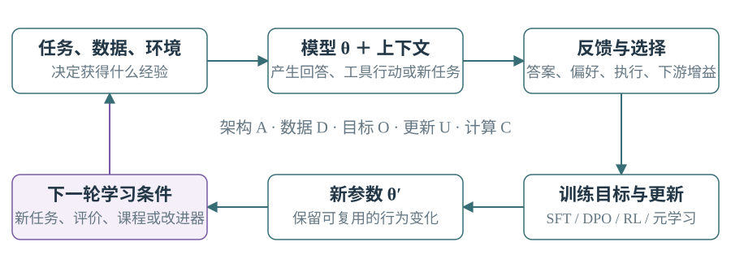
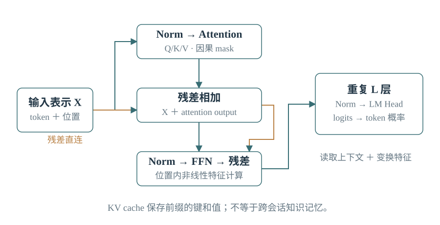
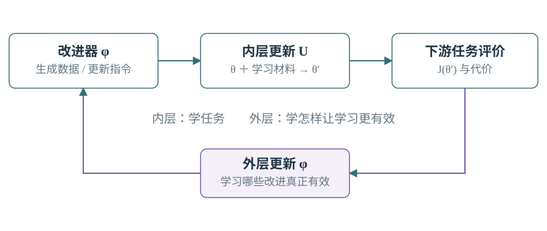
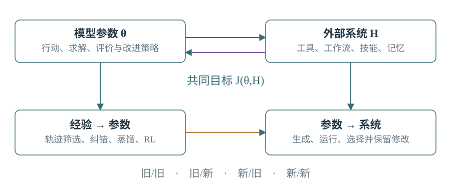
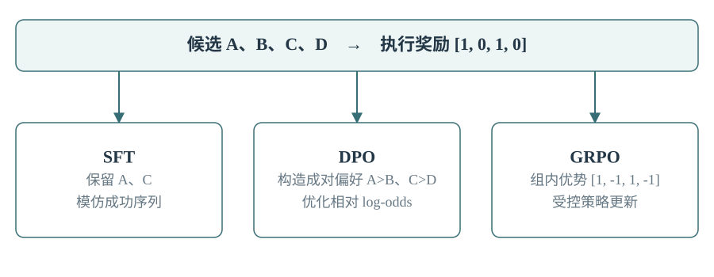

# Model / LLM：从原理到自我改进

[下载 PDF](Model_LLM_Learning_Manual.pdf) · [离线交互图谱](index.html#learn=00) · [项目首页](../README.md)

[00](#chapter-00) | [01](#chapter-01) | [02](#chapter-02) | [03](#chapter-03) | [04](#chapter-04) | [05](#chapter-05) | [06](#chapter-06) | [07](#chapter-07) | [08](#chapter-08) | [09](#chapter-09) | [10](#chapter-10) | [11](#chapter-11) | [12](#chapter-12) | [13](#chapter-13) | [14](#chapter-14) | [15](#chapter-15) | [16](#chapter-16) | [17](#chapter-17) | [18](#chapter-18) | [19](#chapter-19) | [20](#chapter-20) | [21](#chapter-21) | [22](#chapter-22) | [23](#chapter-23) | [24](#chapter-24) | [25](#chapter-25) | [26](#chapter-26) | [27](#chapter-27) | [28](#chapter-28) | [A](#chapter-A) | [B](#chapter-B) | [C](#chapter-C) | [D](#chapter-D)

<a id="chapter-00"></a>

## 00｜先建立一张能贯通全书的地图

本手册从模型计算讲到参数学习，再进入自训练、自博弈、课程、持续学习和模型—系统共同改进。目标是理解一项工作改变了什么、为什么有效，以及怎样据此设计训练。正文覆盖 61 个基础主题，并连接 RSI 图谱 Model 与 Model × Harness 的 19 个分支、95 个子项。附录提供中英术语、主题索引、分支对应和原始文献。

**全书只有一个持续追问：什么经验，经过什么反馈与更新，变成了什么可复用能力？** 模型可以生成答案、批评、任务、训练数据甚至更新方案；但这些输出要经过选择和学习，才会改变未来行为。研究差异主要来自这个闭环中不同的环节，而不是方法名字的多少。



先理解五个对象。**参数 θ** 是模型长期保留的数值；**上下文 c** 是这次调用能看到的信息；**外部系统 H** 是工具、记忆、工作流与执行程序；**数据 D** 是可以用来学习的样本；**反馈 r** 是好坏、正确性或学习收益。模型根据上下文产生行为，环境与评价器给反馈，更新规则把经验变成新参数或新系统。

$$
p_\theta(y\mid c,H),\quad D_k\leftarrow\mathrm{Experience}(\theta_k,H_k),\quad \theta_{k+1}=U(\theta_k,D_k)
$$

这里 k 是训练轮次，U 是更新程序。H 不一定直接进入神经网络，而是通过提示、工具结果、行动空间等改变模型所见的信息。若 H 也依据反馈更新，就出现参数与系统的相互适配。若更新后的模型参与生成下一轮更有价值的经验或更新方案，就形成自改进反馈。

| 阅读方式 | 顺序 | 读完应能做什么 |
|---|---|---|
| 第一遍建立骨架 | 01、02、03、08、09、11、13、22、26 | 解释模型怎样从经验改变行为，区分几种核心学习路线 |
| 第二遍掌握机制 | 顺读 04-21，并回看公式 | 看懂训练管线、反馈来源、评价器、课程和持续学习 |
| 第三遍进入设计 | 23-28，随后查附录 | 设计一次训练闭环，判断收益来自哪里，定位失败原因 |

阅读时每遇到一种方法，先用自己的话回答三句：它改变什么；它凭什么知道该怎样改；它把什么带到下一轮。公式用来精确这些答案，不需要先背符号。算例均是教学构造，不是实际大模型实验结果。

<a id="chapter-01"></a>

## 01｜Model、LLM 与 Harness 的准确边界

**模型（model）** 是一个带参数的计算映射。语言模型把上下文映射为后续 token 的概率，视觉编码器把图像映射为特征，奖励模型把回答映射为分数，世界模型预测行动后可能出现的状态。LLM 是大规模语言模型，是 Model 的一种，不等于一整个代理系统。

**Harness** 是组织模型使用方式的外部程序和状态：什么时候调用模型、给什么信息、调用什么工具、如何保存记忆、怎样重试或结束。**Runtime** 负责实际运行、进程、资源和执行状态；**environment** 提供观察、可用行动和行动后果。它们影响模型表现，但并非神经网络权重本身。

| 变化 | 直接改变的对象 | 跨下一次调用是否保留 |
|---|---|---|
| 在提示里补充一条经验 | 上下文 c | 只有再次装入上下文才保留作用 |
| 把经验写进可检索记忆 | 外部状态 H | 文件可持久；作用仍依赖检索与使用 |
| 对权重或 LoRA 做梯度更新 | 参数 θ | 保存并加载更新后的参数就能保留 |
| 改写工具、流程或提示组装器 | 外部程序 H | 取决于部署的新版本 |
| 同时训练策略并修订其工作流 | θ 与 H | 两个版本及其兼容关系共同保留 |

最常见的误解是把不同维度排成一列：预训练、SFT、RL、LoRA、自博弈、在线学习、评价器，并不是互斥路线。预训练是**阶段**；SFT、DPO、RL 是**目标或更新方式**；LoRA 是**可训练参数的参数化方式**；自博弈是**经验生成机制**；在线是**采集与更新的时间关系**；评价器是**功能角色**。一个系统完全可以在后训练阶段，用自博弈在线采样，以 GRPO 更新 LoRA 参数，兼任出题者和求解者。

| 维度 | 需要问的问题 |
|---|---|
| 学什么 | 哪些参数、适配器、模型模块会变？ |
| 从哪里学 | 人类语料、教师、自己生成、执行环境还是模拟器？ |
| 凭什么学 | 正确答案、偏好、奖励、过程标注还是下游增益？ |
| 如何学 | SFT、蒸馏、偏好优化、策略梯度还是外层搜索？ |
| 何时学 | 离线一次、反复在线、任务内适应还是跨任务持续学习？ |
| 谁在学 | actor、solver、judge、critic、proposer、curator 或 improver？ |

**AI4AI** 指 AI 帮助改进 AI，覆盖数据生成、训练设计、算法和系统优化。**自改进** 强调系统自身参与改进过程并保留结果。**递归自改进（RSI）** 进一步关注新版本怎样改变后续改进的能力或条件。它们的公开用法并不完全统一，阅读时应画出实际反馈路径；普通一次训练、一次蒸馏或固定 AI 帮忙清洗数据，并不单独证明多代递归改进。

<a id="chapter-02"></a>

## 02｜概率、表示与学习：只需要先懂这些数学

文本先被 tokenizer 切成 **token**，再映射为整数。token 可以是字、子词、标点或字节片段，不等于单词，也不必等于汉字。词表大小 V 决定可选 token 的数目；embedding 把每个整数查表变成 d 维向量。向量不是人工给定的语义定义，而是在训练中调整的表示。

**张量** 是多维数组。一个批次输入的隐藏状态常写成 B×T×d：B 条序列，每条 T 个位置，每个位置 d 个数。矩阵乘法把特征重新组合；非线性函数使多层模型能表达复杂关系；参数就是这些可调整的矩阵和向量。隐藏状态随输入变化，参数在一次普通推理中不变。

语言模型给出 logits，即每个候选 token 的未归一化分数。softmax 把它们变为非负且总和为 1 的概率。自回归生成用已经得到的前缀预测下一个 token，直到终止标记或预算用尽。

$$
p_i=\frac{e^{z_i}}{\sum_j e^{z_j}},\qquad p_\theta(y\mid x)=\prod_{t=1}^{T}p_\theta(y_t\mid x,y_{<t})
$$

**条件概率** 表达“在已知这些信息后，模型认为某输出多可能”；高概率不等于事实正确。模型可能对流行错误、训练数据中的偏见和熟悉措辞很自信。**期望** 是按概率加权的平均值；**方差** 衡量随机结果的波动。后面的随机采样和梯度估计都会用到这两个概念。

训练通常最小化正确 token 的负对数概率，即交叉熵。一个正确 token 从概率 0.1 提到 0.5，损失从约 2.303 降至 0.693；因此低概率的正确答案会形成明显的学习信号。对 logits 的导数是“预测概率减真实标签”，把错误方向转换为数值修正。

$$
L=-\log p_{y^*},\qquad \frac{\partial L}{\partial z_i}=p_i-\mathbf{1}[i=y^*],\qquad \theta' =\theta-\eta\nabla_\theta L
$$

η 是学习率，梯度指出损失上升最快的局部方向，减去梯度便作局部下降。**反向传播** 是利用链式法则计算每个参数对损失的影响，并非另一种目标。一次更新只利用局部信息，不保证找到全局最好模型；学习率、数据和参数化决定很多实际行为。

**熵 H(p)** 衡量一个分布有多分散；**KL 散度** 衡量用 q 近似 p 的差异，它有方向、非对称，不是距离。后面用 KL 约束新策略不要偏离参考策略过远。**困惑度** 是平均 token 交叉熵的指数；只适合在一致的 tokenizer、数据和计分方式下比较。

$$
H(p)=-\sum_i p_i\log p_i,\qquad D_{KL}(p\Vert q)=\sum_i p_i\log\frac{p_i}{q_i},\qquad \mathrm{PPL}=e^{L_{\mathrm{token}}}
$$

**泛化** 指对没用于训练的数据仍有效；**过拟合** 指适应了训练样本的细节，却不能迁移。训练集决定更新，验证集帮助选方案，测试集用于最后评估。测试答案若通过语料、检索、奖励或提示流回训练，测到的就可能是泄漏后的记忆，而非预期的泛化能力。

<a id="chapter-03"></a>

## 03｜Transformer：一次生成在网络内部怎样发生

设输入表示为 X。注意力先把它投影为 Q、K、V：query 表示当前位置要查找什么，key 表示各位置可被匹配的特征，value 是匹配后读取的信息。Q 与 K 的点积给出相关分数，经 softmax 归一化后，对 V 作加权求和。[1]

$$
Q=XW_Q,\quad K=XW_K,\quad V=XW_V,\quad A=\mathrm{softmax}(QK^\top/\sqrt{d_k}+M)V
$$

M 是 mask：在自回归模型中把未来位置的分数设为负无穷，使当前 token 看不到未来答案。除以平方根 d_k 是为控制点积分数随维度增长的尺度，减少 softmax 过度饱和。注意力权重是计算中的信息路由，不能直接当作一段回答的完整因果解释。

**多头注意力** 让不同投影并行读取不同关系，再拼接并投影回 d 维。**前馈网络（FFN/MLP）** 对每个位置做特征变换，常先扩大中间维度，再压回。两者分工可粗略理解为“跨位置交换信息”与“当前位置的非线性计算”，但都参与学习和表示。



**残差连接** 把子层输入直接加回输出，使深层网络有更直接的信息和梯度通道。**LayerNorm/RMSNorm** 调整激活尺度以改善优化；RMSNorm 使用均方根尺度，不作均值中心化。常见 pre-norm 结构先归一化再进入子层。**SwiGLU** 用可学习门控调节 FFN 通道；这些设计影响训练稳定性与计算效率，不改变“从反馈调整参数”的基本事实。[2]

没有位置信息，纯注意力难以区分 token 顺序。**RoPE** 对 query/key 的二维分量按位置旋转，使二者内积含有相对位置信息。它提供位置表示，并不自动赋予无限长上下文能力；超出训练长度时的频率、注意力分布和任务结构仍会改变。[3]

训练时有完整正确序列，可以在因果 mask 下同时计算所有位置的下一词损失；推理时未知的下一个 token 要先产生，后面的 token 才能使用它。**prefill** 处理已有提示，**decode** 逐 token 延续。**KV cache** 保存前缀各层的 K/V，避免每次重算。它是当前推理状态，通常不是跨会话的知识记忆。

**MHA** 每个 query head 有自己的 K/V；**MQA** 多个 query head 共享一组 K/V；**GQA** 按组共享，折中表示能力和缓存成本。它们主要改变注意力结构与推理资源需求，不是偏好学习或自训练算法。[4]

以单序列、L 层、T 个缓存 token、h 个 KV 头、每头 d_h 维、每数 b 字节计，普通 KV 缓存约为 2LThd_hb 字节。因子 2 来自 K 和 V。批量大小、分页、共享前缀与压缩会改变实际占用。长上下文昂贵，不只是因为输出慢，还因为缓存和注意力计算在增长。

<a id="chapter-04"></a>

## 04｜架构空间：哪些改变表示，哪些改变计算

**Decoder-only** 用因果注意力生成后续序列，适于开放生成。**Encoder-only** 常用双向上下文构造表示，例如 BERT 的掩码预测，适于理解、检索和分类。**Encoder-decoder** 先编码输入，再让解码器通过 cross-attention 读取输入表示，例如 T5。三者是信息流设计，不是能力等级。[7][8]

**Dense** 每个 token 使用大部分相同的参数。**MoE（混合专家）** 用 router 为每个 token 选择少数专家，通常替换部分 FFN。总参数决定存储规模，激活参数影响每个 token 的部分计算量，二者不能混用。专家不必对应人类命名的领域；路由负载不平衡会让少数专家拥塞或其他专家训练不足，跨设备专家通信也有代价。[5]

**SSM/循环状态模型** 把历史压缩进持续更新的状态。它减少保存完整历史的成本，但有限状态如何保留远处细节是核心问题。Mamba 让状态更新依输入变化，选择保留或忘记的信息。线性注意力、循环模型、SSM 与混合架构都是不同的记忆与计算折中；“对长度线性”不能单独推出在实际任务上更快或更强。[6]

**扩散语言模型** 学习从受损或被遮盖的序列恢复内容，多轮去噪可同时修订多个位置。LLaDA 展示了掩码扩散路线。它与自回归模型的生成过程不同：前者在多轮恢复中计算，后者沿 token 次序展开。比较时需要同时计算去噪轮数、生成长度、质量与延迟。[9]

**多模态** 的关键是把其他信号变成模型可用且语义对齐的表示。典型视觉语言路线是图像→视觉编码器→projector→语言模型；projector 把视觉特征接入语言模型的输入空间。可以先训练连接层，再对选定模块联合微调。LLaVA 是这类路线的代表。冻结编码器省资源，但上游漏掉的细节无法靠语言端凭空恢复。[10]

音频可用连续特征或离散 codec token；视频还需要时间关系；动作可以是文本工具调用、离散动作或连续控制向量。不同输出头对应不同损失与执行语义。“端到端”应说明梯度和训练目标覆盖了哪些模块；把多个预训练模块接在一起，可以构成一个完整系统，但其接口与联合适配仍需要训练。

| 设计选择 | 主要得到什么 | 主要付出什么 |
|---|---|---|
| 更深、更宽 | 更多计算与表示容量 | 算力、显存和优化难度 |
| MoE 稀疏专家 | 同等每 token 计算下增加部分参数容量 | 总存储、路由和通信复杂度 |
| 更长上下文 | 直接读取更多当前证据 | 注意力、缓存及数据训练成本 |
| 循环/SSM | 紧凑历史状态、不同长度扩展特性 | 历史压缩与精确检索的折中 |
| 多模态连接 | 获取文字之外的证据 | 对齐数据、编码器与时间/空间表示 |

选择架构要从任务的缺失信息和计算瓶颈出发。若模型看不到图像中的测量读数，仅增大文本模型可能没有用；若已经能稳定读出证据，错误却在长程行动，优先训练策略和状态使用方式通常更直接。

<a id="chapter-05"></a>

## 05｜预训练、数据与规模：能力从哪里开始

**预训练** 在大量语料上学习广泛表示和生成规律；**继续预训练** 从已有模型继续吸收新领域或新语言分布；**后训练** 使已有能力更适合任务、交互和偏好。**SFT** 常作为后训练的一部分，但自监督、监督和强化信号可以在不同阶段组合，阶段名称不唯一决定目标函数。

下一词预测的训练标签来自文本本身，所以叫自监督。预测好复杂语料需要学习句法、事实关联、程序模式和部分推理结构；这解释了为何一个简单局部目标可以产生广泛能力。与此同时，文本预测只约束可观察输出，不能保证模型已经形成完整、正确、可因果干预的世界模型。

数据的有效价值取决于真实性、覆盖、结构、重复和目标匹配。重复可强化模式，也会挤占新信息；低损失数据可能已经学会，高损失数据可能是噪声、陌生语言或不可解文本。清洗、去重、质量分层、语言/领域配比、时间划分和测试污染处理，都是在决定模型到底看见什么。

对常见稠密 Transformer，预训练算力有粗略估计 C≈6ND，N 为参数量，D 为训练 token 数；它忽略某些注意力、嵌入、通信和系统开销，也不应直接套在全部 MoE 与长上下文情形。用秒级吞吐测量再估算训练时间，比只报 GPU 峰值更可靠。[11]

$$
L(N,D)\approx L_\infty+aN^{-\alpha}+bD^{-\beta},\qquad C\approx6ND
$$

这是经验尺度关系的示意：固定训练预算时，增加参数会减少能训练的 token，二者存在折中。Chinchilla 研究了训练算力最优的分配；它不是普适的“每参数固定训练若干 token”自然定律。若模型要服务海量推理，较小模型训练更久可能降低总部署成本，最优点便会移动。[11]

**数据混合优化** 调整各领域采样权重；**课程** 随训练进展改变采样分布；**数据价值** 指对未来目标能力的贡献。DoReMi 用较小代理模型估计领域权重，再用于更大模型训练，说明不用等全尺寸训练结束才开始研究数据配方。但代理模型上的最优配比能否迁移，仍取决于尺度、目标与数据结构。[12]

**合成语料/改写语料** 可把难读内容变成多个更清楚的表达或练习，把已有知识展开成更容易学习的形式。关键是保留正确性与多样性，而不是让训练集统一成生成器喜欢的口吻。AI 辅助预训练还包括目标函数搜索、优化器搜索与训练系统协同设计；只有训练收益反过来改进这些组件，才构成对应的自改进闭环。

<a id="chapter-06"></a>

## 06｜优化器与训练配方：梯度怎样变成有效更新

每个训练 step 通常包含取样、前向计算、损失、反向传播和参数更新。**batch** 是一次用于估计梯度的样本集合；**epoch** 是按某一约定遍历数据一次；**step** 是一次优化器更新。流式或混合数据可能没有自然的“完整一遍”。应优先记录有效 token 数和实际更新数。

小批量梯度是总体梯度的带噪估计。增大 batch 通常减少采样噪声，但可能减少同样数据量内的更新次数，并增加内存。**梯度累积** 把多个 micro-batch 的梯度相加后再更新；有效 batch 等于每卡 micro-batch×累积次数×数据并行卡数，损失归一化需与它一致。

Adam 追踪梯度一阶矩 m 和平方梯度二阶矩 v，用历史方向与尺度调节各坐标更新。AdamW 把权重衰减从自适应梯度步骤中分离。下面省略了偏置修正的展开，帽子表示已经修正的一、二阶矩。[13]

$$
m_t=\beta_1m_{t-1}+(1-\beta_1)g_t,\quad v_t=\beta_2v_{t-1}+(1-\beta_2)g_t^2
$$
$$
\theta_{t+1}=(1-\eta_t\lambda)\theta_t-\eta_t\frac{\hat m_t}{\sqrt{\hat v_t}+\epsilon}
$$

β₁、β₂ 控制历史平滑程度；λ 控制衰减；ε 防止除数过小。权重衰减不等同于“删除不重要知识”；它通过参数约束影响优化与泛化。SGD、AdamW 和其他优化器的优劣依任务与资源而变，不能只凭单个 loss 下降得快就判断最终能力。

**学习率预热** 在训练早期逐步加大步长，避免不稳定的大跳变；**衰减** 后期减小步长，允许更细的调整；**梯度裁剪** 限制梯度范数，降低偶发巨大梯度的破坏；**dropout** 在训练时随机屏蔽部分激活，形成正则化。它们调节更新过程，不修复错误训练目标。

训练发散时先看真实因果：是数值溢出、错误 mask、坏数据、学习率过大、序列异常长，还是奖励尺度变化？loss 不降时也可能是标签错位、梯度没有流到目标参数或更新实际上没发生。优先排除这些明确原因，再考虑优化器和架构。

**损失加权** 定义什么更重要：对所有 token 平均、对每条序列平均、只算回答 token、按任务加权，会得到不同目标。长序列若被重复赋予相同的最终奖励，也会改变梯度与长度之间的关系。任何“改进训练配方”都应能说明它改了哪种样本或 token 的影响，而不只是报一组超参数。

<a id="chapter-07"></a>

## 07｜显存、并行与效率：能训练和能运行是两回事

推理主要占用模型权重、KV cache 和工作区；训练还要保存梯度、优化器状态、激活以及可能的高精度权重副本。以一种常见混合精度 AdamW 实现为例，BF16 权重 2 字节、梯度 2 字节、FP32 master weights 4 字节、两个 FP32 动量 8 字节，总计约 16 字节/参数，尚未含激活；具体实现可不同。

因此 7B 参数仅这些状态就约 112 GB，而 BF16 推理权重约 14 GB。二者都不是完整显存需求。不能从“能加载模型”直接推断“能全参数训练”，也不能只看 MoE 的激活参数估计全部权重存储。

**LoRA** 冻结原矩阵 W，只训练低秩增量 BA，B 为 d_out×r，A 为 r×d_in，r 远小于两个大维度。更新参数数目从 d_out d_in 降至 r(d_out+d_in)。它限制了更新的表示方式，可以用于 SFT、DPO 或 RL；不是一种独立学习信号。[14]

$$
W'=W+\frac{\alpha}{r}BA
$$

**QLoRA** 以低比特存储冻结主干，在运算时使用适当精度，并把梯度传给 LoRA。省下主要权重存储不等于所有中间计算都是 4-bit，也不消除激活和 rollout 的成本。量化通过减少数值精度降低内存/带宽；误差大小与分组、尺度、异常值和模型敏感性有关。[15]

| 工程方法 | 改了什么 | 需要注意的代价 |
|---|---|---|
| 数据并行 | 每卡处理不同样本，汇总梯度 | 参数复制与梯度通信 |
| 张量并行 | 把同一层的大矩阵分到多卡 | 层内高频通信 |
| 流水线并行 | 不同卡负责不同层 | 流水线空泡与调度 |
| 专家并行 | MoE 专家分布在不同卡 | token 路由和 all-to-all 通信 |
| ZeRO/FSDP | 分片优化器、梯度和/或参数状态 | 按需聚合与通信开销 |
| 激活重计算 | 少存激活，反向时重算 | 用额外计算交换显存 |

ZeRO 的不同阶段逐步分片优化器状态、梯度和参数；FSDP 采用全分片思路实现模型状态管理。**Sequence parallelism** 常指配合张量并行分摊部分沿序列的激活和运算；**context parallelism** 则把长上下文分片并交换注意力所需的信息，具体实现边界需看框架。**FlashAttention** 通过分块和优化内存读写精确计算注意力，重点是 IO，而不是把注意力公式改为近似。**PagedAttention** 重点管理动态 KV cache 的分页与共享。这些方法分别解决不同瓶颈。[16][17][18]

**训练 checkpoint** 是可恢复的状态快照：通常包含参数、优化器、学习率调度器、步数，以及复现实验所需的随机状态和数据位置；仅保存权重不能保证无缝继续同一训练。它与前述 **activation checkpointing（激活重计算）** 不同：后者是单次前后向内部的显存策略，不是保存模型版本。

**BF16/FP16/FP32** 是浮点表示，区别在有效精度和动态范围；某些训练还会使用 FP8。数值精度、量化和参数冻结是不同选择。预算最终应落到端到端时间：数据准备、生成轨迹、评价、训练、通信与评估。RL 中 rollout 很可能比反向传播更贵；加速训练核不一定缩短整轮周期。

<a id="chapter-08"></a>

## 08｜SFT 与蒸馏：从示范中学习行为

**SFT（监督微调）** 提供条件 x 和目标回答 y，让模型提高示范回答的概率。常见对话训练把 system、user 和历史工具结果作为条件，只在希望模型生成的 assistant token 上计损失；多轮数据可能对多个 assistant 回合计分。具体 mask 是训练设计的一部分，并非所有 SFT 都采用同一种规则。

$$
L_{\mathrm{SFT}}=-\frac{1}{\sum_t m_t}\sum_t m_t\log p_\theta(y_t\mid x,y_{<t})
$$

m_t 为计分 mask。模型 forward 需要看到上下文，不代表每个输入 token 都要成为监督目标。**Teacher forcing** 指训练时给正确前缀来预测下一个 token；部署时模型面对自己产生的前缀，错误会改变未来状态，这就是暴露偏差的一种来源。

SFT 告诉模型“遇到这种状态时，示范怎么做”，同时也可以传递知识和推理结构。预训练与 SFT 都可能优化交叉熵，区别主要在样本分布、条件结构、目标 mask 与训练目的。因此“预训练只学知识、SFT 只学格式”过于绝对；但少量示范通常也不能替代大量领域经验。

**蒸馏（distillation）** 是把教师的行为或分布传给学生。教师可以是大模型、模型集成、带搜索的系统，或同一模型在更强上下文/更多计算下的版本。序列蒸馏用教师答案做 SFT；logit 蒸馏让学生匹配教师每个候选 token 的概率；策略蒸馏匹配在状态下的行动分布。[19]

$$
L_{\mathrm{KD}}=T^2D_{KL}(p_{\mathrm{teacher}}^{(T)}\Vert p_{\mathrm{student}}^{(T)})
$$

T 是软化分布的温度，前面的 T² 是常见缩放约定。软标签不仅告诉学生首选答案，还保留其他答案的相对可能性。若只能调用教师文本接口，就可能没有 logits，只能做输出或轨迹层的蒸馏。不同 tokenizer 之间直接对齐 token 概率还需要额外处理。

**推理蒸馏** 学教师的中间推理；**过程蒸馏** 还可学搜索、工具调用与错误恢复。真正关键的是学生部署时能否得到训练时所用的条件。教师依赖工具获得一个隐藏测量值，学生若既没有工具也没看到数值，不能仅靠模仿就对任意新实例恢复它。

**On-policy 蒸馏** 让学生先进入自己会遇到的状态，再由教师提供局部纠正或分布监督；它针对“教师顺利轨迹与学生实际错误状态不匹配”的问题。DAgger 的经典思想是不断把学习者访问到的状态加入监督数据。教师标签可以来自另一模型，而状态仍来自学生策略。[36]

**自蒸馏** 不要求学生复制一个完全相同的样本分布。教师端可以增加搜索、检索、投票或更优上下文，再把更好结果压入同一架构。它能把昂贵推理转换为更便宜的常规行为；若教师与学生能力、信息、计算和样本分布都完全相同，则没有自动产生增益的理由。

<a id="chapter-09"></a>

## 09｜强化学习：从结果学习如何行动

监督学习给出希望模仿的动作，强化学习（RL）根据行动后果优化策略。**策略 πθ(a|s)** 给出状态 s 下动作 a 的概率；语言模型的 token 分布就是一种策略。**环境** 按行动改变状态并提供观察和奖励。一次从开始到结束的任务叫 episode，整条状态、动作与反馈序列叫 trajectory；生成这条轨迹的过程叫 rollout。

真实环境状态可能包含模型看不到的内容，因此代理通常面对 **POMDP（部分可观测决策过程）**。模型实际依据的是观察历史、当前提示和记忆形成的信息状态，不能总把“当前上下文”等同于完整的真实状态。网页隐藏字段、未检索文件和仪器内部状态都是例子。

| 量或角色 | 含义 | 直觉 |
|---|---|---|
| Reward r_t | 某时刻得到的反馈 | 这次得到多少分 |
| Return G_t | 未来奖励的折扣和 | 从这里往后总共得到多少 |
| V(s) | 按策略行动的期望回报 | 来到这里通常能得多少 |
| Q(s,a) | 在这里先做 a 的期望回报 | 做这一步通常能得多少 |
| Advantage A(s,a) | Q(s,a)-V(s) | 比这里的平均选择好多少 |
| Actor | 产生行动的策略 | 负责做 |
| Critic | 估计 value 的组件 | 预测未来回报 |

$$
G_t=\sum_{k\geq0}\gamma^k r_{t+k},\qquad A(s,a)=Q(s,a)-V(s)
$$

γ 是折扣因子。有限长度任务也常取 γ=1。文本里的“critic”有时指语言批评者，RL 中通常指价值估计器，两者不可只看名字混为一谈。RM 给输出打分，value critic 预测在当前策略下未来能得多少分；它们的输入、标签与用途可能完全不同。

策略梯度利用一个关键恒等式：对采样动作的 log-probability 求梯度，再按其回报加权，就能估计期望回报的上升方向。减去一个与当前动作无关的状态基线，可以降低方差而不改变理想期望梯度。

$$
\nabla_\theta J=\mathbb{E}\left[\sum_t\nabla_\theta\log\pi_\theta(a_t\mid s_t)\,A_t\right]
$$

上式写的是有限回合、γ=1 的形式；若优化折扣目标，还需相应的时间或访问分布权重。这不需要对“单元测试是否通过”本身求导。测试可能完全离散，学习信号仍能通过所采样行为的概率进入参数。**回报提供方向，概率梯度提供可调整的接口。** 实现时，估计得到的 advantage 通常在 actor loss 中停止梯度，不让 actor 趁机修改它的标签。

一个宏观工具调用由很多 token 构成。整段 log 概率等于各生成 token 的 log 概率之和，所以一个最终奖励可以影响整个行动序列。用户消息与环境返回并非策略采样动作，通常应从策略损失中 mask 掉；否则可能把“学会行动”混成“预测环境返回文本”。

**探索** 产生未尝试的行动；**利用** 重复当前看起来好的行动。熵奖励可鼓励分布保留一定多样性，温度也改变采样随机性，但盲目提高随机性不保证产生有价值探索。探索是否有效，取决于行动空间、反馈和任务结构。

<a id="chapter-10"></a>

## 10｜PPO、GRPO 与轨迹学习的实际计算

原始策略梯度在有限样本上更新过多，可能过拟合这些轨迹或改变策略太快。**PPO** 保存生成数据时的旧策略概率，用新旧概率比衡量变化，并截断部分有利于过大更新的目标项。注意：clip 是优化目标中的机制，不是对所有状态的策略变化施加严格硬约束。[20]

$$
\rho_t=\frac{\pi_\theta(a_t\mid s_t)}{\pi_{\mathrm{old}}(a_t\mid s_t)},\quad J_{\mathrm{clip}}=\mathbb{E}\left[\min(\rho_tA_t,\mathrm{clip}(\rho_t,1-\epsilon,1+\epsilon)A_t)\right]
$$

当 A>0、ρ 超过上界时，继续提高该动作概率不再增加这个 surrogate 项；当 A<0，过度压低概率也会被另一侧限制。负优势的符号必须保留，不能把目标误写成“所有 ratio 超出区间都直接截断”而丢掉 min 的结构。

PPO 常配一个 value critic 预测 V(s)，用 **GAE（广义优势估计）** 在偏差与方差之间折中。它把不同长度的时序差分残差按权重混合；短回报估计依赖 critic，长回报估计波动更大。

$$
\delta_t=r_t+\gamma V(s_{t+1})-V(s_t),\qquad \hat A_t=\sum_{l\geq0}(\gamma\lambda)^l\delta_{t+l}
$$

终止状态的后续 value 应按终止语义处理。PPO 的完整训练可能还包含 value loss、熵项和 KL 项；不同实现不能仅凭“PPO”一词认定它们完全相同。**old policy** 是采样时快照，**reference policy** 常是固定或缓慢变化的参照模型，它们承担不同职责。

**GRPO** 对同一问题采样 G 条回答，以组内奖励统计构造相对优势，再进行类似受控的策略更新，不需要传统的独立 value critic。用结果奖励时，可把同一条回答的归一化优势用于其生成 token。[21]

$$
\hat A_i=\frac{R_i-\overline{R}}{\mathrm{std}(R_1,\ldots,R_G)+\varepsilon}
$$

算例：四条回答奖励为 [1,0,1,0]，均值 0.5，以总体标准差 0.5 计，优势约为 [1,-1,1,-1]。若同题全为 0 或全为 1，组内相对奖励项便没有区分信号；其他正则项仍可能产生梯度。因此过难、过易或反馈过粗都会浪费相对学习机会。

GRPO 的标准差归一化会改变不同问题的权重，序列平均和 token 平均也会影响长度偏好；奖励裁剪、KL 形式、采样过滤和更新次数都是重要变体。**不用 value critic 不等于不用 reward model，更不等于自动有客观奖励。** GRPO 可以消费规则奖励，也可以消费学习出来的评价。

**Rollout 阶段** 通常不开完整反向图，保存 token、动作 mask、旧 logprob、奖励、终止信息及必要 value。**Training 阶段** 对保存的序列重新 forward，算新 logprob 和损失，再 backward/update。异步训练中数据生成模型可能落后；记录版本、控制陈旧程度或作适当修正，才能知道数据与当前策略的关系。

<a id="chapter-11"></a>

## 11｜偏好、奖励模型、DPO、RLHF 与 RLAIF

有唯一可检查答案时，可以直接用正确性；开放任务常只有“这两个回答谁更好”。**偏好数据** 为 (x,y⁺,y⁻)，分别是条件、被偏好回答和被拒绝回答。偏好可以综合清晰、事实、完整性与成本，也可能掺杂长度、口吻和身份偏差，所以评价准则需要对应真正目标。

**奖励模型 rφ(x,y)** 学一个实数分数。常用 Bradley-Terry 形式把分数差变为偏好概率，用成对交叉熵训练：

$$
P(y^+\succ y^-\mid x)=\sigma(r_\phi(x,y^+)-r_\phi(x,y^-)),\quad L_{RM}=-\log\sigma(r^+-r^-)
$$

分数只通过差值受约束，所以绝对的“8 分”没有天然物理意义。奖励尺度会影响策略更新强度。**RLHF** 常指人类偏好→奖励模型→策略 RL 的流程；广义语境也把 DPO 等人类反馈优化纳入其中。**RLAIF** 把某些人类反馈改由 AI 提供，改变的是反馈来源，并不指定优化器。[23]

希望最大化奖励，同时用 KL 限制相对参考模型的偏移，可写成下面的目标。假定能在所有分布中精确优化，其解是用奖励指数加权参考策略；神经网络训练只是对这个理想目标的近似。

$$
\max_\pi\;\mathbb{E}_{y\sim\pi}[r(x,y)]-\beta D_{KL}(\pi\Vert\pi_{ref}),\qquad \pi^*(y\mid x)\propto\pi_{ref}(y\mid x)e^{r(x,y)/\beta}
$$

**DPO** 用这个关系把隐式奖励写成策略与参考策略的 log 概率比，再代入偏好模型，直接优化策略，无需单独拟合一个显式 RM 或在每个梯度 step 做 RL rollout。[22]

$$
L_{DPO}=-\log\sigma\left(\beta\left[\log\frac{\pi_\theta(y^+\mid x)}{\pi_{ref}(y^+\mid x)}-\log\frac{\pi_\theta(y^-\mid x)}{\pi_{ref}(y^-\mid x)}\right]\right)
$$

所以 DPO 学的是**相对于参考策略的偏好 log-odds 差**，不只是“把好答案概率调大”。相对差变大，并不保证每个 preferred 回答的绝对概率都变大。原始推导依赖特定偏好与 KL 正则设定；有噪声、偏好冲突和分布偏移时仍需看数据与泛化。

固定偏好集上的 DPO 可离线训练；**迭代 DPO** 在各轮用新策略生成新回答、重新判断偏好再训练。因而“DPO 永远不在线”不准确；正确区分是：DPO 的训练损失不等于 PPO 的策略梯度，而数据收集可以在线刷新。

| 方法 | 需要的信号 | 主要做法 | 主要局限 |
|---|---|---|---|
| SFT | 好示范 | 模仿目标序列 | 学不到未覆盖状态的好行为 |
| Rejection FT | 可筛选的成功轨迹 | 留好样本再 SFT | 丢失失败的相对信息 |
| DPO | 正负偏好对 | 调整相对 log-odds | 偏好质量与数据覆盖决定方向 |
| PPO | 奖励与优势估计 | 受控策略梯度 | critic、采样与稳定性成本 |
| GRPO | 同题多样本奖励 | 组内相对策略更新 | 全同奖励、归一化与探索瓶颈 |

这些方法可以串联：先 SFT 建立格式和初始行为，再用 DPO 学开放偏好，或用 RL 学可验证任务。顺序取决于起点、目标和可用反馈，不存在对所有任务都最优的固定配方。

<a id="chapter-12"></a>

## 12｜推理、搜索与测试时计算：一次回答也有算法

**Greedy decoding** 每一步选最大概率 token；它不保证整段最优。**Temperature** 对 logits 除以 T，低温集中、高温分散。**Top-k** 只保留概率最高的 k 个候选；**top-p** 保留累计概率达到阈值的一组候选，再重归一化。它们改变采样分布，不更新权重。

**Chain-of-thought** 让模型输出中间推理轨迹，使计算可沿更多 token 展开。**Reasoning model** 是行为与训练方式的称呼，不必对应全新的主干架构；它可能通过推理示范、RL、验证反馈和推理预算形成更强搜索行为。DeepSeek-R1 是强化学习用于推理后训练的一个代表。[37]

**Self-consistency** 对同题采样多条推理，并对答案聚合；**best-of-N** 依评价器选择 N 个候选中的最好者；**beam search** 维持若干高概率前缀；**tree search/MCTS** 分支、评估、回传结果并分配后续搜索预算。概率高、票数多和真实正确是三个不同概念。[24]

在独立同分布且每次成功率都为 p 的理想近似下，k 次中至少一次成功的概率为 1-(1-p)^k。它说明多采样可能暴露模型已具备但不稳定的能力；真实样本常相关，且系统还需要识别哪个候选正确，不能把这个公式直接当性能保证。

**推理时计算扩展** 可以增加串行思考、并行候选或搜索深度。若任务错误来自缺失证据，单纯延长推理可能只产生更长的猜测；若模型能偶尔生成正确方案且可可靠选择，更多搜索就更有用。预算分配本身也可以被学习。

**Speculative decoding（推测解码）** 用便宜草稿模型提出若干 token，再由目标模型批量验证。采用正确的接受/拒绝与补采样规则时，可以保持目标模型的采样分布；并非“大模型判断草稿看起来不错就全部照收”。加速依赖接受率、批处理与模型成本比。[43]

**PTQ** 是训练后量化；**QAT** 在训练中模拟或纳入量化误差以适应低精度。**Pruning** 删去部分权重、通道或层；稀疏结构只有被硬件/内核利用才会带来实际加速。**Batching** 把多个请求合并计算，连续批处理动态加入和移除请求，通常提高吞吐，但吞吐与单请求延迟要分开看。

**Test-time training/adaptation** 在任务期间调整可学习参数或适应状态；**in-context learning** 通过上下文示例改变行为而不改持久权重。测试时计算不等于持久参数学习，但“只有反向传播才叫学习”也过窄：更新可由其他优化方法实现，TTT layers 还把可训练的小模型状态当作序列内隐状态。判断时明确对象、寿命与更新规则即可。[35]

<a id="chapter-13"></a>

## 13｜自生成数据与自训练：自己教自己为何可能有效

**Self-training** 让模型产生可学习的样本，再用这些样本更新参数。**Bootstrapping（自举）** 强调新能力帮助产生下一轮学习材料。这里没有要求每个原始输出都比模型更聪明：模型可以偶尔答对，通过筛选把概率较低的正确行为变得更常见。

如果从自身分布 pθ 无条件采样，在理想无限数据情况下又精确拟合同一个分布，固定点就是自己；没有天然的新方向。增益来自改变数据的选择条件、信息、计算或目标：执行器筛掉错误，多次搜索找到罕见成功，教师补充信息，任务覆盖扩展，或改写把已有知识变得更易学。

$$
q_k(y\mid x)\propto p_{\theta_k}(y\mid x)\,w(x,y),\qquad \theta_{k+1}\approx\arg\min_\theta D_{KL}(q_k\Vert p_\theta)
$$

w 是选择权重；例如正确答案取 1，错误取 0。这个表达把“先改善目标分布，再让模型拟合它”分开了。拟合后的模型能否泛化，取决于样本覆盖、容量与训练误差；筛选成功并不保证所有任务都受益。

**Rationale bootstrapping** 把推理链作为监督。STaR 先生成推理；答错时可给定正确答案重新构造理由，再将得到正确答案的推理用于训练。这个答案条件化步骤帮助获得示范，但也可能出现事后合理化，所以“最终答案正确”不等于每步理由可信。[25]

**Rejection fine-tuning（拒绝采样微调）** 采样、筛选、SFT；这里的 rejection 指丢弃不合格候选，不是安全拒答。ReST-EM 研究了依二值反馈筛选样本再反复微调的自训练方式。**Self-consistency filtering** 用多次答案的一致性做弱筛选，它只在错误相关性足够低、正确答案形成优势时更可靠。[26][24]

筛选器的质量可定量理解。假设原始样本正确率为 p，正确样本通过率为 a，错误样本通过率为 b，则通过筛选后的正确率为 pa/[pa+(1-p)b]。教学算例：p=0.2，a=0.9，b=0.1，筛后正确率约 69.2%；若 b=0.01，约 95.7%。筛选提高质量，同时减少数量，也可能把某些正确但陌生的解法系统性删掉。

**Replay/mixture** 把新成功经验、旧数据和稀有能力混合；去重防止某一种模板霸占训练。只保留容易生成和容易验证的答案，会逐渐缩窄分布。自蒸馏与自训练可以重叠：前者强调教师—学生知识传递，后者强调自身生成经验回流学习。

看一条自训练路线时，应找出“优于原分布的信号”究竟在哪儿。若只说模型反复输出、再模仿输出，而没有筛选、额外信息或计算优势，就缺少解释为什么会持续变强的机制。

<a id="chapter-14"></a>

## 14｜自批评与 AI 偏好反馈：把语言判断变成学习信号

模型可以根据一份 **rubric（评分准则）** 对回答指出具体不足，再 **critique-revise（批评—修订）**。批评只是语言反馈，还不是梯度。要进入参数，通常把修订后的回答作为 SFT 示例，或把旧/新回答形成偏好对，也可以训练 RM 后用 RL。

**Constitution（原则集）** 规定什么行为更符合目标；rubric 把它落实到可比较维度。例如科研解释可以要求：条件明确、论证有效、关键量定义清楚、证据与猜测分开。模型若只学会在文本里复述这些词，却不满足实际要求，表面遵循并不等于目标改善。

Constitutional AI 的监督阶段使用自批评和修订生成训练示范，强化阶段用 AI 偏好训练评价并改进策略。这体现了“反馈来源”和“更新算法”两条独立轴；同样的 AI 批评也可以接到其他学习程序。[23]

**Shared generator-judge** 让同一个模型通过不同提示兼任回答者和评价者。参数共享便于迁移和降低部署复杂度，但错误与偏好也容易相关。独立 judge 可以改变误差结构，却不因为模型名字不同就自动独立：相似训练数据和评价标准仍会产生相关盲点。

**Self-Rewarding LM** 研究模型以 LLM-as-a-Judge 方式提供自身偏好信号，并用迭代 DPO 更新；论文报告了回答与评价能力在其设置中的改善。应把“共享模型有多个角色”与“每个角色都获得了直接监督”分开，后者要看具体损失和数据。[27]

一个实用机制是：先生成差异足够明显的候选，评价者依据任务证据给出比较，去除无法判断或标准冲突的样本，再构造训练对。若每轮候选几乎相同，偏好噪声可能大于真实差异；若差异只是更长或更自信，模型会学这些捷径。

自批评最有价值的条件，是评价过程可访问生成过程未充分利用的信息，例如外部事实、运行结果、明确规则或独立反例。没有新依据的重复自我肯定，不会自动增加答案真实性。评价理由可以成为进一步检查的对象：它是否引用了真实证据、指出了实际错误，而不只与最终分数一致。

<a id="chapter-15"></a>

## 15｜可验证反馈：从“看起来对”走到可执行后果

**RLVR** 指使用可验证奖励的强化学习，描述反馈来源；PPO/GRPO 描述如何优化，两者可以组合。验证还可用于拒绝采样、数据标注、搜索选择和蒸馏，所以有 verifier 的训练不必都是 RL。

| 验证来源 | 实际判断什么 | 需要保留的边界 |
|---|---|---|
| 最终答案匹配 | 输出是否符合参考答案/等价规则 | 未必验证推理过程或全部等价写法 |
| 单元测试/程序执行 | 在所测试输入上行为是否正确 | 测试覆盖外仍可能错误 |
| 形式化内核 | 形式陈述的证明项是否被接受 | 自然语言目标是否被正确形式化 |
| 环境状态 | 指定任务条件是否达成 | 模拟器与真实环境可能不同 |
| 真实实验测量 | 在测量与控制条件下出现什么结果 | 噪声、干扰因素和实验设计 |

**Grounding** 是学习信号与外部任务事实的联系。可执行验证有力，是因为结果不只是评价者的文字偏好；但它仍由任务定义与检查器决定。代码通过几个弱测试、证明了一个被误写的命题、在模拟器漏洞里得高分，都说明奖励与真实目标存在缝隙。

**Outcome reward** 对最终结果计分；**process reward** 对中间步骤或局部进展给分。过程监督能缩短信用分配距离，但中间“合理”不保证最终正确。PRM 是过程奖励模型，ORM 是结果奖励模型；过程监督实验必须说明标签是人类判定、形式验证、回滚采样还是另一个模型生成。[28]

把每步“似乎不错”简单相加，会鼓励冗长甚至无用步骤。RL 中经典的 potential-based shaping 使用 r'=r+γΦ(s')-Φ(s)，在相应 MDP、终止与边界条件下有保持最优策略的性质；任意添加过程奖励并无这种保证。LLM 训练中还要考虑截断和动作粒度。

**Search-to-train** 先用搜索发现高质量解，再把成功轨迹转为 SFT、偏好或奖励训练。搜索承担发现，学习承担压缩与复用。模型更新后再搜索，若能发现更难解，就形成下一轮信号；若始终只重复已会的题，闭环会停在局部。

**Process credit** 要回答哪一步使成功更可能。一个直觉工具是保持前缀不变，比较不同下一步及其后续结果；这比仅因整段成功就平均奖励所有步骤更接近局部因果贡献。但反事实分支要额外采样，也受策略质量和环境随机性影响。

<a id="chapter-16"></a>

## 16｜评价器学习：Judge、Verifier 与 Critic 怎样分工

Judge 可以比较回答、打分并给理由；RM 把评价变成可用于优化的数值；verifier 检查性质或正确性；critic 预测策略未来回报。它们可以共用主干或独立，也可以有规则实现。**功能角色不决定参数实例，更不决定真值地位。**

**Discriminative RM** 直接输出分数或类别；**generative RM** 先生成评价分析、结论或结构化判定，再转换成奖励。后者可表达复杂准则并暴露理由，但生成更多文字并不天然提高正确率，且可能引入格式和长度偏差。

训练一个评价器，需要带有判定依据的样本：正确/错误对、偏好对、步骤标签、程序执行结果，或已知构造过程的对照输出。Self-Taught Evaluators 通过合成对照回答与判断理由迭代训练评价模型，展示了减少人工偏好标签的可能；合成标签如何获得可靠方向仍是机制核心。[29]

**生成—验证共训** 不是简单地同时开两个训练作业。生成器提供越来越难的样本，评价器学会识别新错误，更新后的评价又改变生成器。若两者只迎合彼此，可能形成一致但错误的闭环；需要有与原始任务事实相连的反馈，以及评价器没有见过的新错误类型。

**Meta-verification** 检查评价过程：理由中的证据是否存在、计算是否正确、评分准则是否被实际应用。它可以用执行器、另一评价器或有限人工标注。无穷增加 judge 层级不解决最后一层信号从哪里来的问题；应把复杂判断拆到能检查的证据上。

**Calibration（校准）** 关注概率陈述是否匹配频率：若一类样本都声称 80% 正确，长期约 80% 真的正确才算该组校准。它不同于排序能力与准确率；一个分数排序很好但数值虚高的模型，仍可能适合作排序，却不适合直接当成功概率。

$$
\mathrm{Brier}=\frac{1}{n}\sum_i(p_i-y_i)^2
$$

这是二值任务常用的概率误差指标。可验证任务可以给开放式 judge 提供部分校准锚点，但数学判定的校准不能自动迁移到文学、研究价值或实验设计。偏好、真实性、难度和未来学习价值最好按用途区分，避免一个总分包办所有判断。

<a id="chapter-17"></a>

## 17｜任务生成与自博弈：谁来决定模型下一次遇到什么

**Proposer** 创造任务，**solver** 求解；**challenger/opponent** 通过挑战或对抗暴露当前策略弱点。**自博弈** 让训练分布随对手或自己的能力改变，既可发生在游戏，也可发生在代码推理、攻防、证明与工具任务中。任务生成创造新题，课程选择则可只在已有题库里抽题，两者需要区分。

出题者若只奖励“让求解者答不出”，最容易的策略可能是制造无解、歧义或不可验证任务。若只奖励“求解成功”，又可能反复生成过易题。有效的出题奖励应同时考虑合法性、可验证性、对能力边界的针对性、多样性，以及学习后是否带来进步。

**Environment-grounded task generation** 先在环境里构造可执行条件、程序或状态，再提出任务。例如生成程序和合法输入，用执行器得到参考行为；求解者预测输出或重建某部分程序。验证从生成过程获得，降低凭空编答案的风险。

Absolute Zero 用代码执行器验证所生成的代码推理任务和答案，并把出题与解题放入学习闭环。其“zero data”指特定后训练设置不依赖外部人工题目数据，不能理解成基础模型从未经历预训练数据，或系统没有人类提供的环境和规则。[30]

**Learnability reward（可学习性反馈）** 衡量任务是否有望让学习者进步。它可以用当前成功率、组内差异或更新前后表现作代理，但这些代理并不等价。成功率 50% 的题可能只是随机噪声；完全失败的题也可能需要先补一个基础技能才能学会。

**Novelty** 是相对已见内容的新颖性；**diversity** 是覆盖差异；它们增加探索空间，却不保证价值。可以在语义、程序结构、解法和环境状态上去重，而不是只检查文字是否不同。多个历史对手、任务档案和混合采样有助于减轻循环性策略和“只会赢当前对手”的问题。

共享权重的 proposer/solver 可能互相迁移，也可能发生角色梯度冲突；独立模型可各自专门化，但多一个模型就多一份训练和协调成本。真正需要比较的是任务质量与下游学习收益，不是角色数量。

<a id="chapter-18"></a>

## 18｜课程与数据价值：为什么最难的题未必最值得学

课程是一种可变的训练分布 q_k(x)。它根据学习者能力、目标和预算决定下一批样本；目标是用有限资源获得更大的未来收益。固定从易到难是课程的一种特例，按能力缺口、领域覆盖和学习进展调整也属于课程。

**Competence frontier（能力边界）** 是当前模型已有一定基础、但仍不稳定的区域。**Learning progress** 是一段训练后表现改善的幅度。困难度是当前不会多少，学习价值是投入后能改善多少：二者往往相关，但绝不相同。

$$
v(x;\theta)\approx J_{\mathrm{target}}(U(\theta,x))-J_{\mathrm{target}}(\theta)
$$

这是数据价值的定义性示意，不是一个免费可计算的指标。真实测量要训练并在目标分布上比较；廉价代理包括损失、梯度、误差类型与历史进展。数据价值还依赖已学内容：先学微积分基础可能比继续堆困难证明更有用，且两类数据的价值并不简单可加。

**Bandit curator** 把领域或任务簇当作可选择的“臂”，以训练收益为反馈，平衡探索未充分尝试的区域和利用已知有效区域。学习者不断变强，臂的价值随时间变，因此这是非平稳决策。某轮收益很低，可能是该领域已学会，也可能是奖励延迟、训练不足或样本有问题。

**Difficulty/domain balancing** 要同时防止过易浪费、过难无信号、窄域过拟合和旧能力退化。**Active learning** 选择哪些样本值得额外标注；**data selection** 选择哪些现成样本用于训练；**curriculum** 组织它们随时间的次序与比例。三者可结合但不是同一个动作。

若用验证集收益训练课程控制器，验证集就参与了外层学习，不能再把它当最终未知测试。若每次都用“谁在训练上下降最快”来奖励课程，可能只偏好易拟合领域。最有用的课程信号应与目标能力相连，并明确投入成本。

一个具体判断：代码模型经常选错 API，不一定需要更多完整难题；先训练 API 发现、参数约束和执行错误修复，可能创造后续长任务的可学习性。课程的价值在于找到这种依赖，而不是机械地按题目长度排序。

<a id="chapter-19"></a>

## 19｜环境交互、长程信用与经验回放

**Agentic RL** 让模型在工具、网页、代码或物理/模拟环境里多步行动，再依任务结果训练。它比单轮问答多了一个关键因果关系：当前行动改变后续能看见什么、能做什么和会犯什么错。因此训练必须覆盖真实访问的状态，尤其是错误恢复状态。

**On-policy** 指数据相对于被优化策略来自它的采样分布；PPO 常用当前轮快照生成数据，并在有限次更新中使用它。**Off-policy** 指行为策略与目标策略不同。这个区分最严格地用于策略学习；SFT 可以消费任何合法监督数据，不应把“教师示范”一概当作某种 off-policy RL 算法。

**Online/offline** 描述是否在学习过程中继续采集新数据，与 on/off-policy 独立。每轮让外部教师生成新题新答案是 online，但动作不来自学生；持续使用学生的历史 replay 是在线系统中的旧策略数据；异步 rollout 还会存在不同程度的策略陈旧。

**Experience replay** 保留旧轨迹，提升利用率并保护稀有技能。直接把旧轨迹塞进 on-policy 梯度估计可能有偏；常见处理是限制旧数据比例、作重要性加权、使用适合离线数据的目标，或把成功轨迹作为 SFT 监督。**Relabeling** 重新计算奖励或目标，不是随意把失败改成成功；新的标签必须符合真实环境记录。

**长程信用分配** 的困难来自稀疏奖励与多步依赖：最终成功可能由早期一个关键检索决定，失败也可能由后来一次错误覆盖造成。value、GAE、过程奖励、子目标、反事实分支与轨迹排序分别提供不同分辨率的信号。更细的反馈只在足够准确时有用。

WebRL 将任务生成、结果奖励与策略训练组合，用失败经验推动课程更新，是环境经验进入参数学习的代表。它说明了一个一般机制：当前策略暴露的失败类型，可以直接改变下一轮训练任务。[31]

**World model** 预测行动后的观察、状态或奖励；**model-based RL** 用它规划或产生模拟轨迹，**model-free RL** 不要求显式学习这种转移模型。这里的“model-free”不等于没有神经网络，而是没有必需的显式环境模型。策略和世界模型可以共学：新交互改善模型，模型生成更有用的训练经验。

模拟会累积误差，策略也可能专门利用模拟器缺陷。真实交互用于校正，短模拟 rollout、模型不确定性和多环境覆盖可以改变这一风险。只把世界模型权重训练得更好，仍属于 Model 更新；只有外部环境程序或接口也被改写时，才同时涉及相应 Harness 演化。

**Harness coordination** 对模型而言是学会利用可见外部状态：何时检索记忆、调用哪种工具、怎样解释错误、何时保存中间结果。外部记忆“存在”与策略“学会使用它”是两件事，后者可以由工具示范和环境反馈训练。

<a id="chapter-20"></a>

## 20｜持续学习与测试时适应：怎样学新东西又保留旧能力

**Continual learning** 在任务流中反复学习，关心新任务收益、旧任务保留和长期适应速度。**Plasticity** 是继续改变的能力，**stability/retention** 是保留已有能力。**Catastrophic forgetting** 是顺序训练导致旧任务大幅退化；它与知识过时后的有意修订不同。

用局部一阶近似可以看清梯度干扰。新任务更新为 Δθ=-ηg_new，则旧任务损失变化约为 -η g_old·g_new。当两个梯度内积为负，这一步可能提高旧任务损失；内积为正则可能同时有利。该近似只描述局部，不是对长程训练的完整理论。

$$
\Delta L_{old}\approx-\eta\,g_{old}^{\top}g_{new}
$$

**Replay** 用旧样本重新施加约束；**regularization** 惩罚对重要参数或旧输出的过度偏移；**parameter isolation** 给任务分配适配器/模块；**distillation** 用旧模型输出维护行为；**consolidation** 把局部学到的能力整合进长期模型。EWC 用参数重要性加权约束，是正则化路线的经典例子。[34]

PEFT 是参数高效微调总称：LoRA、瓶颈 adapter、prefix tuning、soft prompt tuning、选层微调等。soft prompt 是可训练向量，不同于人手修改文本 prompt；prefix tuning 在模型内部添加可训练前缀表示。可训练参数少，常减少资源需求，但不会自动保证不遗忘。

**测试时适应** 可在当前任务的无标签输入、可验证结果或任务内反馈上更新。要说明更新谁、使用什么信号、何时重置。**Episodic reset** 每个任务从同一基础状态开始；**streaming adaptation** 沿任务流继承；**consolidation** 再把确认有用的局部变化保留。三者目标不同，不能把短期适应收益直接当作长期能力积累。

TTT layers 把快速学习的小模型作为序列状态；SEAL 则研究生成自编辑材料和更新指令，再进行适应。二者都涉及“测试时学习”，但所更新状态和外层训练机制不同。快速权重、激活状态、适配器和持久主干权重需要分别记录。[35][33]

**知识编辑** 旨在局部修改事实或关系；继续预训练吸收更广的分布；RAG 从外部取当前证据；长上下文在一次调用中呈现材料。选择取决于知识更新速度、可核验性、使用频率、隐私和计算成本，不是“所有知识都必须写入参数”。

学习新接口时，旧工具名、参数 schema 或返回结构可能变了。可以训练接口变体、使用局部适配器，再检查旧流程是否仍可执行。保存版本和适应起点，是为了能理解能力变化并恢复有效组合，不是用版本数量代替能力积累。

<a id="chapter-21"></a>

## 21｜元学习与学习到的改进器：优化“怎样学习”

普通训练优化任务损失；**meta-learning** 优化“经过一次学习过程之后的表现”。被优化的对象可以是初始参数、学习率、优化器、训练数据生成器、奖励设计者，或修改技能/工作流的策略。关键是反馈来自下游学习结果，而非是否写了一段漂亮的改进建议。

$$
\theta'=U(\theta,D_\phi),\qquad \phi^*=\arg\max_\phi J_{val}(\theta')
$$

θ 是学习者参数，φ 控制生成数据或更新方案，U 是内层学习过程，J_val 是内层更新后的外层目标。内层解决当前训练，外层选择怎样让内层更有效。这就是 **bilevel optimization（双层优化）** 的基本结构。

MAML 学一个初始参数，使它经少量任务数据的梯度更新后能在该任务的新数据上泛化。**Support set** 用于内层适应，**query set** 用于外层判断适应效果；若把两者混在一起，可能只学会快速拟合训练样本。[32]



若 U 可微，可通过展开更新、隐式微分或近似求外层梯度；若更新涉及离散文本、代码或不可微训练管线，可以用策略梯度、演化或黑箱搜索。完整展开很贵且梯度可能不稳定；代理任务便宜但会带来外层目标失配。

SEAL 让模型生成 **self-edit**：改写知识为训练材料，或给出数据增强与更新指令；执行内层微调后，用新模型的下游表现奖励这些自编辑行为。这解释了“学习怎样让自己学得更好”的具体含义，而不仅是自我反思。[33]

**Synthetic-data generator training** 奖励数据对学生的训练增益；**reward designer training** 奖励所设计奖励真正提高目标任务表现；**skill/harness curator training** 奖励整理后的技能与系统让后续执行更好。执行模型可冻结，而改进器仍在训练；因此“solver 没更新”不等于整个系统没有 Model 学习。

**Learned optimizer/objective search** 可以学习梯度到更新的映射，或搜索损失函数。**Training systems co-design** 同时考虑模型、数据、内核与调度：更低的每步损失但一轮慢十倍，未必更划算；更快的 rollout 若使策略陈旧严重，也可能损害训练效率。

外层奖励最好反映可迁移的实际收益，并扣除重要成本。若只奖励内层训练 loss 降低，改进器可生成重复容易样本；若只奖励某个固定验证集，会过拟合那套题。要学的是能改善新任务学习的方法，因此外层任务多样性与独立目标分布是定义的一部分。

<a id="chapter-22"></a>

## 22｜Model × Harness：九种耦合怎样进入参数学习

你熟悉外部系统，因此这里仅解释耦合带来的模型问题。令 J(θ,H) 为模型参数和外部系统组合后的表现。改变 H 会改变模型所见的状态与可用动作，训练 θ 又会改变最适合的 H。这是联合设计的原因；单向传递、交替更新和持续共演具有不同的反馈结构。

**① 工作流与策略共同适配。** 规划/执行分工、工具调用与错误恢复流程改变后，旧轨迹分布不一定仍匹配。可固定工作流训练模型，再固定模型改流程，也可用共同目标安排交替更新。每一轮都应在实际接口下采集经验，否则是在让新模型模仿旧世界。

**② 外部经验进入参数。** 复杂搜索、教师纠错、技能提示和工具支持产生轨迹，SFT/RL/蒸馏把这些经验转成可复用行为。**技能条件自蒸馏** 用带技能提示的模型教简化条件下的模型；**动作空间编译** 将复杂流程转成部署端可用的行动序列。移除外部支持后再看能力，才能判断哪些行为被内化。

**③ 模型能力用于系统改写。** 更新后的模型设计工作流、通信结构、工具、环境包装、训练程序和分析工具；将成功修改继承到下一轮。解题能力增强不必然提升这种设计能力，可以单独用“提出修改→运行→取得下游收益”的数据训练改进器。

**④ 技能、记忆与策略共演。** 外部库保存可执行程序或自然语言技能；参数学习负责检索、调用、写入、更新、删除与适用条件判断。将一段轨迹抽象为“何时适用、做什么、何时失败”的技能，再训练选择策略，比无限堆积记录更接近可迁移能力。库的内容与使用库的策略各自可以更新。

**⑤ 任务、环境与学习共同变化。** 模型的失败影响任务和探索分布；环境包装改变观察、行动与任务组合。图谱中的 Stage/Contract/Chain 可按阶段、接口契约、任务链理解，它们不是所有论文通用的统一算法名称。改变环境难度可以提供课程，但应保留任务语义与验证条件；世界模型模拟再与真实交互相互校正。

**⑥ 奖励、评价与策略互相影响。** 策略产生难例推动 RM 更新，也可以推动外部评价代码/工具/skills 修订。前者改变参数，后者改变程序；二者都影响过程奖励和结果奖励。偏好例与环境真值提供不同信息，应避免策略—评价器一起漂向与任务目标无关的方向。

**⑦ 训练器与学习系统共同优化。** 参数训练的结果用于修改训练配方、优化器、样本过滤、rollout 调度、奖励形状与训练目标；分析工具和研究记忆保留有效经验，实验分支可选择、合并和复用。固定研究 LLM 帮忙训练目标模型属于 AI4AI；若研究过程本身也被改进并继承，才多出对应的系统演化。

**⑧ 组织结构与角色能力共同学习。** 角色可共享权重并通过角色条件特化，也可用异构模型和专家路由。层次化委派、信息交接、协作轨迹和联合训练决定各角色见到什么信号；预算分配与组织重构改变行动成本。协作总奖励很难定位每个角色贡献，需处理多智能体信用分配和相互变化的策略分布。

**⑨ 部署变化与再适配。** 工具 schema、动作空间、skills/hooks/prompt 变体或模型版本改变后，训练与部署条件可能失配。可通过接口变体训练、跨模型适配或测试时局部学习恢复能力。版本兼容与长期回退服务于保留有效组合；跨模型搬用同一个 Harness 并不保证行为不变。



要判断增益来自模型、系统还是匹配，可比较旧模型/旧系统、旧模型/新系统、新模型/旧系统、新模型/新系统四种组合。只有新/新有效，说明存在强适配效应；新模型换回旧系统仍有收益，说明至少部分能力已写入参数。四组合比较还需使用相同任务和可比预算。

<a id="chapter-23"></a>

## 23｜测评：究竟知道了什么，仍没知道什么

**Benchmark** 是任务集与协议；**metric** 是分数定义；**evaluator** 是判定过程或主体；**verifier** 是检查特定性质的实现。一个 benchmark 可以同时用可执行测试和 LLM judge；相同任务集换提示、预算、工具或判定器后，往往已不是完全相同的比较。

| 所测对象 | 常见量 | 能说明什么 |
|---|---|---|
| 语言分布拟合 | token loss、perplexity | 在给定分布上预测文本的能力 |
| 事实与知识 | accuracy、事实核验率 | 按指定证据和答案规则作答的能力 |
| 推理与代码 | 解题率、pass@1、pass@k | 指定采样与验证条件下的成功概率 |
| 交互代理 | 成功率、回报、步骤、成本 | 在给定环境和 Harness 下完成任务 |
| 偏好与表达 | 成对胜率、分维评分 | 评价规则所衡量的输出偏好 |
| 持续学习 | 新任务收益、旧任务保留、迁移 | 参数沿任务流演化的效果 |

**Pass@1** 通常表示一次采样通过的概率；估计时可以用多个样本的平均成功率。**Pass@k** 关心 k 个候选里至少一个通过，通常不要求系统自己选出那个正确候选。**Best-of-k success** 还包括选择器，可能明显低于 oracle pass@k。

若同题共采 n 次，其中 c 个通过，常用无偏估计为 1-C(n-c,k)/C(n,k)，要求 n≥k；c 的来源、采样温度与独立性假设需一致。不能把采样 100 次中挑出的最佳结果与另一模型一次输出直接称为同预算能力比较。

**ID** 是训练分布附近测试；**OOD** 是领域、格式、难度、时间或环境发生变化。OOD 不是一个统一难度等级；换一种措辞与换一种数学结构，是不同迁移。**Robustness** 关注合理扰动下性能稳定性；**calibration** 关注概率与频率；二者也不等于准确率。

**Ablation（消融）** 控制其他条件后去掉某个组件，判断其作用。若去掉组件同时少用一半计算，结果包含机制与预算两个变化。**Causal attribution** 要考虑数据量、参数量、推理预算、采样方式和评价器是否同步改变；对关键差异做有针对性的对照即可。

抽样误差会让小提升不稳定。n 个近似独立二值任务、成功率 p 的标准误差约为 sqrt[p(1-p)/n]；同一套题的两模型比较宜看配对差异。训练种子、任务异质性和多次方案选择还会增加不确定性，不能只用这个简单公式包办。

**Contamination** 不只来自原题进入预训练，还可能来自题解、近重复版本、检索结果、选择规则和测试反馈反复用于修改。测试题进入外层课程奖励后，它就是训练资源。任务相关事实可以正常使用，测试答案和选择反馈是否被提前获得，则要按照评测目标界定。

评价自改进还要比较固定预算下不同代的表现、改进器产生有效修改的能力，以及新任务上的收益。有限轮次上升说明在那些条件下发生了改进；持续开放式进步是更强的主张，需要不同的长期证据。

<a id="chapter-24"></a>

## 24｜模型设计：六个轴怎样共同决定能力

可以把一次研发描述为架构 A、参数 θ、数据 D、目标 O、更新程序 U、训练计算 C，再加部署时推理算法 I 和评价目标 J。能力不是 θ 的单个数字属性，而是这个模型在指定输入、资源与环境中表现出来的行为。

$$
\theta'=U(A,\theta,D,O,C),\qquad \mathrm{Performance}=J(A,\theta',I,H)
$$

因此设计顺序应从目标与失败原因开始：模型缺信息、缺表示、缺行为示范、缺探索、缺可靠反馈，还是已经会做却计算太贵？这些瓶颈分别对应不同干预，不能都归结为“再做一次 RL”或“再增大参数”。

| 目标变化 | 优先考虑的机制 | 为什么 |
|---|---|---|
| 大量新领域文本与术语 | 继续预训练、领域数据混合 | 直接改变长期接触的数据分布 |
| 已有知识但不会按任务工作 | SFT、过程/工具示范 | 给出希望采用的行为条件与轨迹 |
| 候选都能生成但选择偏差 | 偏好学习、奖励优化、选择器 | 强化更符合目标的输出 |
| 偶尔成功但不稳定 | 验证筛选、RL、搜索后训练 | 把罕见成功变成更常见策略 |
| 长程交互总在错误后崩溃 | on-policy 纠错、环境 RL | 学习实际访问的失败与恢复状态 |
| 模型无法获得关键证据 | 多模态输入、检索、工具接口 | 先提供可用信息，再训练利用方式 |
| 固定能力推理太贵 | 蒸馏、量化、缓存、调度、推测解码 | 减少部署计算、存储或等待 |

这些是因果起点，不是一一对应定律。SFT 也能学知识，预训练也能形成行为，RL 也可改变表达和事实选择。架构提供归纳偏置与计算资源，数据规定经验，目标规定方向，优化决定能否到达，推理决定部署时如何使用。

**Inductive bias（归纳偏置）** 是模型和算法对什么模式更容易学习的倾向：注意力擅长按内容读上下文，循环状态偏向压缩历史，卷积偏向局部平移结构。它不保证真实世界恰好符合该结构。**Capacity** 是可表达和可学习模式的能力范围，不是“有多少参数就知道多少事实”。

设计里的关键取舍包括：容量与训练充分度，数据多样性与目标聚焦，稳定与可塑，探索与利用，质量与成本，外部可更新证据与参数内化。可比较方案的 Pareto frontier（帕累托前沿）表示在一个目标上再改善，就不能不牺牲另一个目标的非支配方案集合；它帮助避免用单一总分抹去真实代价。

<a id="chapter-25"></a>

## 25｜贯穿算例：同一批回答怎样进入三种训练

设任务是编写一个处理整数列表的函数，训练环境提供输入输出规范、独立测试与运行时间约束。以下数量均为教学构造。当前模型对同一训练任务生成四个候选：A 正确且简洁，B 错误，C 正确但较慢，D 语法错误。验证奖励为 [1,0,1,0]，这是结果反馈；若另加速度奖励，目标已经变了。

**SFT 路径。** 保留 A、C，以问题为条件，以其代码为目标，mask 掉用户与测试返回。模型学“这些成功代码怎样写”。若只选 A，则把正确性和效率偏好共同带入了筛选。没有负样本对比，不代表其他答案概率完全不变；softmax 归一化会让概率重新分配。

**DPO 路径。** 若依据明确规则得到 A>B、C>D，构造两组偏好对。它提高好答案相对于坏答案的 log-odds，参考模型限制比较的基准。A 与 C 都正确，要不要加 A>C，取决于是否确实希望优化效率，以及慢多少才重要。

**GRPO 路径。** 四个奖励得到相对优势 [1,-1,1,-1]，在保存的旧概率与动作 mask 上计算策略目标。两个成功样本都被相对强化；仅此奖励不能区分 A 与 C 的速度。如果四个全错，组内优势没有正确性差异，需要更可学的题、更多探索或更好的初始化，而不是凭空增强某个错误答案。



再看一个只有“成功/失败”两种动作的标量模型。令成功概率 p=σ(z)=0.4。成功示范的 SFT 损失为 -log p，对 z 的梯度是 p-1=-0.6。若 η=0.1，则 z 增加 0.06，p 从 0.4 增到约 0.4145。这个最小例子展示了梯度怎样提高目标行为概率。

若用奖励 R(成功)=1、R(失败)=0 的 RL，期望奖励 J=p，因此 dJ/dz=p(1-p)=0.24。期望策略梯度提升 z；但有限采样会有波动，且只有一个失败样本时原始回报项可能为零。一个准确基线可以减方差，却不会替系统创造未获得的成功证据。

在完整闭环中，先从训练任务池生成候选并验证，再训练候选模型；独立验证集选择训练方案，最终未知测试评估泛化。下一轮用新模型重新采样，课程依据训练侧失败调整。重要的是让新参数真正参与下一轮经验生成，而不是一直使用旧缓存却称作新的自改进循环。

```text
for round in rounds:
    tasks = curriculum.sample(training_pool)
    traces = rollout(snapshot(policy), tasks)
    feedback = verifier.evaluate(traces)
    training_data = build_targets(traces, feedback, replay)
    candidate = update(policy, training_data, chosen_objective)
    policy = select_with_validation(policy, candidate)
    replay, curriculum = revise_from_training_experience(...)
```

这里 select_with_validation 是可选的版本选择策略，不是所有训练必需的一环；若不断据此选择，最终评估仍需独立测试。伪代码省略并行与梯度细节，重点是数据从哪里来、以什么身份进入每个目标。

<a id="chapter-26"></a>

## 26｜为什么闭环会停滞：从现象找到可改变的原因

自改进不会因为有一个环就持续增益。有效循环至少要持续提供有方向的信号、可获得的有用经验和能保留迁移的更新。三个环节中任何一个枯竭，反复运行同一程序都可能只消耗更多计算。

| 现象 | 可能的机制 | 对应改变什么 |
|---|---|---|
| 训练奖励升，真实成功率降 | 奖励漏洞、评价偏差、分布过拟合 | 修正反馈与任务覆盖，分析具体失败 |
| 多采样也几乎全错 | 缺前置能力、任务过难、搜索空间失配 | 补示范/知识、构造中间课程、换表示 |
| 所有候选越来越像 | 熵下降、筛选过窄、重复数据积累 | 改善探索与数据多样性，而非只加样本数 |
| 新任务好，旧任务差 | 梯度干扰、训练配比失衡 | replay、正则、模块隔离或整合 |
| judge 和 solver 一起自信 | 相关盲点与自我强化偏差 | 引入任务证据、难负例与独立判断条件 |
| 教师轨迹学不会部署动作 | 状态分布或接口不匹配 | 学生状态上的纠正，重新编译动作空间 |
| loss 降了但能力不变 | 优化了无关 token 或容易模板 | 重新检查 mask、目标和数据价值 |

**Reward hacking** 指利用奖励与真实目标的差异取得高分；**Goodhart 效应** 指指标被强力优化后可能不再是好代理。二者不是“RL 必然失败”的定理，而是解释为何奖励必须与任务后果相连。**Model collapse** 则关注生成数据反复回流时可能丢失分布尾部或放大误差；结果取决于新数据、筛选、混合与采样条件，不能推成“合成数据一定有害”。[42]

对一个提升，应先问最能改变判断的问题：是增加了正确行为的出现率，还是只提高了选择器？是迁移到新任务，还是更熟悉原题？是同样成本更好，还是多用很多搜索？是学习器本身变好，还是评价标准变宽？答案决定下一步投入在哪里。

研究品味体现为找到高影响变量：改变信息可达性、任务表示、反馈可靠性、学习信号的归因粒度、经验覆盖、更新可塑性，往往比微调一串互不解释的超参数更有意义。但如果根本瓶颈是明显的实现错误，先修正它就是最有价值的工作。

<a id="chapter-27"></a>

## 27｜表示、因果与模型理解：哪些结论能从行为推出

模型把输入编码成隐藏表示，某些信息可以从这些表示中被读出。**Probe（探针）** 用一个额外模型预测某个属性，回答“这里是否包含可解码的信息”；它不能单独证明原模型真的依赖这条信息完成任务。容量过大的 probe 还可能自己学会目标。[39]

**Ablation、activation patching 与干预** 主动移除或替换一部分激活、头或模块，观察输出变化，更接近“这个计算环节是否起作用”。但干预可能把模型推到不自然状态，也可能影响许多因素；一个局部电路解释不一定覆盖全部输入与行为。[40]

**Attention map** 展示某层的信息混合权重，**文本推理链** 展示模型输出的中间说明，二者都不能直接等同于完整内部因果机制。外显推理可以帮助解决任务，也可能省略内部信息或给出事后理由；解释忠实性需要单独研究。[41]

**Causal learning** 要区分观察到的相关关系和行动造成的结果。大量文本能描述因果知识，但只依观察分布不能普遍识别所有因果结构。环境干预、实验、对照和结构假设提供额外信息；world model 的预测准确度也不自动保证干预预测准确。

**不确定性** 可来自世界本身的随机性（aleatoric）与模型缺知识（epistemic）。重复采样的分散度混合了采样机制、表达差异和模型信念，不能直接当真实认知不确定性。校准、模型分歧、证据覆盖和可执行验证各提供不同视角。

**Hallucination** 常指输出缺乏依据或与事实不符。成因包括缺信息、数据错误、错误关联、解码选择和目标偏好。把回答训练得更流畅不解决事实来源；让模型学会检索、核对、表达条件和在证据不足时避免编造，改变的是信息与行为机制。

理解模型的价值在于能预测“改什么会改变什么”，并找到更好的训练与设计。只给隐藏状态起一个漂亮名字、或只凭模型自述判断它有某种内部能力，都不足以建立这种解释。

<a id="chapter-28"></a>

## 28｜把知识变成可用的直觉

读完后，不必背所有缩写；尝试独立推演下面的问题，再看给出的解释。如果能说清条件变化会怎样改变学习，说明你已开始掌握方法，而不是只识别名词。

**问题一：GRPO 是否必须用数学答案奖励？** 不必须。它需要同题候选的可比较奖励，反馈可来自执行器或 RM；“可验证”由反馈来源决定。规则奖励让学习更接近任务真值的程度，还取决于检查器是否正确与充分。

**问题二：为什么一个较弱模型能从自己生成的数据变强？** 因为原分布中可能已有少量正确行为。搜索、筛选、外部反馈和数据重组可以得到比原始分布更好的学习目标，再把它压入参数；不需要假定每条生成都比模型本身更强。

**问题三：模型做了十次反思但权重没变，是不是没有任何学习？** 它可能发生上下文适应或积累了外部经验，但尚不能据此声称持久参数学习。若反思被训练进参数或转成下次复用的技能，才出现相应持久变化。需要说清“学习”所指的状态。

**问题四：把 70B 教师的答案交给 7B 学生，学生能否完全复制？** 取决于学生容量、数据覆盖、训练预算和部署信息。简单任务可以压缩很多教师计算；若教师有学生无法获得的证据或需要更大计算能力，有限示范不能保证复制全部能力。

**问题五：测试时增加搜索后准确率提高，模型参数是否更强？** 参数可能完全没变；增强的是部署算法下的系统表现。若把搜索结果回流训练，再在相同推理预算下提高表现，才有证据支持参数能力改善。

**问题六：训练样本都正确，为什么仍可能越训越差？** 正确样本可能覆盖过窄、重复严重、丢掉旧能力，或所教行为与部署状态不匹配。正确性是样本质量的一部分，不等于整个训练分布适当。

**问题七：出题者是不是越能难倒 solver 越好？** 不。无解和含糊任务也能难倒它。好的出题机制产生合法、可反馈、有学习空间且服务目标能力的任务，必要时还要奖励训练后的实际进展。

**问题八：同一模型既解题又评价，是否构成循环论证？** 共享角色本身不构成逻辑错误；问题是评价依据是否独立于想要证明的结论。执行结果、正确答案与可检查证据可以提供约束；纯粹互相肯定则不能保证方向。


<a id="chapter-A"></a>

## A｜中英术语速查

这里提供检索入口；完整原理与条件在对应章，避免把同一解释重复写多遍。表中的章号也可通过 HTML 目录进入。

| 英文 | 中文 | 一句话定位 | 章 |
|---|---|---|---|
| Token / Token ID | 词元 / 词元编号 | 文本编码的离散单位与整数标识 | 02 |
| Vocabulary | 词表 | token 的可选集合 | 02 |
| Tokenizer / BPE | 分词器 / 字节对编码 | 按子词或字节规则编码文本；BPE 逐步合并常见符号对 | 02 |
| Embedding | 嵌入 | 把离散 ID 查表变成连续向量 | 02 |
| Tensor / Shape | 张量 / 形状 | 多维数组及各维长度 | 02 |
| Parameter / Weight | 参数 / 权重 | 训练中可被优化、保存的数值 | 01-02 |
| Activation / Hidden state | 激活 / 隐藏状态 | 当前输入下的中间计算表示 | 02-03 |
| Logits / LM head | 分数 / 语言模型输出头 | 把隐藏状态投影到词表分数 | 02-03 |
| Softmax / Sigmoid | 概率归一化 / S 形函数 | 前者形成多类分布；后者把实数映射到 0-1 | 02、11 |
| Context / Context window | 上下文 / 上下文窗口 | 当前可用输入；支持的序列范围，实际还受资源与实现限制 | 02-03 |
| Conditional probability | 条件概率 | 给定上下文后的输出概率 | 02 |
| Expectation / Variance | 期望 / 方差 | 概率加权平均 / 随机波动程度 | 02 |
| Entropy / KL divergence | 熵 / KL 散度 | 分布分散程度 / 两分布的有向差异 | 02、11 |
| Cross-entropy / NLL | 交叉熵 / 负对数似然 | 以目标的负 log 概率衡量预测误差 | 02、08 |
| Perplexity | 困惑度 | 平均 token 损失的指数 | 02、23 |
| Forward / Backward | 前向 / 反向 | 算输出 / 用链式法则算梯度 | 02、06 |
| Gradient / Learning rate | 梯度 / 学习率 | 局部损失变化方向 / 更新步长 | 02、06 |
| Backpropagation | 反向传播 | 高效计算复合函数参数梯度 | 02 |
| Generalization / Overfitting | 泛化 / 过拟合 | 迁移到未见样本 / 过度适应训练细节 | 02、23 |
| Self-attention / Cross-attention | 自注意力 / 交叉注意力 | 同一序列内部读取 / 从另一输入表示读取 | 03-04 |
| Query / Key / Value | 查询 / 键 / 值 | 匹配需求、被匹配特征、读取内容 | 03 |
| Causal mask / Loss mask | 因果遮罩 / 损失遮罩 | 限制看未来 / 指定哪些 token 计损失 | 03、08 |
| Multi-head attention | 多头注意力 | 并行学习多组信息读取投影 | 03 |
| MHA / MQA / GQA | 多头 / 多查询 / 分组查询 | K/V 头不共享、全共享或分组共享 | 03 |
| MLP / FFN / SwiGLU | 多层感知机 / 前馈网络 / 门控激活 | 位置内非线性计算及一种门控形式 | 03 |
| Residual / Normalization | 残差 / 归一化 | 输入加回输出 / 调整激活尺度 | 03 |
| LayerNorm / RMSNorm | 层归一化 / 均方根归一化 | 前者中心化并缩放；后者使用均方根尺度 | 03 |
| RoPE | 旋转位置编码 | 旋转 Q/K 分量使匹配含相对位置关系 | 03 |
| Autoregressive | 自回归 | 依前缀逐步生成后续 token | 02-03 |
| Encoder / Decoder | 编码器 / 解码器 | 构造输入表示 / 条件生成输出 | 04 |
| Dense / MoE | 稠密 / 混合专家 | 广泛使用相同参数 / 条件选择专家 | 04 |
| Expert / Router / Top-k routing | 专家 / 路由器 / 选 k 专家 | 子网络、选择机制与稀疏激活规则 | 04 |
| Total / Active parameters | 总参数 / 激活参数 | 全部存储参数 / 单次 token 路径参与的参数 | 04、07 |
| Load balancing | 负载均衡 | 防止专家被过度或不足使用 | 04 |
| SSM / RNN / Linear attention | 状态空间 / 循环网络 / 线性注意力 | 不同历史压缩与序列计算方式 | 04 |
| Diffusion language model | 扩散语言模型 | 通过多轮恢复受损序列学习生成 | 04 |
| Multimodal / Projector | 多模态 / 投影连接层 | 跨信号表示与接口对齐 | 04 |
| Pretraining / Base model | 预训练 / 基础模型 | 广泛数据学习阶段 / 该阶段得到的起点模型 | 05 |
| Continued / Domain-adaptive PT | 继续 / 领域自适应预训练 | 用新数据延续基础训练 | 05 |
| Mid-training / Post-training | 中期训练 / 后训练 | 阶段称呼；边界依报告定义 | 05 |
| Self-supervised learning | 自监督学习 | 由数据本身构造监督目标 | 05 |
| Data mixture / Deduplication | 数据混合 / 去重 | 领域采样比例 / 减少重复覆盖 | 05、18 |
| Scaling law / Compute-optimal | 尺度律 / 算力最优 | 经验规模关系 / 给定成本下的配置取舍 | 05、24 |
| Sample / Sequence | 样本 / 序列 | 逻辑学习单元 / 实际 token 串 | 06 |
| Packing / Padding | 拼接装箱 / 补齐 | 提高序列利用率 / 对齐形状；mask 应反映真实边界 | 06、08 |
| Batch / Micro-batch | 批次 / 微批次 | 一次更新的数据 / 分次计算的部分 | 06 |
| Gradient accumulation | 梯度累积 | 多个微批次梯度合并后更新 | 06 |
| Step / Epoch | 更新步 / 数据遍历轮 | 优化器更新一次 / 按约定看遍数据一次 | 06 |
| SGD / Adam / AdamW | 梯度优化器 | 普通随机梯度 / 自适应矩 / 解耦权重衰减 | 06 |
| Warmup / Decay / Clipping | 预热 / 衰减 / 裁剪 | 调整学习率过程 / 限制梯度幅度 | 06 |
| Regularization / Dropout | 正则化 / 随机失活 | 抑制不适当拟合的一组约束与方法 | 06、20 |
| Mixed precision | 混合精度 | 不同计算与状态使用不同数值精度 | 07 |
| FP32 / BF16 / FP16 / FP8 | 浮点格式 | 动态范围、精度与资源折中 | 07 |
| Full fine-tuning / PEFT | 全参微调 / 参数高效微调 | 更新全部目标权重 / 只训练较小参数集合 | 07、20 |
| LoRA / Rank | 低秩适配 / 秩 | 以两个小矩阵参数化权重增量 / 中间维度 | 07 |
| QLoRA / Adapter | 量化 LoRA / 适配模块 | 低比特冻结主干加低秩训练 / 可插拔训练增量 | 07 |
| Prefix / Soft prompt tuning | 前缀 / 软提示微调 | 训练内部前缀或输入向量，而非只改文本 | 20 |
| DP / TP / PP / EP | 数据 / 张量 / 流水线 / 专家并行 | 分样本、分矩阵、分层、分专家 | 07 |
| Sequence / Context parallelism | 序列 / 上下文并行 | 分摊序列维激活或长上下文计算 | 07 |
| ZeRO / FSDP | 模型状态分片 | 分摊优化器、梯度、参数等状态 | 07 |
| Checkpoint / Resume | 训练快照 / 恢复 | 保存并继续训练状态 | 07 |
| Activation checkpointing | 激活重计算 | 少存中间结果，反向时重算 | 07 |
| SFT / Demonstration | 监督微调 / 示范 | 按目标行为序列训练 | 08 |
| Teacher forcing | 教师强制 | 用正确前缀预测下一个 token | 08 |
| Exposure bias | 暴露偏差 | 训练前缀与部署自身前缀的分布差异 | 08 |
| Distillation / Teacher / Student | 蒸馏 / 教师 / 学生 | 向学生转移教师的输出、分布或过程 | 08 |
| Logit / Response / Policy distillation | 分布 / 回答 / 策略蒸馏 | 监督对象分别为概率、文本、动作分布 | 08 |
| Self-distillation | 自蒸馏 | 用自身更强计算或条件下的行为教自己 | 08、13 |
| Policy / Actor / Solver | 策略 / 行动者 / 求解者 | 分布、行动角色与任务求解角色 | 09 |
| State / Observation / Action | 状态 / 观察 / 行动 | 环境真实状态、可见信息、策略选择 | 09 |
| MDP / POMDP | 马尔可夫 / 部分可观测决策过程 | 完整状态或部分观察的序贯决策模型 | 09 |
| Episode / Trajectory / Rollout | 任务回合 / 轨迹 / 采样执行 | 一次任务、过程记录与生成过程 | 09-10 |
| Reward / Return / Discount | 奖励 / 回报 / 折扣 | 即时信号、未来累计与时间权重 | 09 |
| Value / Q / Advantage | 价值 / 动作价值 / 优势 | 状态预期、先做动作的预期与相对差值 | 09 |
| Critic / Baseline | 价值评价器 / 基线 | 预测未来回报 / 降低策略梯度方差的参照 | 09-10 |
| Policy gradient / REINFORCE | 策略梯度 / 回报加权估计 | 以回报调整被采样行为的 log 概率 | 09 |
| Credit assignment | 信用分配 | 定位哪些动作导致最终结果 | 09、15、19 |
| PPO / Ratio / Clip | 近端策略优化 / 概率比 / 截断 | 控制旧轨迹上的策略更新目标 | 10 |
| GAE / TD error | 广义优势估计 / 时序差分误差 | 混合不同跨度的回报信息 | 10 |
| GRPO / Group advantage | 组相对策略优化 / 组内优势 | 用同题多回答比较构造更新信号 | 10 |
| Old policy / Reference policy | 旧策略 / 参考策略 | 采样快照 / 正则比较基准 | 10-11 |
| Preference / Chosen / Rejected | 偏好 / 偏好答案 / 较差答案 | 成对比较监督的三个要素 | 11 |
| Reward model / Bradley-Terry | 奖励模型 / 成对偏好模型 | 评分函数 / 从分差产生比较概率 | 11 |
| RLHF / RLAIF | 人类 / AI 反馈学习 | 主要区分反馈来源 | 11、14 |
| DPO / Iterative DPO | 直接偏好优化 / 迭代偏好优化 | 相对 log-odds 损失 / 多轮刷新数据 | 11 |
| KL regularization | KL 正则 | 限制相对参考分布的偏移 | 11 |
| Greedy / Temperature | 贪心 / 温度 | 最大概率选择 / 调节采样集中度 | 12 |
| Top-k / Top-p sampling | 前 k / 核采样 | 限制生成候选的规则 | 12 |
| CoT / Reasoning model | 推理链 / 推理模型 | 外显中间步骤 / 以推理行为为重点的模型 | 12、27 |
| Self-consistency / Best-of-N | 自一致 / N 中选优 | 答案聚合 / 评价器选择 | 12 |
| Beam search / MCTS | 束搜索 / 蒙特卡洛树搜索 | 保留前缀 / 按分支价值分配搜索 | 12 |
| Test-time compute / ICL | 测试时计算 / 上下文学习 | 使用更多推理资源 / 通过输入示例适应 | 12 |
| Prefill / Decode / KV cache | 预填充 / 解码 / 键值缓存 | 处理前缀、延续生成与缓存中间状态 | 03、12 |
| FlashAttention / PagedAttention | 注意力计算 / 缓存管理优化 | 减少 IO / 管理 KV 动态内存 | 07 |
| Speculative decoding | 推测解码 | 草稿提出，目标分布校正与验证 | 12 |
| PTQ / QAT / Pruning | 训练后量化 / 量化感知训练 / 剪枝 | 减少精度或结构计算的路线 | 12 |
| Batching / Throughput / Latency | 批处理 / 吞吐 / 延迟 | 并发计算、单位时间产出、请求等待时间 | 12 |
| Self-training / Bootstrapping | 自训练 / 自举 | 自身经验回流参数并用于下一轮 | 13 |
| Rejection fine-tuning | 筛选微调 | 保留合格轨迹再做监督训练 | 13 |
| Rationale bootstrapping | 推理链自举 | 把筛选或构造的推理过程用于下一轮学习 | 13 |
| Critique-revise / Rubric | 批评修订 / 评分准则 | 指出不足并改写 / 规定比较维度 | 14 |
| Constitution / LLM-as-a-Judge | 原则集 / 模型担任评价者 | 反馈准则与角色实现 | 14 |
| RLVR / Verifier / Grounding | 可验证奖励 RL / 验证器 / 外部依据 | 目标事实如何进入反馈 | 15 |
| ORM / PRM | 结果 / 过程奖励模型 | 对最终结果或中间步骤评价 | 15-16 |
| Reward shaping | 奖励塑形 | 加入额外反馈以改变学习路径 | 15 |
| Search-to-train | 搜索回流训练 | 把昂贵搜索发现的解压入参数 | 15 |
| Generative RM / Meta-verification | 生成式评价 / 元验证 | 生成理由再判定 / 检查评价依据 | 16 |
| Calibration / Brier score | 校准 / 概率误差分数 | 声明概率与真实频率是否匹配 | 16、23 |
| Co-training / Co-evolution | 共训 / 共演 | 互相提供学习信号 / 持续相互改变与继承 | 16、22 |
| Proposer / Challenger / Opponent | 出题者 / 挑战者 / 对手 | 改变学习者遇到的任务或对抗条件 | 17 |
| Self-play / Learnability | 自博弈 / 可学习性 | 随能力变化的任务分布 / 训练增益潜力 | 17 |
| Novelty / Diversity | 新颖性 / 多样性 | 与过去不同 / 对不同区域的覆盖 | 17 |
| Curriculum / Curator | 课程 / 课程选择者 | 训练分布的时序组织及控制角色 | 18 |
| Competence frontier / Learning progress | 能力边界 / 学习进展 | 已有基础但不稳定的区域 / 更新带来的变化 | 18 |
| Bandit / Data valuation | 多臂选择 / 数据价值 | 探索利用分配 / 对下游训练的贡献 | 18 |
| Active learning | 主动学习 | 选择值得请求额外标签的样本 | 18 |
| On-policy / Off-policy | 同策略 / 异策略数据 | 行为策略与被优化策略的关系 | 19 |
| Online / Offline / Asynchronous | 在线 / 离线 / 异步 | 采集更新节奏与执行时间关系 | 19 |
| Replay / Relabeling | 回放 / 重标注 | 重用旧经验 / 按有效规则重算目标 | 19 |
| Importance sampling / Policy lag | 重要性采样 / 策略延迟 | 修正分布差异 / 生成版本落后程度 | 10、19 |
| Agentic RL / Tool SFT | 代理 RL / 工具示范微调 | 从交互后果或调用示范学习 | 19 |
| World model / Model-based RL | 世界模型 / 基于模型 RL | 预测环境后果 / 使用该预测进行学习或规划 | 19 |
| Continual learning / Streaming | 持续学习 / 流式适应 | 沿任务流继承学习结果 | 20 |
| Forgetting / Interference | 遗忘 / 干扰 | 旧能力退化 / 更新方向或表示冲突 | 20 |
| Plasticity / Retention | 可塑性 / 保留 | 继续学习能力 / 旧能力维持 | 20 |
| Reset / Consolidation | 重置 / 整合 | 恢复起点 / 转成长期保留能力 | 20 |
| TTT / TTA / Fast weights | 测试时训练 / 适应 / 快权重 | 任务或序列内的可学习状态变化 | 12、20 |
| Knowledge editing / RAG | 知识编辑 / 检索增强生成 | 局部改参数 / 外部提取证据 | 20 |
| Meta-learning / Bilevel optimization | 元学习 / 双层优化 | 根据学习后表现优化学习过程 | 21 |
| Inner / Outer loop | 内层 / 外层 | 执行适应 / 改进适应规则 | 21 |
| Support / Query set | 支持集 / 查询集 | 内层学习数据 / 适应效果评价数据 | 21 |
| MAML / Learned optimizer | 元初始化 / 学习到的优化器 | 优化易适应起点 / 优化更新规则 | 21 |
| Self-edit / Improvement policy | 自编辑 / 改进策略 | 产生学习材料或指令 / 学习如何提高系统 | 21 |
| Internalization / Externalization | 内化 / 外化 | 经验进入参数 / 模型能力生成外部资产 | 22 |
| Co-adaptation / Alternating optimization | 共同适配 / 交替优化 | 互相匹配 / 分步固定另一侧更新 | 22 |
| Role specialization / Routing | 角色特化 / 路由 | 训练分工能力 / 把任务送给合适组件 | 22 |
| Benchmark / Metric / Evaluator | 题集协议 / 指标 / 评价者 | 任务是什么、怎么算分、谁作判断 | 23 |
| Pass@1 / Pass@k / Win rate | 单次 / k 次至少一成 / 胜率 | 不同采样与偏好评价目标 | 23 |
| ID / OOD / Robustness | 分布内 / 分布外 / 鲁棒性 | 与训练分布关系 / 扰动稳定性 | 23 |
| Contamination / Ablation | 污染 / 消融 | 测试信息提前进入训练 / 控制条件移除组件 | 23 |
| Inductive bias / Capacity | 归纳偏置 / 容量 | 容易学习什么 / 可表达与学习的能力范围 | 24 |
| Pareto frontier | 帕累托前沿 | 多目标中没有被全面支配的方案集合 | 24 |
| Reward hacking / Goodhart | 奖励利用 / 指标失真 | 优化代理目标与真实目标偏离 | 26 |
| Model collapse | 模型坍缩 | 反复生成回流中分布信息可能丢失的现象 | 26 |
| Probe / Activation patching | 探针 / 激活修补 | 检测可解码信息 / 干预内部计算 | 27 |
| Epistemic / Aleatoric uncertainty | 认知 / 随机不确定性 | 知识不足 / 数据或环境内在随机性 | 27 |
| Hallucination / Faithfulness | 幻觉 / 解释忠实性 | 缺依据输出 / 解释是否反映实际决定因素 | 27 |
| AI4AI / Self-improvement / RSI | AI 改进 AI / 自改进 / 递归自改进 | 辅助改进、保留改进、影响后续改进条件的不同关系 | 01、21-22 |

<a id="chapter-B"></a>

## B｜61 个基础主题索引

以下按基础主题定位正文。相关内容在正文中按学习依赖组织，术语定义见附录 A。

| 编号 | 主题 | 本书章号 |
|---|---|---|
| 0 | 整个 Model 层 | 00、01、24 |
| 1 | 一个 LLM 是什么 | 02、03 |
| 2 | 基础模型名词 | 02、A |
| 3 | Transformer | 03 |
| 4 | Dense 与 MoE | 04 |
| 5 | 训练流程 | 02、06 |
| 6 | Step/Batch/Microbatch/Epoch | 06 |
| 7 | Pretraining | 05 |
| 8 | Continued/Domain PT | 05、20 |
| 9 | SFT | 08 |
| 10 | PT 与 SFT 的关系 | 05、08 |
| 11 | Distillation | 08 |
| 12 | Rejection/Self-training | 13 |
| 13 | Preference learning | 11 |
| 14 | Reward Model | 11、16 |
| 15 | RLHF/RLAIF | 11、14 |
| 16 | DPO | 11 |
| 17 | RL 基础 | 09 |
| 18 | RL 与 token | 09 |
| 19 | Advantage | 09、10 |
| 20 | PPO | 10 |
| 21 | GRPO | 10 |
| 22 | RLVR | 15 |
| 23 | Outcome/Process reward | 15 |
| 24 | On/Off-policy | 19 |
| 25 | Online 与 On-policy | 19 |
| 26 | Replay | 13、19、20 |
| 27 | KL regularization | 02、11 |
| 28 | Entropy | 02、09 |
| 29 | Credit assignment | 09、15、19 |
| 30 | Rollout 与 Training | 10、25 |
| 31 | LoRA | 07 |
| 32 | QLoRA | 07 |
| 33 | PEFT | 20 |
| 34 | Full fine-tuning | 07 |
| 35 | AdamW | 06 |
| 36 | Learning rate | 06 |
| 37 | Gradient clipping | 06 |
| 38 | Mixed precision | 07 |
| 39 | Distributed training | 07 |
| 40 | Checkpointing | 07 |
| 41 | Scaling | 05 |
| 42 | Reasoning model | 12 |
| 43 | Test-time compute | 12 |
| 44 | Test-time training | 12、20 |
| 45 | Continual learning | 20 |
| 46 | Meta-learning | 21 |
| 47 | Curriculum | 18 |
| 48 | Self-play | 17 |
| 49 | Evaluator co-training | 16 |
| 50 | 功能角色 | 01、09、16、22 |
| 51 | Model RSI 十分支 | 13-21、C |
| 52 | 能力形成来源 | 24 |
| 53 | 模型测评 | 23 |
| 54 | Benchmark/Metric/Evaluator/Verifier | 23 |
| 55 | 两种 Optimization | 06-07、12 |
| 56 | Quantization | 07、12 |
| 57 | KV cache | 03 |
| 58 | FlashAttention | 07 |
| 59 | Speculative decoding | 12 |
| 60 | 模型研发六轴 | 24、28 |

<a id="chapter-C"></a>

## C｜Model 与 Model × Harness 图谱对应

图谱 Model 含 10 个分支、51 个子项；Model × Harness 含 9 个分支、44 个子项。以下逐项列出图谱用语，均有正文位置。机制可交叉，不能把这些项当作互斥算法分类。

### Model：10 个学习分支

| 图谱分支 | 全部子项 | 正文章号 |
|---|---|---|
| 自生成数据与自训练 | 1. Rationale bootstrapping：推理链自举；2. Rejection fine-tuning：正确轨迹筛选；3. Self-consistency filtering：自一致筛选；4. Self-distillation：自身经验蒸馏；5. Replay / mixture：新旧数据混合 | 08、13 |
| 自批评与 AI 偏好反馈 | 1. Critique–revise：批评与修订；2. RLAIF：AI 反馈强化学习；3. Iterative DPO / preference optimization；4. Constitution / rubric：原则与评价准则；5. Shared generator–judge：生成与评价共享参数 | 11、14 |
| 可验证反馈与策略改进 | 1. Outcome verification：结果核验；2. Execution feedback：程序与工具执行；3. Formal verification：Lean 等证明核验；4. Search-to-train：搜索结果回流训练；5. Process credit：中间步骤与轨迹归因 | 10、15 |
| 评价器学习与生成—验证共演 | 1. Generative reward model：生成式奖励模型；2. Process / outcome verifier：过程与结果验证；3. Meta-verification：检查评价理由；4. Actor–critic co-training：执行与评价共训；5. Calibration：以可验证任务校准开放式评价 | 11、16 |
| 任务生成与自博弈 | 1. Proposer–solver：出题者与求解者；2. Adversarial self-play：攻防自博弈；3. Environment-grounded task generation；4. Learnability reward：可学习性反馈；5. Diversity / novelty：覆盖与新颖性 | 17 |
| 课程与数据价值学习 | 1. Competence frontier：能力边界；2. Learning-progress curriculum：学习进展课程；3. Bandit curator：数据选择 bandit；4. Difficulty / domain balancing；5. Data valuation：样本的下游训练价值 | 18 |
| 环境交互与长程经验学习 | 1. Agentic RL：工具与多步决策训练；2. Trajectory credit assignment；3. Experience replay / relabeling；4. Simulated and real environments；5. Harness coordination：学会使用外部状态；6. Policy–world-model co-learning | 09、19 |
| 学习如何改进学习者 | 1. Bilevel optimization：内外层学习；2. Synthetic-data generator training；3. Learned self-edit：学习数据 / 更新指令；4. Reward designer training；5. Skill / harness curator training | 21 |
| 持续学习与测试时适应 | 1. Test-time training / RL；2. Streaming adaptation：任务流适应；3. Retention / interference：保留与干扰；4. Parameter-efficient adaptation：LoRA 等；5. Reset / consolidation：重置与长期保留 | 07、20 |
| 预训练中的 AI4AI | 1. Synthetic / rephrased corpora；2. Data mixture optimization；3. Curriculum for pretraining；4. Learned optimizer / objective search；5. Training systems co-design | 05、21 |
### Model × Harness：9 个耦合分支

| 图谱分支 | 全部子项 | 正文章号 |
|---|---|---|
| 工作流与策略共同适配 | 1. 规划与执行分工；2. 工具调用与错误恢复；3. 模型—工作流分布匹配；4. 交替更新与联合目标 | 19、22① |
| 外部经验进入参数 | 1. 成功轨迹筛选与SFT；2. 局部纠错与on-policy监督；3. 技能条件自蒸馏；4. 复杂harness向目标动作空间编译；5. 外部支持移除后的能力保持 | 08、22② |
| 模型能力用于系统改写 | 1. 工作流与通信结构生成；2. 工具与技能程序合成；3. 环境包装与任务设计；4. 训练程序与诊断工具修订；5. 改进器在下一轮复用 | 21、22③ |
| 技能、记忆与策略共演 | 1. 可执行技能与自然语言技能；2. 技能检索及调用策略；3. 记忆写入/更新/删除策略；4. 经验抽象与适用条件；5. 外部库扩展与参数学习 | 19、22④ |
| 任务、环境与学习共同变化 | 1. 自动课程与能力边界；2. 任务生成及验证；3. 环境Stage/Contract/Chain；4. 真实交互与世界模型模拟；5. 探索分布与学习价值 | 17-19、22⑤ |
| 奖励、评价与策略互相影响 | 1. 过程奖励与结果奖励；2. reward-model更新；3. 可演化的评价工具和skills；4. 偏好示例与环境真值；5. 策略—评价器分布变化 | 15-16、22⑥ |
| 训练器与学习系统共同优化 | 1. 训练配方与优化器；2. 样本过滤与rollout调度；3. 奖励形状与训练目标；4. 诊断工具及训练记忆；5. 实验分支选择、合并与复用 | 06-07、21、22⑦ |
| 组织结构与角色能力共同学习 | 1. 共享权重与角色特化；2. 异构模型与专家路由；3. 层次化委派与信息交接；4. 协作轨迹与联合训练；5. 预算分配与组织重构 | 09、22⑧ |
| 部署变化与再适配 | 1. 工具schema与动作空间变化；2. skills/hooks/prompt变体；3. 跨模型harness迁移；4. 测试时训练与局部适配；5. 版本兼容及长期回退 | 20、22⑨ |

<a id="chapter-D"></a>

## D｜原始文献与进一步阅读

正文以机制教学为主，编号对应下列原始论文。年份按首次公开年份列示，链接可进入修订版本。书中算例、结构图和学习顺序为本手册的教学组织，不是论文实验结果。文献研读状态见图谱中的对应记录。

建议先读 [1]、[21]、[22] 建立结构和损失的联系，再读 [25]、[30]、[33] 理解经验生成、任务生成与更新生成。若想看完整模型报告，用 [38] 把数据、计算和后训练重新串联。

### [1] Attention Is All You Need

2017。Transformer 的原始架构；与现代 decoder-only 设计区分阅读。 [原文](https://arxiv.org/abs/1706.03762)

### [2] LLaMA: Open and Efficient Foundation Language Models

2023。现代开源 decoder-only 模型的结构与训练实例。 [原文](https://arxiv.org/abs/2302.13971)

### [3] RoFormer: Enhanced Transformer with Rotary Position Embedding

2021。位置旋转如何进入注意力匹配。 [原文](https://arxiv.org/abs/2104.09864)

### [4] GQA: Training Generalized Multi-Query Transformer Models from Multi-Head Checkpoints

2023。共享 KV 头的结构与资源折中。 [原文](https://arxiv.org/abs/2305.13245)

### [5] Switch Transformers: Scaling to Trillion Parameter Models with Simple and Efficient Sparsity

2021。稀疏专家、路由和训练负载。 [原文](https://arxiv.org/abs/2101.03961)

### [6] Mamba: Linear-Time Sequence Modeling with Selective State Spaces

2023。选择性状态空间模型的序列建模思路。 [原文](https://arxiv.org/abs/2312.00752)

### [7] BERT: Pre-training of Deep Bidirectional Transformers for Language Understanding

2018。双向表示与掩码预训练。 [原文](https://arxiv.org/abs/1810.04805)

### [8] Exploring the Limits of Transfer Learning with a Unified Text-to-Text Transformer

2019。T5 的统一文本到文本框架。 [原文](https://arxiv.org/abs/1910.10683)

### [9] Large Language Diffusion Models

2025。掩码扩散语言生成路线。 [原文](https://arxiv.org/abs/2502.09992)

### [10] Visual Instruction Tuning

2023。视觉编码器、语言模型与指令对齐。 [原文](https://arxiv.org/abs/2304.08485)

### [11] Training Compute-Optimal Large Language Models

2022。训练算力下参数和数据的经验折中。 [原文](https://arxiv.org/abs/2203.15556)

### [12] DoReMi: Optimizing Data Mixtures Speeds Up Language Model Pretraining

2023。用代理模型研究数据混合权重。 [原文](https://arxiv.org/abs/2305.10429)

### [13] Decoupled Weight Decay Regularization

2017。AdamW 与自适应优化中的权重衰减。 [原文](https://arxiv.org/abs/1711.05101)

### [14] LoRA: Low-Rank Adaptation of Large Language Models

2021。冻结主干和低秩增量的参数化。 [原文](https://arxiv.org/abs/2106.09685)

### [15] QLoRA: Efficient Finetuning of Quantized LLMs

2023。低比特冻结主干上的适配器训练。 [原文](https://arxiv.org/abs/2305.14314)

### [16] ZeRO: Memory Optimizations Toward Training Trillion Parameter Models

2019。训练状态分片与资源分析。 [原文](https://arxiv.org/abs/1910.02054)

### [17] FlashAttention: Fast and Memory-Efficient Exact Attention with IO-Awareness

2022。精确注意力的内存读写优化。 [原文](https://arxiv.org/abs/2205.14135)

### [18] Efficient Memory Management for Large Language Model Serving with PagedAttention

2023。KV cache 分页与服务吞吐。 [原文](https://arxiv.org/abs/2309.06180)

### [19] Distilling the Knowledge in a Neural Network

2015。分布蒸馏与教师—学生学习。 [原文](https://arxiv.org/abs/1503.02531)

### [20] Proximal Policy Optimization Algorithms

2017。PPO surrogate、裁剪与采样更新。 [原文](https://arxiv.org/abs/1707.06347)

### [21] DeepSeekMath: Pushing the Limits of Mathematical Reasoning in Open Language Models

2024。GRPO；重点读 §4.1 和附录训练目标。 [原文](https://arxiv.org/abs/2402.03300)

### [22] Direct Preference Optimization: Your Language Model is Secretly a Reward Model

2023。KL 正则目标与偏好损失的联系。 [原文](https://arxiv.org/abs/2305.18290)

### [23] Constitutional AI: Harmlessness from AI Feedback

2022。批评修订、原则与 AI 偏好反馈。 [原文](https://arxiv.org/abs/2212.08073)

### [24] Self-Consistency Improves Chain of Thought Reasoning in Language Models

2022。多样推理与答案聚合。 [原文](https://arxiv.org/abs/2203.11171)

### [25] STaR: Bootstrapping Reasoning With Reasoning

2022。推理链自举与答案条件化。 [原文](https://arxiv.org/abs/2203.14465)

### [26] Beyond Human Data: Scaling Self-Training for Problem-Solving with Language Models

2023。ReST-EM 的生成、筛选、再训练。 [原文](https://arxiv.org/abs/2312.06585)

### [27] Self-Rewarding Language Models

2024。共享评价角色与迭代 DPO。 [原文](https://arxiv.org/abs/2401.10020)

### [28] Let's Verify Step by Step

2023。过程监督与结果监督的区分。 [原文](https://arxiv.org/abs/2305.20050)

### [29] Self-Taught Evaluators

2024。利用合成对照与理由训练评价器。 [原文](https://arxiv.org/abs/2408.02666)

### [30] Absolute Zero: Reinforced Self-play Reasoning with Zero Data

2025。执行器约束下的出题与解题自博弈。 [原文](https://arxiv.org/abs/2505.03335)

### [31] WebRL: Training LLM Web Agents via Self-Evolving Online Curriculum Reinforcement Learning

2024。交互失败、任务课程与策略更新。 [原文](https://arxiv.org/abs/2411.02337)

### [32] Model-Agnostic Meta-Learning for Fast Adaptation of Deep Networks

2017。学习能快速适应的初始化。 [原文](https://arxiv.org/abs/1703.03400)

### [33] Self-Adapting Language Models

2025。SEAL 的自编辑、内层适应与外层奖励。 [原文](https://arxiv.org/abs/2506.10943)

### [34] Overcoming catastrophic forgetting in neural networks

2016。顺序学习中的参数重要性约束。 [原文](https://arxiv.org/abs/1612.00796)

### [35] Learning to (Learn at Test Time): RNNs with Expressive Hidden States

2024。TTT layers 的序列内学习状态。 [原文](https://arxiv.org/abs/2407.04620)

### [36] A Reduction of Imitation Learning and Structured Prediction to No-Regret Online Learning

2010。DAgger 与学习者状态上的监督。 [原文](https://arxiv.org/abs/1011.0686)

### [37] DeepSeek-R1: Incentivizing Reasoning Capability in LLMs via Reinforcement Learning

2025。推理后训练与多阶段学习实例。 [原文](https://arxiv.org/abs/2501.12948)

### [38] The Llama 3 Herd of Models

2024。把架构、数据、后训练与系统放回完整报告阅读。 [原文](https://arxiv.org/abs/2407.21783)

### [39] Designing and Interpreting Probes with Control Tasks

2019。可解码信息、探针容量和解释边界。 [原文](https://arxiv.org/abs/1909.03368)

### [40] Interpretability in the Wild: a Circuit for Indirect Object Identification in GPT-2 small

2022。内部组件干预与电路解释实例。 [原文](https://arxiv.org/abs/2211.00593)

### [41] Language Models Don't Always Say What They Think: Unfaithful Explanations in Chain-of-Thought Prompting

2023。外显推理与真实决定因素的差异。 [原文](https://arxiv.org/abs/2305.04388)

### [42] AI models collapse when trained on recursively generated data

2024。特定递归数据回流条件下的分布退化。 [原文](https://www.nature.com/articles/s41586-024-07566-y)

### [43] Fast Inference from Transformers via Speculative Decoding

2022。保持目标采样分布的推测解码。 [原文](https://arxiv.org/abs/2211.17192)
