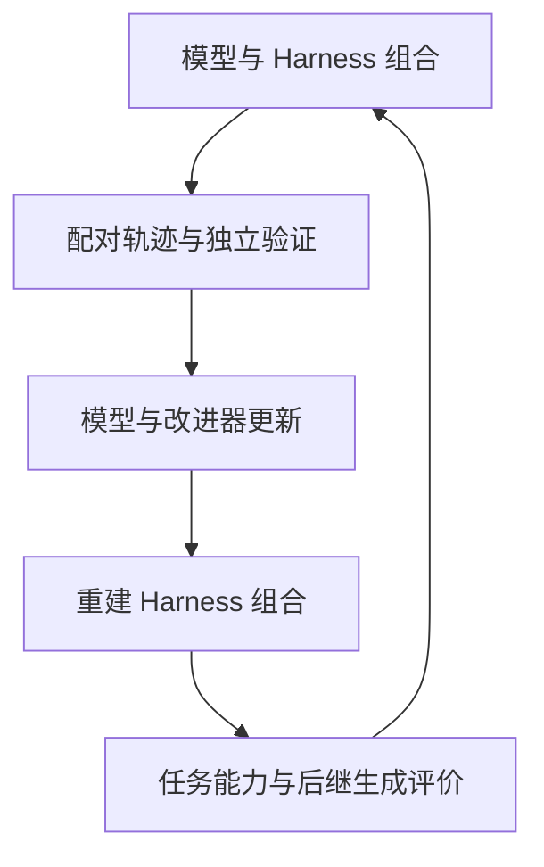

# RSI 的历史与因果图景

[English](../../MAP.md) · [中文入口](../../README.zh-CN.md)

理解 RSI，需要分别回答：软件能否改写自身，学习者能否改善更新规则，AI 能否生成有用的数据或奖励，代理能否积累外部能力，后继能否更善于产生下一代，以及这些收益能否跨任务和瓶颈持续存在。按照因果依赖组织这些问题，比按照项目名称排列更有解释力。

## 1. 研究对象

部署系统可写为：

$$
S_t=(M_t,H_t,I_t,D_t,E_t).
$$

| 对象 | 内容 |
|---|---|
| $M_t$ | 权重、架构、优化器状态和学习到的策略 |
| $H_t$ | 提示、上下文、记忆、工具、技能、路由、角色结构、控制流、验证调用和停止规则 |
| $I_t$ | 提出、实现、测试和选择修改的程序 |
| $D_t$ | 持久经验、训练数据、谱系和外化知识 |
| $E_t$ | 任务、软件、模拟器、仪器、用户及其他反馈来源 |

最终接受过程单独表示为：

$$
V^*(S_t,S_{t+1};Q,B),
$$

其中 $Q$ 是未参与修改的任务分布，$B$ 是固定资源预算。评价程序可以通过独立研究改进；候选本身不能直接改变接受自己的测试。

阅读一项工作时，需要定位更新对象、改进算子、反馈来源、持久性、迁移与递归深度。

## 2. 历史传统与因果连接

| 传统 | 主要问题 | 与当前研究的连接 |
|---|---|---|
| 自指与自修改 | 什么条件下程序可以改变自身？ | Good、Gödel Machine、可执行自修改代理 |
| 启发式与进化搜索 | 怎样发现有用程序及搜索策略？ | AM、EURISKO、AutoML、提示与工作流搜索 |
| 学会学习 | 经验与更新规则怎样参与学习？ | 元学习、自博弈、自训练、参数层自改进 |
| 外部认知 | 怎样在权重之外保留并调用能力？ | 记忆、工具、技能、持久 Harness |
| 验证与选择 | 怎样识别真实改进？ | 精确验证器、学习评价器、独立与后续新任务 |

这些传统在模型、Harness、改进器的共同演化问题上汇合。连接表示依赖和机制关系，不表示后来的方法全面取代早期方法。模型可以自训练而不改 Harness；Harness 可以演化而不改权重；固定搜索器也可以持续产出更好的外部程序。

## 3. 五个分支

### 3.1 自指与形式化自修改

[Good 的 1965 年论述](https://doi.org/10.1016/S0065-2458(08)60418-0)提出机器设计能力可能产生正反馈，但没有给出算法或实测判据。

[Gödel Machine](https://arxiv.org/abs/cs/0309048)把自指写入形式系统：在证明修改提高给定效用后，程序可以改写自身。理论性质依赖初始公理、效用表达与证明要求；实际发现有用证明可能非常困难。

STOP、Gödel Agent、SICA、DGM、HGM、HyperAgents、AIDE² 等工作把可执行代码或改进程序纳入修改范围，用经验评价替代形式证明。研究重点随之转向：选出的后继能否迁移，以及是否改善了后续改进过程。

### 3.2 启发式、进化与程序搜索

[AM 与 EURISKO](https://www.cs.northwestern.edu/~mek802/papers/not-mine/Lenat_EURISKO.pdf)通过启发式组织发现，EURISKO 进一步生成或修改启发式。它展示了搜索求解程序自身组成部分的可能性，同时依赖人工表示、规则与领域结构。

遗传编程、架构搜索、AutoML 和程序合成扩大了自动搜索范围。[AutoML-Zero](https://proceedings.mlr.press/v119/real20a.html)从基本操作搜索学习算法；[FunSearch](https://www.nature.com/articles/s41586-023-06924-6)等方法把预训练模型与外部评价结合，用于程序发现。

Promptbreeder、ADAS、AFlow、GEPA、AgentBreeder 把搜索对象推进到代理提示与执行结构。固定优化器发现更好目标，是自动研究能力；优化器自身是否更善于改进，需要另行测量。

### 3.3 元学习、自博弈与模型更新

[MAML](https://proceedings.mlr.press/v70/finn17a.html)学习有利于快速适配的参数，[AlphaGo Zero](https://www.nature.com/articles/nature24270)在精确规则和奖励下展示强大的自博弈学习。它们证明了学习行为与自生成经验的价值，同时训练算法和目标仍由外部规定。

SPIN、Self-Rewarding Language Models、SEAL 将数据、偏好或更新材料的生成放进模型循环。后继还需接受迁移、旧能力保留与后续更新质量的检验。共同错误、偏好漂移和覆盖收缩，是多代经验回流需要研究的具体机制；环境反馈、验证和真实数据会改变这些机制。

### 3.4 外部认知与 Harness 演化

Harness 决定可见上下文、可调用工具、状态保留、任务分解、尝试验证和停止时机。可变范围大致从提示，扩展到记忆与技能，再到工作流和角色结构，最后到完整源码与运行机制。

ACE、EvoHarness-RL、RHI、Meta-Harness、RRSI、HSI、HarnessDev 等位于不同位置。外部修改可检查，通常比训练权重便宜；实际收益也可能依赖任务结构、特定模型、更多重试或评价细节。

产生有效修改与使用有效修改是两种能力。应把模型与 Harness 的组合视为实验单位，并分别测量改进者和执行者。

### 3.5 验证与选择

精确规则使游戏、证明、代码测试和程序搜索较容易获得可靠反馈。学习评价器扩大了任务范围，也引入噪声、偏好和可利用性。隐藏测试若被反复用于开发，也会形成适应性选择。

研究方案区分三类反馈：

$$
V_t^{\mathrm{search}},\qquad V_t^{\mathrm{validation}},\qquad V^*_{\mathrm{accept}}.
$$

搜索反馈密集，验证反馈支持程序选择，最终接受使用未参与更新的数据，最好包括候选冻结后生成的任务。Rethinking the Evaluation of Harness Evolution、Harness Updating Is Not Harness Benefit、统计选择研究与 Harness 篡改审计，都直接影响对增益的解释。

## 4. 时间线

| 时期 | 新的研究对象 | 代表工作 | 后续问题 |
|---|---|---|---|
| 1965 | 智能提升的正反馈 | Good | 算法、证据与操作定义 |
| 1970–1980 年代 | 可修改启发式与元启发式 | AM、EURISKO | 表示扩展与独立复现 |
| 1987–2001 | 学习过程作为学习目标 | 早期元学习 | 广泛任务与强模型 |
| 2003 | 形式化自指重写 | Gödel Machine | 可行证明与现实环境 |
| 2010 年代 | 可扩展适配与自生成经验 | MAML、AlphaGo Zero | 一般化的持久自修改 |
| 2020–2024 | 算法搜索与自生成训练 | AutoML-Zero、FunSearch、SPIN、自奖励模型 | 改进器提升与广泛迁移 |
| 2023–2025 | 提示、程序和代理代码可编辑 | STOP、Promptbreeder、Gödel Agent、SICA、DGM | 多代归因与规模迁移 |
| 2026 | Harness、元代理、参数与系统共同变化 | HyperAgents、HSI、AIDE²、Co-Harness、MASS 等 | 完整循环、独立复现与长期收益 |
| 研究目标 | 模型、系统、改进器和数据反复更新 | BeforeRSI 的实验计划 | 结果尚待检验 |

## 5. 当前前沿

**持久代码与 Harness 修改**已在有界设置中得到展示：系统检查轨迹、提出编辑、评价版本并保留修改。

**迁移**已有独立任务或分布外结果，但多集中于相关任务族和少量模型端点。

**短期多代提升**已有显式谱系。仍需区分后继更会改进，与固定外层搜索不断产生更好目标。

**模型与系统适配**由 Co-Harness、OpenRSI、MASS、SIA 等从不同设置研究。HELIX 提供 Harness 组合与训练记录，尚未训练后继模型；图谱将已执行边和提出的后续循环分开。长期共同演化与持续提高的改进效率仍是实验问题。

## 6. 汇合的研究主线

本项目提出并检验的路线是：保留多个 Harness，在配对任务上运行，验证成功与失败，将经验用于模型和改进器更新，再为新模型重建 Harness，最后在独立任务上比较解题与改进能力。

方案包含六项研究条件：组合与谱系搜索；带验证信息的经验；$M_i\times H_j\times I_k$ 的组件归因；独立最终评价；冻结后产生的新任务；父代和后继在相同预算下生成后代的比较。

## 7. 能改变领域判断的结果

有价值的下一步包括：跨不相关任务族和模型规模的等成本 Harness 迁移；参数更新改善独立开发的多个 Harness；后继在新问题上产生更好的后代；收益超过一两次缺陷修补后仍保持；学习何时修改权重、系统、记忆、工具或改进器；变化环境下仍有效的评价；连接模型能力、评价质量、预算和可达增益的经验关系。

这些问题界定了开放式 RSI 的研究目标，而不是对现有系统的完成声明。
