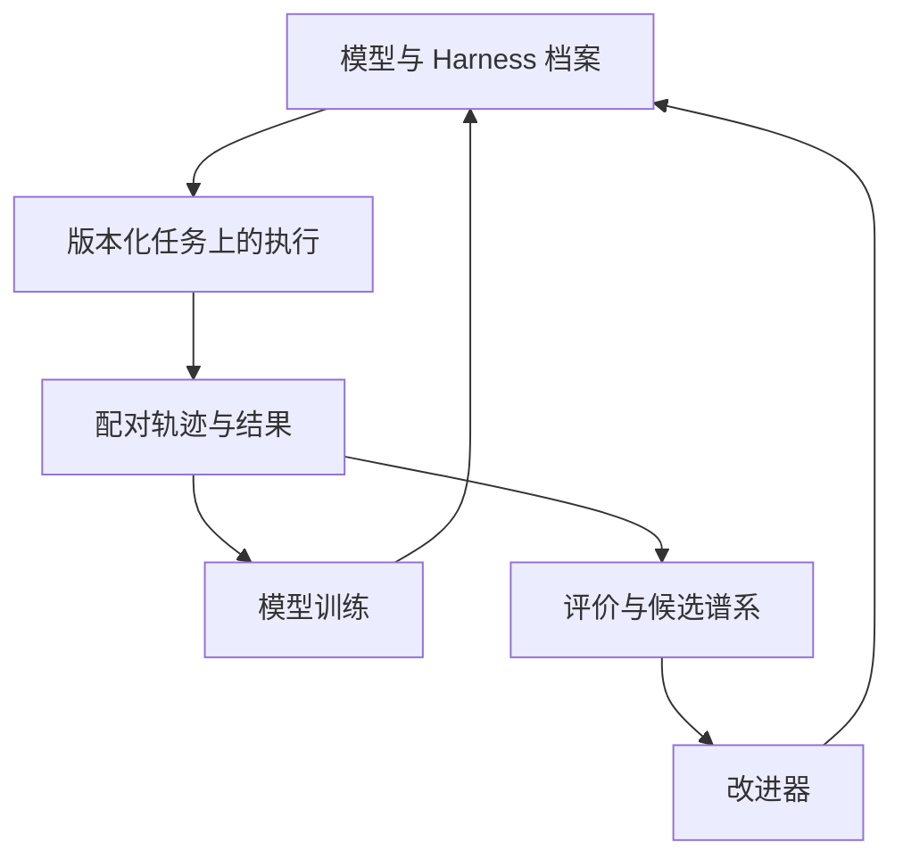

# 研究计划：模型与 Harness 共同演化

[English](../../PROGRAM.md) · [中文入口](../../README.zh-CN.md)

目标是反复提高任务能力与产生后续改进的能力。研究单位为：

$$
S_t=(M_t,\mathcal H_t,I_t,D_t,E_t),
$$

并使用独立最终评价 $V^*$。$M_t$ 是模型版本，$\mathcal H_t$ 是 Harness 组合，$I_t$ 管理提案、实验、归因和父代选择，$D_t$ 保存验证轨迹、失败、反事实、谱系和训练记录，$E_t$ 表示任务与执行环境。

本方案保留多个 Harness，以检验不同系统在任务得分、训练数据价值、模型适配和行为多样性上的取舍。

## 1. 优化目标

对候选系统定义多维目标：

$$
J(S)=\left(U_Q,-U_{\mathrm{regress}},-C_{\mathrm{task}},-C_{\mathrm{improve}},T,R,D_{\mathrm{quality}}\right).
$$

各维分别对应独立任务能力、能力回退、执行成本、改进成本、迁移、后代质量和训练经验价值。选择保留帕累托集合，并按事先规定的能力保留要求比较，而非只看一个总分。

## 2. 重复循环

### A：冻结模型，演化 Harness 组合

在固定 $M_t$ 上修改上下文、记忆、工具、规划、验证、搜索和停止规则。每个候选说明干预和假设；用开发与验证任务筛选，保留成本与回退记录，独立任务留作最终测量。

输出是 $\mathcal H_t=\{H_t^1,\ldots,H_t^k\}$。

### B：产生配对轨迹

相同任务、随机种子、工具和预算下运行多个 Harness。保存成功、失败、接近成功、不同有效策略、验证拒绝、组件变化、评价分歧及资源。配对数据支持因果比较，不同任务上的孤立日志难以识别具体修改作用。

### C：验证与归因

结果附带接受它的具体依据。通过配对结果、组件消融、Harness 替换、反事实回放、重复评价、负对照和计分一致性检查，识别变化的贡献。归因可以近似，但训练说明应与干预记录一致。

### D：更新模型

从经验构造成功示范、配对偏好、带证据的错误分析、工具和状态转换、反例及困难负样本。声明训练方法，保留父代 $M_t$，在新一轮系统搜索前测量 $M_{t+1}$ 的一般能力与回退。

### E：交叉模型与 Harness

至少评价：

$$
(M_t,H_t),\quad(M_{t+1},H_t),\quad(M_t,H_{t+1}),\quad(M_{t+1},H_{t+1}).
$$

组合实验形成：

$$
A_{ij}=U_Q(M_i,H_j).
$$

它区分权重贡献、外部程序贡献和局部共同适配，也检验新模型是否能用旧系统、新系统是否能迁移回父代。

### F：为更新模型重建 Harness

冻结 $M_{t+1}$ 后再次搜索，比较不同规模与代际发现的编辑。可迁移规律应在模型变化后仍有效，或至少能预测其失效条件。

### G：更新改进器

用完整谱系学习修改哪个组件、编辑多大、运行哪个判别实验、扩展哪个分支、何时训练权重及怎样分配评价预算。再把 $I_t$ 与 $I_{t+1}$ 放在新的改进问题上直接比较。

## 3. 系统组织

最终评价和原始记录位于候选的编辑范围之外。候选可以提出新测试，测试的采用需要单独依据。

## 4. 关键设计选择

**区分 evolver 与 executor。** 提案者、任务执行者和验证者可以由不同模型承担，并进行交叉实验。

**兼顾通用与专门结构。** 保留小的通用核心、领域系统和临时任务状态；局部修改进入通用部分时检验迁移。

**保留多样性。** 按能力、成本、新颖性、错误类型和数据贡献保留谱系。过去未胜出的候选可能在新模型上有价值。

**把 Harness 看成经验生成策略。** 它既决定当前任务结果，也决定未来有哪些训练数据。高分但同质的轨迹未必优于互补策略与有信息的失败。

**分别评价评价器的变化。** 搜索评价可更新；最终接受标准变化时，应独立验证并对旧版本回放。

**加入后续新任务。** 候选冻结后产生新任务，减轻反复开发对静态隐藏集的适应。

## 5. 五个判别实验

| 实验 | 干预与比较 | 决定什么 |
|---|---|---|
| [1：Harness 迁移](experiments/001-harness-transfer.md) | 标准父代、等总资源父代、标准后继；独立任务与第二模型家族 | 持久修改是否优于额外搜索 |
| [2：模型与 Harness 交叉](experiments/002-model-harness-cross.md) | 四组合，覆盖多个模型规模 | 主效应、协同、补偿与共同适配 |
| [3：后继作为改进器](experiments/003-successor-as-improver.md) | 同一新问题、同一预算，比较父代和后继的后代 | D3 的直接证据 |
| [4：多轮共同演化](experiments/004-repeated-coevolution.md) | 至少三轮完整更新；与单侧、固定改进器、等计算和人工计划对照 | 是否积累、复利或饱和 |
| [5：评价器边界](experiments/005-evaluator-phase-boundary.md) | 改变噪声、质量、接触范围和可利用性 | 搜索何时转为噪声选择 |

第三项的示意指标为：

$$
R_t=\frac{U_Q(S_{t+1}^{\mathrm{child}})-U_Q(S_t)}{C_{\mathrm{improve}}}.
$$

实际比较需要为各父代明确基准与资源口径，并报告其后代的独立增益。

## 6. 规模实验

对不同能力或规模的模型测量：

$$
\Delta(s)=U_Q(M_s,H_1)-U_Q(M_s,H_0).
$$

可能出现弱模型无法执行、中等模型受益、强模型冗余、强模型被限制，以及只有超过某一能力才可改进改进器的情况。目标是解释整条曲线，而非寻找单个正结果。

## 7. 数据记录

每次改进保存：系统与父代 ID、模型检查点、Harness 提交、改进器版本、候选 ID、更新对象、假设、开发和验证任务、独立及后续新任务、轨迹、验证器版本、资源、接受决定、迁移、回退、计分一致性与后代结果。

训练样本链接到产生它的系统和评价器版本。

## 8. 成功判据

研究结果应同时说明持久版本变化、独立与后续任务迁移、相同总资源基线、组件归因、重要回退、独立验收、重复代际、父代与后继改进能力比较，以及可复现产物。开放式 RSI 还需要在变化任务和瓶颈下观察更长时间的持续收益。

## 9. 何时调整研究设计

若收益在等计算下消失、迁移局限于单一套件、后继无法重复优势、随模型变强持续缩小、数据回流损害覆盖、评价分歧大于效果、记录不完整、组件无法归因或搜索主要选择噪声，应改变任务、评价、可编辑范围或更新程序。

这些是对实验解释的反馈，不能靠重复同类局部编辑解决。

## 10. 近期顺序

选择一个可检查实现，复现其报告结果，加入等计算与后续新任务，跨模型迁移，运行四组合，用验证轨迹训练一次本地模型更新，为新模型重建 Harness，最后比较父代与后继的改进能力。

这个序列的产物应是对共同演化是否带来可迁移递归增益的直接证据。
