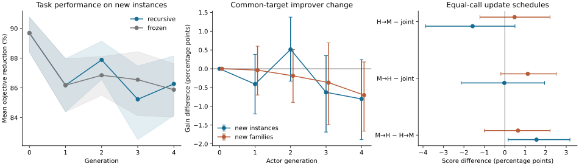

# Executed results: recursive numerical optimizer

**Result.** The tested self-reuse procedure did not establish a final-task
or common-target improver advantage over the pinned ancestor. Training the
improver objective directly also did not establish improved improver
performance at the tested budget. Update order mattered for new instances
of development families, but superiority across new families was not shown.

These are measured results from a six-coordinate numerical optimizer,
not LLM experiments or evidence that all RSI routes fail. The general
mathematical result is in THEORY.md Section 9; this benchmark tests one
specified implementation, with computed objective values rather than an
assumed capability trajectory.

## Recursive reuse, 32 independent lineages

Each feedback update improved the selected six-task score by 3.823
percentage points on average. Each generation uses new feedback tasks, so
these local gains cannot be added to obtain one common-task gain.
The final harness changed in 20/32 recursive lineages.

| Comparison | New instances, percentage points [95% interval] | New families, percentage points [95% interval] |
|---|---:|---:|
| Recursive endpoint minus initial | -3.419 [-5.210, -1.775] | -1.226 [-3.251, +0.773] |
| Recursive endpoint minus frozen route | +0.393 [-1.188, +1.910] | -0.563 [-2.251, +1.019] |
| Final actor minus initial actor, common-target gain | -0.804 [-1.888, +0.245] | -0.702 [-1.661, +0.182] |
| Actor effect with one-step assessment | +0.167 [-0.243, +0.640] | -0.415 [-0.988, +0.179] |
| Actor effect after common pinned continuation | +0.110 [-0.346, +0.593] | -0.390 [-1.092, +0.278] |

Visible selection gains did not transfer into a positive mean endpoint
gain on new instances. This is evidence of selection/generalization
failure in this procedure. It does not identify one unique cause or
establish that the recursive and frozen routes are exactly equivalent.

## Training objective, 16 independent lineages

J-training and G-training consume exactly 7,296 primitive calls per
outer candidate on the same pool of 24 task definitions. The outer
proposal actor is pinned. G-training allocates these calls to producing
and assessing descendants of two common targets; J-training allocates
them to task executions. This isolates the change in training objective
and computation allocation rather than granting G-training extra compute.

| G-trained minus J-trained | New instances, pp [95% interval] | New families, pp [95% interval] |
|---|---:|---:|
| Task score | -9.508 [-13.361, -5.795] | -1.323 [-3.946, +1.390] |
| Common-target improvement gain | +0.063 [-2.315, +2.581] | +0.227 [-1.504, +2.003] |

Directly changing the objective to G did not establish the intended
actor improvement and reduced task performance on new instances.
A separate improver objective is therefore not sufficient in this
search class and budget. The data do not distinguish limited search,
noisy gain estimates and inadequate inductive bias as sole causes.

## Update order, 32 independent lineages

Both ordered routes and joint search use 34 configuration evaluations
(6,528 primitive calls). M denotes the controller coefficients and H
the three discrete search settings. These are update operations, not
only static cross-pair execution.

| Comparison | New instances, pp [95% interval] | New families, pp [95% interval] |
|---|---:|---:|
| M then H minus H then M | +1.550 [+0.163, +3.184] | +0.644 [-1.000, +2.211] |
| M then H minus joint | -0.024 [-2.137, +1.943] | +1.122 [-0.192, +2.516] |
| H then M minus joint | -1.574 [-3.879, +0.496] | +0.479 [-1.215, +2.211] |

The observed order effect supports testing update-order dependence.
It does not establish that alternation beats joint search or that one
order is preferable on every task distribution.

## Reproduction and scope

Four runs, including the retained pilot, executed 16,791,552 primitive
objective calls. Each result directory contains a source-hashed manifest,
frozen configurations and summaries. Full candidate and task records are
in [raw-results.tar.gz](raw-results.tar.gz);
[raw-results.manifest.json](raw-results.manifest.json) records their hashes.
The archive is lossless and was checked against every original file.

Intervals are paired bootstrap intervals over independent lineages
(5,000 resamples), not over correlated candidates or task rows. They are
descriptive and not corrected for every reported comparison. The pilot
led to an explicit discrete-edit correction; subsequent objective/order
comparisons are declared follow-ups, not an untouched original study.
Task families, dimensionality, search class and budgets remain limited.
No energy measurements, neural-weight training, or frontier-model
transfer result is claimed.

The immediate research decision is to reject automatic promotion based
only on feedback-task gain, one-step G, or recursive lineage. These runs
supply no empirically justified universal update schedule. The remaining
budget and attainable continuation outcomes must enter the comparison;
the exact identity states how, without asserting those values are known.

See [PROTOCOL.md](PROTOCOL.md) for interventions and resource accounting.
Run analyze.py after the experiments, or after extracting the raw archive
into this directory, to regenerate this report and figure.
