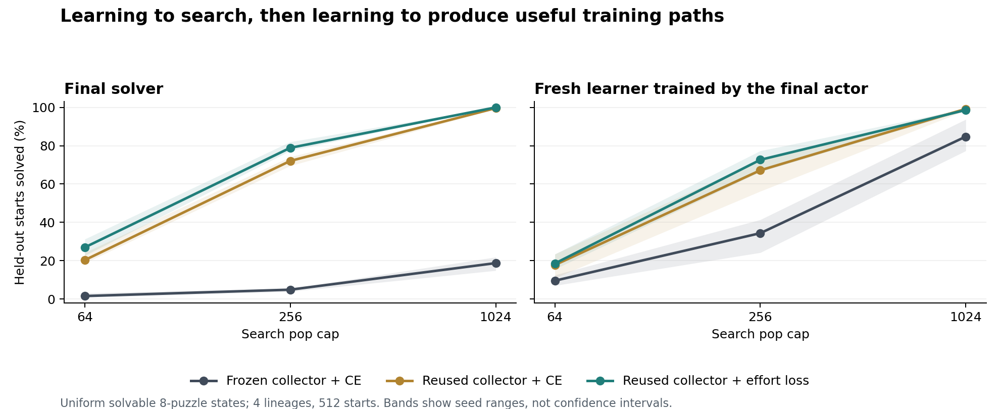

# Learned-search results

Four independent lineages (18, 29, 43, 71), with paired task sets and zero-initialized
2,592-parameter context policies. All training solution paths were found by executed
search. Pilot seed 1 is excluded. This is a small sliding-tile environment, not an LLM
experiment or a reproduction of published 24-tile-puzzle results.

Reused collection substantially improves both the final solver and the downstream
learner in this setting. The effort objective has a visible advantage at smaller
budgets on the uniform-state follow-up, while the original 1,024-pop test is near
a ceiling. The complete-search portfolio outperforms local action mixing here, but
usually gives up performance relative to the learned search alone: preserving an
anchor costs computation. These results support this bounded loop, not indefinite growth.

## Original random-walk cohorts

| Route | Harness | Solved / 768 at 256 pops | Solved / 768 at 1,024 pops | Mean capped pops at 1,024 |
|---|---|---:|---:|---:|
| uniform | uniform | 2 | 43 | 1004.11 |
| frozen_ce | learned | 358 | 560 | 464.78 |
| frozen_ce | local | 291 | 507 | 535.69 |
| frozen_ce | portfolio | 308 | 519 | 518.42 |
| reuse_ce | learned | 734 | 767 | 71.38 |
| reuse_ce | local | 554 | 710 | 248.97 |
| reuse_ce | portfolio | 707 | 767 | 95.07 |
| reuse_lts | learned | 743 | 768 | 62.35 |
| reuse_lts | local | 557 | 718 | 237.71 |
| reuse_lts | portfolio | 723 | 768 | 83.46 |

## New uniform-state distribution

The FOLLOWUP protocol was written after the original ceiling effect, before drawing
512 new uniformly sampled solvable starts. No weights or algorithm settings changed.
This is a harder sampling distribution in the same domain, not a new task domain.

| Route | Harness | Solved / 512 at 64 | At 256 | At 1,024 | Mean capped pops at 256 |
|---|---|---:|---:|---:|---:|
| uniform | uniform | 0 | 0 | 2 | 256.00 |
| frozen_ce | learned | 8 | 25 | 96 | 249.27 |
| frozen_ce | local | 2 | 13 | 52 | 252.97 |
| frozen_ce | portfolio | 4 | 19 | 69 | 250.79 |
| reuse_ce | learned | 104 | 369 | 510 | 156.24 |
| reuse_ce | local | 16 | 81 | 282 | 238.13 |
| reuse_ce | portfolio | 65 | 296 | 501 | 179.10 |
| reuse_lts | learned | 138 | 404 | 512 | 137.94 |
| reuse_lts | local | 12 | 94 | 296 | 235.37 |
| reuse_lts | portfolio | 86 | 346 | 509 | 161.38 |

## Common-target improvement operation

Each final actor collected solution paths on the same 96 new starts per lineage.
Identical fresh zero-weight CE learners then consumed the respective datasets.
All students used learned-only Levin search. This tests the value of the actor as
a data-producing improver, conditional on this learner, task panel and resource convention.

| Data-producing actor | Original starts: solved / 768 at 1,024 | Uniform starts: / 512 at 64 | At 256 | At 1,024 |
|---|---:|---:|---:|---:|
| uniform | 122 | 0 | 0 | 6 |
| frozen_ce | 753 | 49 | 176 | 434 |
| reuse_ce | 768 | 91 | 344 | 508 |
| reuse_lts | 767 | 95 | 372 | 505 |

## Paired lineage differences

Differences below are percentage points. The four seed values, rather than thousands
of correlated training steps or individual task outcomes, are the replication units.
No significance or precise population interval is inferred from four lineages.

| Cohort / cap | Comparison | Mean pp | Four seed differences |
|---|---|---:|---|
| initial / 256 | reuse_ce-frozen_ce | +48.958 | +50.000, +50.521, +50.000, +45.312 |
| initial / 1024 | reuse_ce-frozen_ce | +26.953 | +28.125, +25.521, +29.167, +25.000 |
| initial / 256 | reuse_lts-reuse_ce | +1.172 | +0.521, +2.083, +0.521, +1.562 |
| initial / 1024 | reuse_lts-reuse_ce | +0.130 | +0.000, +0.000, +0.000, +0.521 |
| initial / 1024 | common_student_reuse_ce-common_student_frozen_ce | +1.953 | +0.000, +1.562, +5.208, +1.042 |
| initial / 1024 | common_student_reuse_lts-common_student_frozen_ce | +1.823 | +0.000, +1.562, +4.688, +1.042 |
| uniform_states / 64 | reuse_ce-frozen_ce | +18.750 | +17.969, +17.188, +18.750, +21.094 |
| uniform_states / 256 | reuse_ce-frozen_ce | +67.188 | +64.062, +70.312, +67.969, +66.406 |
| uniform_states / 1024 | reuse_ce-frozen_ce | +80.859 | +77.344, +79.688, +84.375, +82.031 |
| uniform_states / 64 | reuse_lts-reuse_ce | +6.641 | +7.031, +3.906, +8.594, +7.031 |
| uniform_states / 256 | reuse_lts-reuse_ce | +6.836 | +7.812, +7.812, +5.469, +6.250 |
| uniform_states / 1024 | reuse_lts-reuse_ce | +0.391 | +0.781, +0.000, +0.781, +0.000 |
| uniform_states / 64 | common_student_reuse_ce-common_student_frozen_ce | +8.203 | +14.844, +5.469, +3.906, +8.594 |
| uniform_states / 256 | common_student_reuse_ce-common_student_frozen_ce | +32.812 | +28.906, +38.281, +32.031, +32.031 |
| uniform_states / 1024 | common_student_reuse_ce-common_student_frozen_ce | +14.453 | +6.250, +14.062, +21.094, +16.406 |
| uniform_states / 64 | common_student_reuse_lts-common_student_frozen_ce | +8.984 | +7.812, +8.594, +8.594, +10.938 |
| uniform_states / 256 | common_student_reuse_lts-common_student_frozen_ce | +38.281 | +34.375, +39.844, +42.188, +36.719 |
| uniform_states / 1024 | common_student_reuse_lts-common_student_frozen_ce | +13.867 | +4.688, +14.062, +21.094, +15.625 |

## Cost of producing the learned solvers

Totals across four lineages. Shared per-task pop caps and optimization ceilings do
not equalize FLOPs, token gradients, or wall time. CPU seconds are process CPU time
on this runtime; no accelerator or energy measurements were made. Assessment is
external to training and is recorded separately in summary.json.

| Route | Collection pops | Collection CPU s | Fit CPU s | Token-gradient evaluations | Retained paths |
|---|---:|---:|---:|---:|---:|
| frozen_ce | 444051 | 1.298 | 0.382 | 118315 | 373 |
| reuse_ce | 119310 | 4.107 | 1.742 | 1374772 | 1791 |
| reuse_lts | 116744 | 3.563 | 2.441 | 1955178 | 1794 |

## Build plus deployment cost

For each predeclared route, add its one build to one deployment of the stated cohort
at the stated cap. This does not charge the route for the research comparison of other
routes, other cap settings, or external common-target assessment. A selector that tried
all of them would have to pay those additional costs. Values are measured process CPU
seconds summed across four lineages, not predictions for other hardware.

| Cohort / cap | Route | Build + deployment CPU s | Solved / tasks |
|---|---|---:|---:|
| initial / 256 | frozen_ce | 8.423 | 358 / 768 |
| initial / 256 | reuse_ce | 9.212 | 734 / 768 |
| initial / 256 | reuse_lts | 8.679 | 743 / 768 |
| initial / 1024 | frozen_ce | 18.674 | 560 / 768 |
| initial / 1024 | reuse_ce | 9.503 | 767 / 768 |
| initial / 1024 | reuse_lts | 8.742 | 768 / 768 |
| uniform_states / 256 | frozen_ce | 8.643 | 25 / 512 |
| uniform_states / 256 | reuse_ce | 11.021 | 369 / 512 |
| uniform_states / 256 | reuse_lts | 10.461 | 404 / 512 |
| uniform_states / 1024 | frozen_ce | 26.196 | 96 / 512 |
| uniform_states / 1024 | reuse_ce | 12.524 | 510 / 512 |
| uniform_states / 1024 | reuse_lts | 11.295 | 512 / 512 |

## Interpretation boundaries and reproduction

- Reuse versus frozen collection changes future training data through the learned policy.
  It does not isolate data quantity from data quality; both are parts of this operation.
- Common targets control the downstream learner initialization and update rule, but
  the actor policy has a different evaluation cost and produces different dataset sizes.
- The frontier and acceptance test are fixed; this is not self-rewriting code or open-ended growth.
- Whole-search preservation has a worst-case scheduling guarantee, not guaranteed superiority
  over the best individual search at the same cap. Its guarantee is in pops.
- The search-bound objective is established prior work. Its fit value alone does not
  certify transfer; the report retains every CE/LTS comparison and both harness controls.

Run `python run.py --check`, then `python run.py --seed SEED` for each declared seed,
then `python followup.py --seed SEED`, and `python analyze.py`. Set
`OPENBLAS_NUM_THREADS=1 OMP_NUM_THREADS=1` for comparable CPU accounting.
The lossless [artifacts.tar.gz](artifacts.tar.gz) contains task starts, full training
paths, per-task outcomes, parameters and source-hashed manifests for the pilot, original
runs and follow-up. Extract it into this directory to inspect or re-analyze the stored runs.
The original two analytic gradient checks had maximum absolute error below 2e-11.
